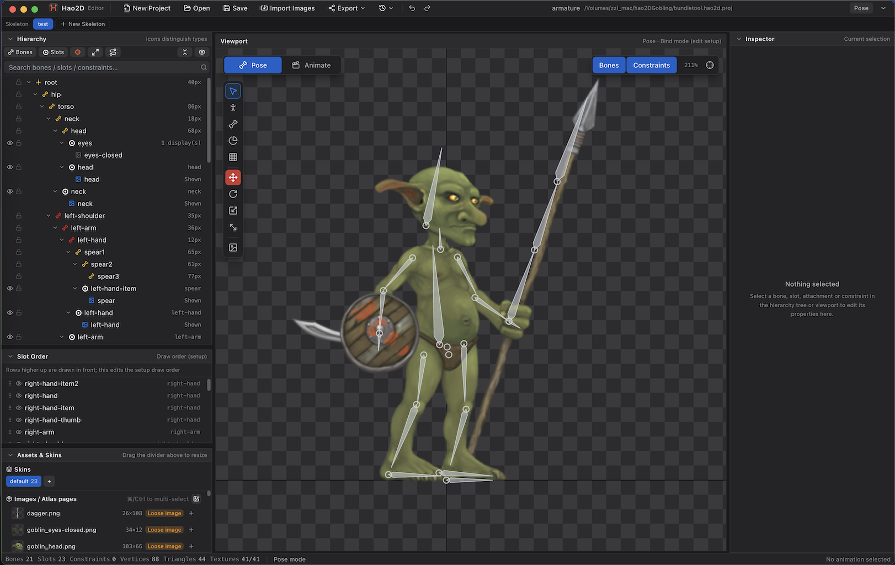

# Hao2D Editor

> 免费、轻量、跨平台的 2D 骨骼动画编辑器 · A free, lightweight 2D skeletal animation editor
>
> 下载链接: [百度网盘](https://pan.baidu.com/s/13h2HvBEMe7V4XfcnhCOEug?pwd=8pqe) 提取码: 8pqe
>
> 使用手册: [wiki/index.md](wiki/index.md) （安装、界面、工具、教程、导入导出、AI 接入）

---

## release 1.0.2

- 优化ui
- 增加导出视频功能
- 添加本地和世界坐标轴切换

---

## 中文简介

**Hao2D Editor** 是一款**完全免费**的 2D 骨骼动画编辑器，基于 Electron + TypeScript + PixiJS 打造，Windows / macOS 开箱即用，无需购买授权。

它提供网格蒙皮与 FFD 自由变形、IK / 变换 / 路径约束、曲线编辑器与实时预览，可直接导入 **Spine**、**DragonBones** 工程及 PSD 分层文件，并导出 Spine 4.3 JSON、Unity 资源或自研 `.hao2d` 数据。内置本地 HTTP / WebSocket 接口，AI 工具可脚本化完成建模与动画。

相比 DragonBones（已停止维护），它持续更新、双格式互通；相比 Spine（商业授权），它零成本、无节点限制。

---

## English Overview

**Hao2D Editor** is a **completely free** 2D skeletal animation editor built with Electron, TypeScript, and PixiJS. It runs out of the box on Windows and macOS — no license fees, no seat limits.

It covers mesh skinning, FFD deformation, IK / transform / path constraints, curve editing, and real-time preview. Import **Spine**, **DragonBones**, and layered PSD files, then export Spine 4.3 JSON, Unity assets, or its own `.hao2d` runtime data. A built-in local HTTP / WebSocket API lets AI tools script the entire workflow.

Unlike DragonBones (no longer maintained), Hao2D stays updated and bridges both ecosystems. Unlike Spine (paid licensing), it costs nothing.

---

## 与 DragonBones / Spine 对比

| 对比项 | **Hao2D Editor** | DragonBones | Spine |
| :--- | :---: | :---: | :---: |
| 价格 | **完全免费** | 免费 | 商业付费授权 |
| Windows / macOS | ✅ | ✅ | ✅ |
| 网格蒙皮 + FFD 变形 | ✅ | ✅ | ✅ |
| IK / 变换 / 路径约束 | ✅ | 部分 | ✅ |
| 导入 Spine 数据 | ✅ | ✕ | — |
| 导入 DragonBones 数据 | ✅ | — | ✕ |
| 导入 PSD 分层 | ✅ | ✕ | ✕ |
| AI 脚本接口（HTTP / WS） | ✅ 内置 | ✕ | ✕ |
| 授权与节点限制 | **无** | 无 | 按授权收费 |

> **一句话总结**：想要 Spine 的能力、DragonBones 的免费，又不想被授权和停更困住 —— 用 Hao2D Editor。
