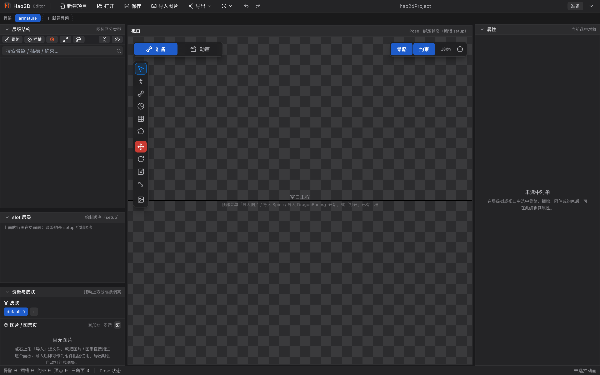
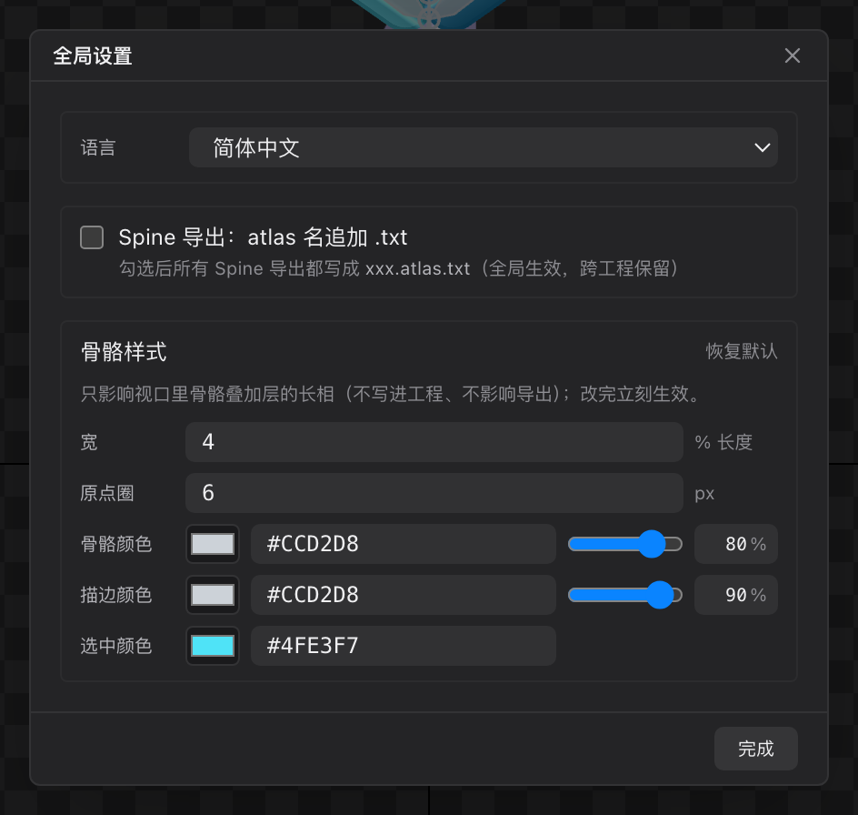

# 01 安装与首次启动

[← 返回目录](index.md) ｜ 下一篇：[02 界面总览](02-interface.md)

> 一句话：下载压缩包 → 解压 / 安装 → 直接打开，没有账号、没有授权码、没有节点限制。

---

## 1. 下载

| 平台 | 安装包形态 | 说明 |
| :--- | :--- | :--- |
| **Windows** | `.exe` 安装程序 | 可选择安装目录，自动创建桌面与开始菜单快捷方式 |
| **macOS** | `.dmg` / `.zip` | 提供 Intel（x64）与 Apple 芯片（arm64）两个版本，按机型选择 |

下载地址见仓库 README 的百度网盘链接（提取码 `8pqe`）。软件完全免费，无需购买授权。

> 系统要求：Windows 10 及以上、macOS 11 及以上。编辑器基于 Electron，不依赖任何游戏引擎或运行时。

---

## 2. 运行时

在软件安装目录的 `resources/runtimes` 下面

---

## 3. 安装

**Windows**

1. 双击 `Hao2D.Editor-<版本>-win-x64.exe`。
2. 选择安装目录（默认在用户目录下，可改）。
3. 勾选「创建桌面快捷方式」，完成安装后从桌面图标启动。

**macOS**

1. 打开 `.dmg`，把 **Hao2D Editor** 拖进「应用程序」。
2. 首次打开若提示「无法验证开发者」，在「系统设置 → 隐私与安全性」里点「仍要打开」。或执行 `xattr -dr com.apple.quarantine "/Applications/Hao2D Editor.app"`
3. 若下载的是 `.zip`，解压后同样是拖入「应用程序」。

---

## 4. 首次启动

第一次启动时编辑器是**空白工程**（自带一根 `root` 骨骼），视口中央会提示下一步该做什么：

> 之后每次启动，编辑器会自动打开**上一次编辑的工程**。想换个工程，用「打开」或「最近打开的工程」。

标题栏中间显示当前项目名与工程文件的完整路径；有未保存修改时，项目名右侧会出现一个橙点，窗口标题也会带 `*`。

---

## 5. 切换界面语言

编辑器内置简体中文与英文两套界面，**默认跟随系统语言**（中文系统 → 简体中文，其它 → English）。

切换方式：

1. 打开菜单「**Hao2D Editor → 设置**」（Windows 在「文件 → 设置」），或按 `⌘ ,` / `Ctrl ,`。
2. 在「语言」下拉里选择 `简体中文` 或 `English`。
3. 关闭弹窗即生效，选择会被记住（与本机绑定，与工程无关）。

---

## 6. 认识主界面（30 秒版）

| 位置 | 是什么 |
| :--- | :--- |
| 顶部菜单栏 | 新建 / 打开 / 保存 / 导入 / 导出、最近打开、撤销重做、当前状态徽标 |
| 顶部第二行 | **骨架条**：一个工程里可以有多套骨架，在这里切换与新建 |
| 左栏 | 层级结构（树）、slot 层级（绘制顺序）、资源与皮肤（图片池与皮肤） |
| 中央 | **视口**：画骨骼、摆姿势、刷权重都在这里；左上角是 Pose / Animate 开关与工具面板 |
| 右栏 | 属性：当前选中对象的全部参数（Animate 态自动收起） |
| 底部 | Animate 态出现的时间轴；最下面是状态栏 |

详细说明见 [02 界面总览](02-interface.md)。

---

## 7. 下一步

- 想马上做一个角色：[30 教程 1：新建工程与导入素材](30-tutorial-import.md)
- 想先搞清楚每个面板：[05 层级结构](05-hierarchy.md) 起逐页阅读
- 手上已有 Spine / DragonBones 工程：[40 导入详解](40-import-formats.md)
