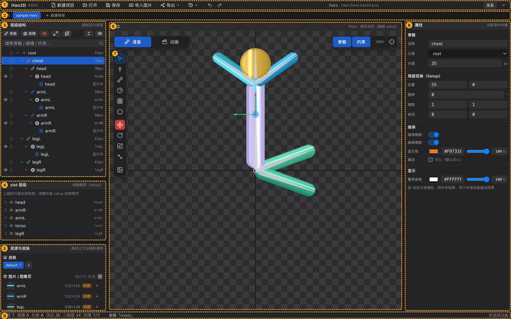
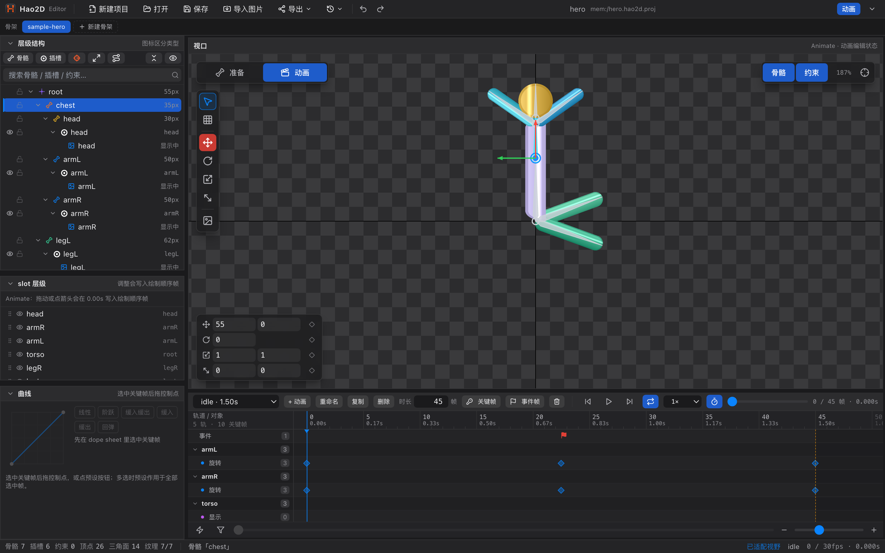

# 02 界面总览

[← 返回目录](index.md) ｜ 上一篇：[01 安装与首次启动](01-install.md) ｜ 下一篇：[03 工程与骨架管理](03-project.md)

> 一句话：编辑器由「上、左、中、右、下」五块组成，**Pose 态**和 **Animate 态**的布局不一样。

图注：① 菜单栏　② 骨架条　③ 层级结构　④ slot 层级　⑤ 资源与皮肤　⑥ 视口（含左上角状态开关与工具面板）　⑦ 工具面板　⑧ 属性　⑨ 状态栏

---

## 一、九大区域速查

| 编号 | 区域 | 作用 | 详见 |
| :---: | :--- | :--- | :--- |
| ① | **菜单栏** | 新建 / 打开 / 保存 / 导入图片 / 导出 / 最近打开 / 撤销重做；中间显示项目名与路径；右侧是当前状态徽标 | [04 菜单栏](04-menubar.md) |
| ② | **骨架条** | 一个工程里可以有多套骨架，在这里切换、新建、重命名、删除；把别的骨架**拖出去**就是[子骨架](14-subarmature.md) | [03 工程与骨架管理](03-project.md) |
| ③ | **层级结构** | 一棵树装下骨骼、插槽、display、约束；负责新建、删除、拖拽换父级、搜索定位 | [05 层级结构](05-hierarchy.md) |
| ④ | **slot 层级** | 决定插槽的**绘制顺序**（谁盖住谁），可拖拽排序 | [06 slot 层级](06-slot-order.md) |
| ⑤ | **资源与皮肤** | 皮肤切换；图片池（碎图 / 图集页）；拖图到视口即建插槽 | [07 资源与皮肤](07-assets.md) |
| ⑥ | **视口** | 画骨骼、摆姿势、刷权重、看动画；所有可视化编辑都在这里 | [08 视口](08-viewport.md) |
| ⑦ | **工具面板** | 6 个编辑工具 + 4 个变换工具 + 舞台参考图；**唯一的工具入口** | [20 选择工具](20-tool-select.md) 起 |
| ⑧ | **属性** | 当前选中对象（骨骼 / 插槽 / 附件 / 约束）的全部参数 | [09 属性面板](09-inspector.md) |
| ⑨ | **状态栏** | 骨骼 / 插槽 / 约束 / 顶点 / 三角面 / 纹理统计、当前选中、操作提示 | [12 状态栏与提示](12-statusbar.md) |

---

## 二、两种编辑状态：Pose 与 Animate

视口左上角是一个两段式开关，按 `Tab` 也可以来回切。它决定「你现在编辑的是绑定姿态还是动画」。

| | **Pose（准备）** | **Animate（动画）** |
| :--- | :--- | :--- |
| 一句话 | 编辑 setup：骨骼、插槽、网格、权重 | 编辑动画：时间轴、关键帧、FFD |
| 右栏「属性」 | 显示 | **整栏收起**，空间让给视口与时间轴 |
| 底部时间轴 | 不显示 | 显示 |
| 左栏第三块 | 「资源与皮肤」 | 换成「曲线」 |
| 工具面板 | 全部 6 个编辑工具 | 只留 **选择** 与 **顶点工具（FFD）** |
| 视口左下 | 网格工具时出现子工具条 | 出现「属性打帧条」 |
| 视口下方 | — | 选中关键帧时出现「关键帧值」条 |
| 层级树右键 | 新建 / 删除对象 | 打关键帧（绑定数据禁止修改） |
| slot 层级 | 改 setup 绘制顺序 | 拖动即写当前时刻的**绘制顺序帧** |

> 切到 Animate 时，如果此前没有选中的动画，会自动恢复上次离开时选的那个；切回 Pose 会自动把时间轴切回「（未选择动画）」，避免视口继续挂着动画求值。

---

## 三、面板布局

### 拖动分隔条

- 左栏与视口之间、视口与右栏之间、视口与时间轴之间都有分隔条，拖动即可调整宽高。
- 左栏内部三块面板之间还有横向分隔条，可以调整「层级结构 / slot 层级 / 资源与皮肤（曲线）」的高度。
- 所有尺寸都会**记住**（下次打开保持），时间轴高度与曲线面板高度分别独立记忆。

### 折叠面板

点击面板标题左侧的 `⌄` 箭头即可折叠，再点展开。折叠会完全让出空间，不会留一条空白。

### 重置布局

菜单栏最右侧的 `⌄` 按钮（title「重置面板布局」）会把所有面板恢复到默认尺寸与位置，包括各面板内部记住的高度。

---

## 四、常见的「东西去哪了」

| 现象 | 原因 |
| :--- | :--- |
| 右栏不见了 | 当前在 **Animate** 态，属性面板会收起；按 `Tab` 回 Pose |
| 时间轴不见了 | 当前在 **Pose** 态，时间轴只在 Animate 态出现 |
| 「资源与皮肤」变成了「曲线」 | 同上，Animate 态左栏第三块固定是曲线 |
| 工具面板少了几个按钮 | Animate 态只保留选择与 FFD；绑定类工具（画骨骼 / 权重刷 / 遮罩 / Pose）只在 Pose 态可用 |
| 视口一片空白，只有中间一行小字 | 工程里既没有骨骼也没有图片，属于空白工程状态 |
