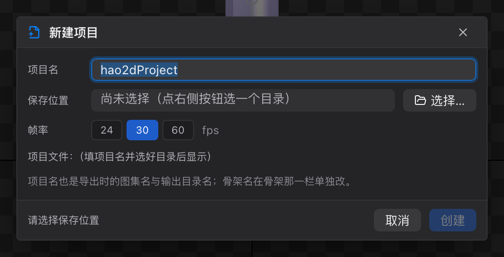
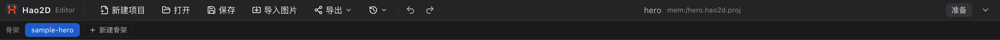

# 03 工程与骨架管理

[← 返回目录](index.md) ｜ 上一篇：[02 界面总览](02-interface.md) ｜ 下一篇：[04 菜单栏](04-menubar.md)

> 一句话：一个**工程**（`.hao2d.proj`）里可以有多套**骨架**，它们共享同一个**图片池**。

---

## 一、新建工程

点击菜单栏「新建项目」或按 `⌘N` / `Ctrl+N`。



| 字段 | 说明 |
| :--- | :--- |
| **项目名** | 必填。不能包含空格与 `/ \ : * ? " < > \|`；中文可以。项目名会直接当文件名，**也是导出时的图集名与输出目录名** |
| **保存位置** | 点右侧「选择…」挑一个目录，工程会写成 `<目录>/<项目名>.hao2d.proj` |
| **帧率** | `24` / `30` / `60` 三选一，默认 30。决定时间轴「一帧」等于多少秒；**确认后写入所有骨架** |
| 项目文件 | 只读预览，显示最终会写出的路径 |

点「创建」之后编辑器会：

1. 清空当前工程（图片内存一并释放）；
2. 建一个空骨架，并自动补一根层级根骨骼 `root`；
3. 记住项目名与路径，**立刻把工程文件写到磁盘**；
4. 回到 Pose 态，视口原点居中、缩放 100%。

> 新工程的图片池是空的，接下来用「导入图片 / 导入 Spine / 导入 DragonBones」往里加素材。

---

## 二、打开、保存、另存

| 操作 | 入口 | 快捷键 |
| :--- | :--- | :--- |
| 打开 | 菜单栏「打开」/ 菜单「文件 → 打开」 | `⌘O` / `Ctrl+O` |
| 保存 | 菜单栏「保存」 | `⌘S` / `Ctrl+S` |
| 另存为 | 菜单「文件 → 另存为…」 | `⌘⇧S` / `Ctrl+Shift+S` |
| 最近打开 | 菜单栏「最近打开的工程」图标 | — |

**最近打开**列表由主程序持久化保存，点击即可直接打开；如果文件已被移动或删除，该项会打不开，此时用「打开」重新选文件。

**保存时会自动收集图片**：工程文件里只写**相对路径**，图片本体被复制到工程目录下的 `images/` 里。因此整个工程文件夹可以随意搬走、打包、发给别人，不会因为换电脑而丢图。

```
我的角色/
├── 我的角色.hao2d.proj      ← 工程文件（可读 JSON）
├── images/                  ← 保存时自动收集的图片
│   ├── head.png
│   └── body.png
└── stage/                   ← 舞台参考图（如果你设置过）
    └── reference.png
```

> 图片复制失败不会阻塞保存，只会在状态栏给出告警；`data:` 这类内联图片会原样保存在工程文件里，不复制。

---

## 三、工程文件里有什么

工程文件是**可读的 JSON**，方便对比差异和排查问题。顶层大致是：

| 字段 | 内容 |
| :--- | :--- |
| `schemaVersion` | 数据格式版本 |
| `armatureName` / `frameRate` | 当前骨架名与帧率 |
| `bones` / `slots` / `skins` / `constraints` / `animations` | 当前骨架的骨骼、插槽、皮肤、约束、动画 |
| `editorMeta` | 编辑器状态：视口、导出缩放、舞台参考图等 |
| `images` | **全工程共享**的图片池（相对路径 `images/xxx.png`） |
| `projectName` | 项目名 |
| `activeSkeleton` / `skeletons` | 多骨架时才有：当前骨架下标 + 全部骨架（每个骨架不再重复 `images`） |

单骨架工程的格式与早期版本完全兼容，老编辑器仍可打开。

---

## 四、多骨架

顶部第二行是**骨架条**：



- 每个骨架是一个标签，当前骨架为实心蓝底。
- **双击**标签可重命名；**右键**也有「重命名 / 删除」。
- 行尾的虚线按钮「新建骨架」：新建一套骨骼 / 插槽 / 皮肤 / 图层 / 动画完全独立的骨架，并自动补一根 `root`。
- 项目里**至少保留一个骨架**，只剩一个时「删除」置灰。
- 非当前骨架的标签可以**拖出去**：拖到层级树的骨骼行 / 插槽行 / 视口，就在当前骨架里挂一个**子骨架**（骨架嵌套），详见 [14 子骨架](14-subarmature.md)。

> **图片池是共享的**：在骨架 A 里导入的图片，切到骨架 B 立刻可用。删除骨架不会删除图片。

切换 / 新建 / 删除骨架都会清理「选中的骨骼」「待绑定骨骼」「时间轴动画名」并重置视口取景，避免出现「选中的骨骼已经不存在」这类幽灵状态。

### 什么时候用多骨架

- 一个角色有多个形态（人形 / 兽形），共用同一套贴图；
- 一个工程管理一整套 UI 动效，每个控件一套骨架；
- 做换装演示：皮肤放同一骨架，形态差异大时拆骨架；
- 武器 / 坐骑这类**要独立动画**的部件拆成另一套骨架，再用 [子骨架](14-subarmature.md) 挂到当前角色上。

### 怎么把已有骨架加进来

除了「新建骨架」，更常用的是**导入**：菜单「文件 → 导入 Spine / 导入 DragonBones」，解析成功后选「**导入当前工程**」，新骨架会追加到骨架条并自动切过去，图片池合并共享。见 [40 导入详解](40-import-formats.md)。

---

## 五、导入已有资源

三种入口，效果都是把资源变成当前工程的内容：

| 入口 | 说明 |
| :--- | :--- |
| 菜单栏「导入图片」 | 选碎图（可多选）、图集 png、文件夹；也能选 `.psd` 走 PSD 导入流程 |
| 菜单「文件 → 导入 Spine」 | 选 Spine 导出的 `xxx.json` + `xxx.atlas` + 图集 png；解析成功后可选「创建新工程 / 导入当前工程」 |
| 菜单「文件 → 导入 DragonBones」 | 选 `xxx_ske.json` / `xxx_tex.json` + 图集 png；同样可选导入目标 |

拖拽也支持：把文件或文件夹直接拖进「资源与皮肤」面板即可。细节见 [40 导入详解](40-import-formats.md)。

---

## 六、下一步

- 想马上动手：[30 教程 1：新建工程与导入素材](30-tutorial-import.md)
- 想看菜单上每个按钮：[04 菜单栏](04-menubar.md)
