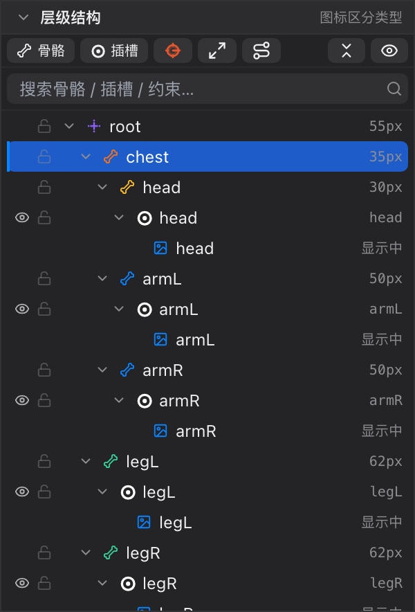

# 05 层级结构

[← 返回目录](index.md) ｜ 上一篇：[04 菜单栏](04-menubar.md) ｜ 下一篇：[06 slot 层级](06-slot-order.md)

> 一句话：整个角色只有一棵树 —— **骨骼是枝干，插槽挂在骨骼下，display 挂在插槽下，约束寄宿在驱动它的骨骼上**。

---

## 一、面板头

| 元素 | 说明 |
| :--- | :--- |
| `⌄` 折叠按钮 | 折叠整个面板（让出空间给下面的面板） |
| 标题「层级结构」 | — |
| 右侧「图标区分类型」 | 提示这一棵树里混装了多种节点，靠图标区分 |

---

## 二、工具栏

| 按钮 | 作用 | 细节 |
| :--- | :--- | :--- |
| **骨骼** | 新建一根骨骼，挂在当前选中骨骼下 | 未选中时挂到根骨骼 `root` 下；自动命名 `${父级}_child`（重名加 `_2`），长度 0.4 |
| **插槽** | 新建一个空插槽 | 挂到当前选中的骨骼；未选中时挂到第一根骨骼；同时在该皮肤里补一条空附件清单 |
| **IK 准星** | 新建 IK 约束 | 会自动新建一根零长度的 `xxx_ik` 节点骨挂在 `root` 下、摆在链尾末端；先多选「链根 → 链尾」再点，可一次配好骨链 |
| **变换约束** | 新建变换（继承位移 / 旋转 / 缩放 / 斜切）约束 | — |
| **路径约束** | 新建路径约束，让骨骼沿路径曲线排布 | — |
| **全部展开 / 全部折叠** | 一键展开或收起整棵树 | 全展开时按钮含义变为「全部折叠」 |
| **眼睛（最右）** | 显示 / 隐藏 **display 行** | 关掉后树里只留骨骼与插槽，面板更清爽 |

> 「骨骼」「插槽」按钮都是「先选中谁，就挂在谁下面」，所以点按钮前先在树里点一下目标骨骼。

---

## 三、搜索框

- 占位文字「搜索骨骼 / 插槽 / 约束…」。
- 输入即过滤：保留命中的骨骼 / 插槽 / display / 约束**及其祖先**，**根骨骼始终保留**。
- 搜索期间强制全展开；清空（点右侧 ✕ 或按 `Esc`）后恢复原来的折叠状态。

---

## 四、每一行看什么

行高 22px，缩进表示层级。从左到右：

| 列 | 内容 |
| :--- | :--- |
| ① 眼睛（14px） | 仅插槽有：显示 / 隐藏该插槽。隐藏后视口与导出都不绘制它，图标变橙 |
| ② 锁（14px） | 骨骼与插槽都有：锁定后**视口里点不中它**（层级树里照常可操作） |
| ③ 展开箭头 | 有子节点时才出现 |
| ④ 类型图标 | 普通骨骼＝骨形（取骨骼自身颜色）；层级根骨骼＝带四向凸点的十字；插槽＝圆环加中心点（取插槽颜色）；display＝贴图 / 网格 / 遮罩 / **骨架（人形图标）** 各自的图标；约束＝IK 准星（橙）/ 变换（绿）/ 路径（黄）/ 物理（灰） |
| ⑤ 名称 | 超长截断，悬停看完整信息 |
| ⑥ 行尾小字 | 骨骼：长度（`55px` = 0.55 世界单位）；插槽：当前 display 名或「N 个 display」；display：`显示中` / `显示中 · 网格` / `显示中 · 遮罩` / `显示中 · 骨架 xxx`；约束：`IK N 骨` 或「变换 / 路径 / 物理」 |
| ⑦ 删除按钮 | 悬停行尾出现，等价于右键菜单里的「删除」 |

**悬停 display 行**会弹出一个「缩略图 + 描述」浮层：缩略图按该附件自己的 UV 矩形裁剪（不是整张图集页），嵌套骨架没有图，用人形图标占位。

**排序规则**：同级插槽按**绘制顺序降序**排列 —— 列表**越靠上 = 画得越靠前**（盖住下面的）。

**约束不单独成行**：IK / 变换 / 路径约束寄宿在宿主骨骼行上，行首图标换成约束图标；只有物理约束和「宿主缺失」的约束才单独成行。

---

## 五、选中与定位

| 操作 | 结果 |
| :--- | :--- |
| 单击 | 单选，并成为「主选中」 |
| `Shift` + 单击 | 从锚点到当前行的范围选择 |
| `⌘` / `Ctrl` + 单击 | 加选 / 减选 |
| 双击行 | 在视口里**聚焦**该对象（把镜头对准它） |
| 在视口 / 时间轴里选中 | 树会自动滚动到对应行并闪一下 |
| 点空白处 | 取消选择（视口里同样清空） |

主选中为实心蓝块，多选中的其它行为淡一档，行左侧有 2px 蓝色竖条。

---

## 六、拖拽规则

拖动节点可以改父子关系与顺序，规则比较严格（不符合时显示红框与禁止光标）：

| 拖动对象 | 放到哪里 | 结果 |
| :--- | :--- | :--- |
| **骨骼** | 骨骼行**中间** | 成为它的子骨骼 |
| 骨骼 | 骨骼行**上沿 / 下沿** | 变成同级，排到它前面 / 后面 |
| 骨骼 | 列表空白处 | 挂到层级根骨骼 `root` 下，排到末尾 |
| **插槽** | 骨骼行中间 | 换宿主骨骼，追加到该骨骼插槽的末尾 |
| 插槽 | 骨骼行上沿 / 下沿 | 换宿主，并排到该骨骼插槽的首 / 尾 |
| 插槽 | 插槽行 | 按绘制顺序插到目标前 / 后 |
| 插槽 | 列表空白处 | 移到绘制顺序最底层 |
| **display** | 插槽行 / 同插槽的 display 行 | 同插槽内排序，或跨插槽搬运 |
| **骨架**（从顶部骨架条拖出） | 插槽行 | 在该插槽加一个**子骨架** display（骨架嵌套） |
| 骨架 | 骨骼行 | 先在该骨骼下新建同名插槽，再挂上子骨架 |

**会被拒绝的情况**（状态栏给出原因）：

- 骨骼拖到它自己下面、或拖进自己的子树（会形成环）；
- 移动层级根骨骼 `root`（其它骨骼都在它之下，它自己不能移动）；
- 插槽拖到非骨骼 / 非插槽行；
- display 拖到插槽之外；
- 骨架拖到空白处或当前骨架自己身上（「骨架只能拖到骨骼或插槽上」「不能把骨架拖到它自己的层级里」）。

> 骨架嵌套的完整用法见 [14 子骨架](14-subarmature.md)。

> 换父级 / 换宿主时编辑器会换算世界矩阵，**画面上的角色不会跳一下**。
> **Animate 态禁止改绑定数据**：所有拖拽与新建都会被拒绝，并提示「切到 Pose 状态才能改绑定数据」。

---

## 七、把图片拖进树

从「资源与皮肤」面板拖图片到层级树，是最快的建插槽方式：

| 拖到 | 结果 |
| :--- | :--- |
| 骨骼行 | 在该骨骼下新建插槽，这张图成为它的 display |
| 插槽行 / display 行 | 给该插槽追加一个 display 并切到它（拖多张时最后一张显示） |
| 空白处 | 在根骨骼 `root` 下新建插槽 |

没有骨骼时会提示「场景里还没有骨骼：先用工具栏的「骨骼」新建一根骨骼，再把图片拖进来」。

---

## 八、右键菜单

**Pose 态**

| 位置 | 菜单项 |
| :--- | :--- |
| 空白处 | 添加骨骼、添加插槽；添加 IK 约束、添加变换约束、添加路径约束 |
| 骨骼行 | 上面全部 + 删除「x」 |
| 插槽行 | 添加骨骼、添加插槽、删除「x」 |
| 约束行 | 仅「删除「x」」（物理约束或宿主缺失时） |

删除限制：层级根骨骼 `root` 与「只剩一根骨骼」时置灰，分别提示「`root` 是层级根骨骼，不能删除」「至少保留一根骨骼」。

**Animate 态**：菜单换成打关键帧 —— 骨骼给出位置 / 旋转 / 缩放 / 斜切与「全部通道」关键帧；插槽给出显示 / 颜色 / 可见性与「全部通道」；约束给出各通道参数关键帧。工程里还没有动画时置灰，并提示先在时间轴点「+ 动画」。

---

## 九、重命名在哪

层级树**没有**内联重命名入口（双击是聚焦视口）。改名请到 [09 属性面板](09-inspector.md)：选中骨骼或插槽，改「名称」字段，回车生效。

---

## 十、相关快捷键

- `Tab` 切 Pose / Animate（Animate 态不能改绑定结构）
- `Delete`：删除视口里选中的网格顶点，或时间轴里选中的关键帧
- `V` / `B` / `G` / `M` / `N`：切换编辑工具后再操作树
