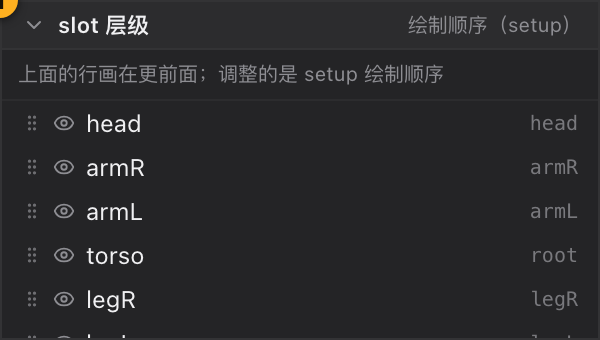

# 06 slot 层级

[← 返回目录](index.md) ｜ 上一篇：[05 层级结构](05-hierarchy.md) ｜ 下一篇：[07 资源与皮肤](07-assets.md)

> 一句话：这个面板只干一件事 —— 决定**谁盖住谁**（绘制顺序）。

---

## 一、面板说明

| 位置 | 内容 |
| :--- | :--- |
| 标题右侧 | Pose 态显示「绘制顺序（setup）」；Animate 态显示「调整会写入绘制顺序帧」 |
| 顶部说明行 | Pose：「上面的行画在更前面；调整的是 setup 绘制顺序」；Animate：「拖动或点箭头会在 `x.xxxs` 写入绘制顺序帧」 |

**排序规则**：列表**越靠上 = 越晚绘制 = 盖住下面的**。默认按插槽的 `zOrder` 降序；Animate 态且当前时刻存在绘制顺序帧时，改用该帧的顺序（帧里没提到的插槽补到末尾）。

---

## 二、每一行

| 元素 | 说明 |
| :--- | :--- |
| 拖拽把手 | 按住整行拖动即可排序 |
| 眼睛 | 显示 / 隐藏该插槽（与层级树里的是同一个开关） |
| 插槽名 | 隐藏的插槽整行变半透明 |
| 右侧小字 | 宿主骨骼名；没有宿主时显示「根层」 |
| `↑` / `↓` | 悬停行尾出现：上移一层（画得更晚，盖住下面的）/ 下移一层（被上面的盖住） |

- **双击行** = 在视口里聚焦该插槽。
- 在层级树里选中某个 display 时，这里会同步高亮它所属的插槽行，滚出视野会自动滚回。

---

## 三、拖动排序

1. 直接拖行上下移动，插入位置显示为一条 2px 蓝色插入线。
2. 行上缘、行与行的缝隙、列表下方空白都能作为落点；拖到最下面 = 移到最底层。
3. 拖回原位不会产生撤销记录。

排序结果：

| 模式 | 落库方式 | 状态栏提示 |
| :--- | :--- | :--- |
| **Pose** | 改写插槽的 `zOrder`（setup 顺序） | 已调整插槽绘制顺序（setup） |
| **Animate** | 在当前时刻写入一个**绘制顺序帧** | 已在 `1.23s` 写入绘制顺序帧（N 个插槽） |

> Animate 态下，一旦当前时刻有绘制顺序帧，面板顶部的说明行后面会出现一个虚线下划线按钮「清除此帧」，点它删除该时刻的帧，这一段就回到 setup 顺序。

---

## 四、右键菜单

菜单标题为「插槽「x」· 层级」。

| 菜单项 | 说明 |
| :--- | :--- |
| 移到顶层 | 移到所有插槽最前面（最后绘制） |
| 上移一层 | 往前画一层 |
| 下移一层 | 往后画一层 |
| 移到底层 | 移到所有插槽最后面（最先绘制） |
| 删除插槽 | 仅 Pose 态；连附件与动画轨道一起删（`⌘Z` 可撤销） |
| 层级关键帧 | 仅 Animate 态；把当前绘制顺序写入当前时刻 |

---

## 五、什么时候需要动它

- 手臂该盖住身体还是被身体盖住（近侧手臂 vs 远侧手臂）；
- 武器、披风、头发的前后关系；
- 角色转身时交换左右手的前后层级 —— 这类变化在 Animate 态**按帧**记录。

---

## 六、相关概念

- **插槽可见性**：眼睛按钮控制的是「画不画」，和绘制顺序是两回事；隐藏的插槽在导出时也不会绘制。
- **绑定顺序**：层级树里插槽的排列顺序就是这里的顺序（降序显示），两处改的是同一份数据。
