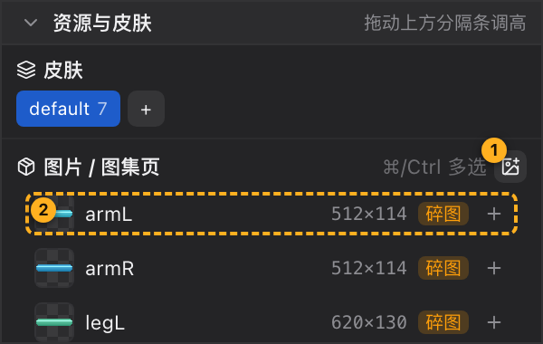

# 07 资源与皮肤

[← 返回目录](index.md) ｜ 上一篇：[06 slot 层级](06-slot-order.md) ｜ 下一篇：[08 视口](08-viewport.md)

> 一句话：这里是全工程**唯一的图片池**（所有骨架共享），也是切换**皮肤**的地方。

> 面板只在 **Pose** 态出现；Animate 态同一位置换成[曲线面板](11-curve.md)。

---

## 一、皮肤

| 元素 | 说明 |
| :--- | :--- |
| 皮肤标签 | 每个皮肤一颗胶囊，显示「皮肤名 + 附件数」（该皮肤所有插槽的附件总数）；当前皮肤为实心蓝底 |
| 点击 | 立刻切换皮肤 |
| `+` | 新建皮肤，自动命名 `skin1`、`skin2`…，并为所有插槽建空附件清单 |

`default` 是默认皮肤，代表「未指定皮肤」。换皮肤等价于换掉每个插槽显示哪张附件 —— 这是做换装（武器、服装、表情）的标准做法。

---

## 二、图片 / 图集页

### 每行显示什么

| 元素 | 说明 |
| :--- | :--- |
| 缩略图 | 22px 高、棋盘底；读不出时显示一个「无法读取图片文件」的占位图标；悬停会弹出大图预览（含完整路径） |
| 图片名 | 工程内唯一的名字（也是保存到 `images/` 时的文件名） |
| `宽×高` | 该图片文件的**像素尺寸**，例如 `512×114` |
| 类型角标 | **碎图**（橙底，单张 png）或 **图集**（灰底，打包后的大图） |
| 剪刀（仅图集） | 把图集拆成碎图，见下 |
| `+` | 用这张图快速建插槽（挂到当前选中骨骼下） |

### 导入图片

- 面板标题右侧的图片 + 按钮，或按 `⌘I` / `Ctrl+I`；
- 也可以把**文件或文件夹**直接拖进这个面板（整块面板会高亮，顶部提示「松开导入到「资源与皮肤」」）；
- 选到 `.psd` 会走 PSD 导入流程（见 [13 对话框合集](13-dialogs.md)）。

编辑器会自动识别拖入的是「碎图 / 图集 png / Spine / DragonBones / 工程文件」，分流到对应的导入流程。

### 拖图片建插槽（最常用）

把图从面板拖到视口，落点处就会**新建一个插槽**（图作为它的 display），插槽挂在当前选中骨骼下。

更精确的拖法：

| 拖到 | 结果 |
| :--- | :--- |
| 视口 | 在落点新建插槽 |
| 层级树的**骨骼行** | 在该骨骼下新建插槽 |
| 层级树的**插槽行 / display 行** | 给该插槽**追加一个 display**（多张时最后一张显示） |

> 先多选（`⌘`/`Ctrl` 点选，或 `Shift` 范围选）再拖，可以**一次拖多张**；标题右侧会显示「已选 N 张 · 拖入场景可一起创建」。

### 多选

- 普通点击：单选
- `⌘` / `Ctrl` + 点击：增减选
- `Shift` + 点击：按锚点范围选
- 点列表空白处：取消多选

### 行尾 `+` 按钮

在**当前选中骨骼**下建一个插槽，并用这张图作为它的 display。没有骨骼时按钮置灰，提示先新建一根骨骼。

### 右键菜单

| 菜单项 | 说明 |
| :--- | :--- |
| 替换图片… | 选一张新图，**保持原名**，引用它的附件自动跟随 |
| 删除图片 | 从工程移除。若正被 N 个附件引用，会先确认：附件会丢贴图、退化为纯色块，但附件本身保留（`⌘Z` 可撤销） |

### 图集拆分

图集行右侧的剪刀按钮：「拆成碎图」—— 把图集里的每块子图各写出一张 png（被旋转存放的会转正），**引用它的附件自动改用碎图**，图集从工程移除（磁盘上的原 png 保留）。

> 常用于：拿到别人打包好的图集，需要改其中一张图；或想重新规划图集。

---

## 三、图片池的几条铁律

1. **全工程只有一份图片池**，所有骨架共享 —— 在骨架 A 导入的图，切到骨架 B 立刻可用。
2. **删除骨架不会删图**；删除图片才会清理所有骨架里的引用。
3. **保存时会自动收集**：图片被复制到工程目录的 `images/`，工程文件里只写相对路径，因此整个文件夹可以整体搬走。
4. 图片名是工程内唯一标识，改名请用「替换图片」或重新导入，不要直接改磁盘文件名（会让工程找不到图）。

---

## 四、常见问题

| 现象 | 原因与处理 |
| :--- | :--- |
| 视口里角色是白块 | 状态栏「纹理 x/y」显示缺图；检查图片是否被移动 / 删除，或重新导入 |
| 拖图到视口没反应 | 当前没有骨骼 —— 层级树里先建一根骨骼 |
| Animate 态找不到这个面板 | 正常，Animate 态左栏第三块是曲线；按 `Tab` 回 Pose |
| 图集拆不开 | 拆分失败会在状态栏提示原因（例如图集数据不全）；可先检查 png 与图集 json 是否配套 |
