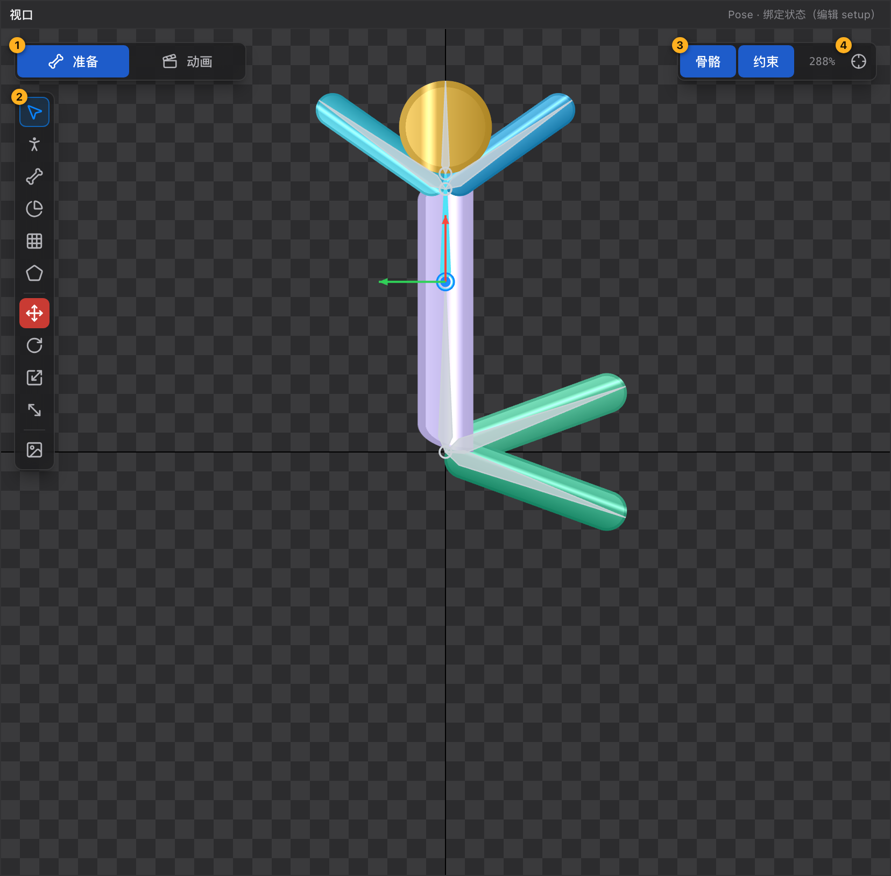

# 08 视口

[← 返回目录](index.md) ｜ 上一篇：[07 资源与皮肤](07-assets.md) ｜ 下一篇：[09 属性面板](09-inspector.md)

> 一句话：视口是所有可视化编辑的舞台 —— 但**导航只有三个动作**：滚轮缩放、中键平移、`F` 适配。

图注：① Pose / Animate 开关　② 工具面板　③ 骨骼 / 约束显示开关与缩放读数　④ 适配视野

---

## 一、导航

| 操作 | 效果 |
| :--- | :--- |
| **滚轮** | 以鼠标位置为锚点缩放，每格 ×0.9 / ×1.1 |
| **中键拖动** | 平移视口（唯一平移方式） |
| `F` / 右上角准星 / 双击空白处 | 适配视野：把内容按最大延伸装进视口，留 48px 边距 |
| 双击层级树的节点 | 聚焦该对象（把镜头对准它，而不是整体适配） |

- 缩放范围 2% – 80000%；右上角读数 = 屏幕像素 ÷ 图像像素，100% 表示 1 图像像素画 1 屏幕像素。
- **`空格` 不是平移**，它是「播放 / 暂停」；右键也不参与平移。

---

## 二、右上角浮层

| 元素 | 作用 |
| :--- | :--- |
| **骨骼** | 显示 / 隐藏骨骼骨架。关掉后骨架不绘制，**骨骼与关节圈也点不中** |
| **约束** | 显示 / 隐藏约束手柄（IK / 路径）。关掉后约束准星不可拾取 |
| 缩放读数 | 当前缩放百分比，每 250ms 刷新 |
| **适配视野** | 等价于按 `F` |

> 两个开关都不影响导出，只是编辑时的显示辅助。

---

## 三、点击与拾取

视口里同时叠着好几层「可点区域」，优先级从高到低：

1. 斜切包围盒的边
2. 骨骼小坐标轴（gizmo）
3. 骨骼原点圆圈
4. 骨骼本体
5. 约束准星
6. 附件（图片本体）

命中的是骨骼还是附件、以及拖起来是什么行为，取决于**当前工具**：

| 当前工具 | 点骨骼 | 点图片 |
| :--- | :--- | :--- |
| 选择 V | 选中并按当前变换工具拖动 | 选中；Pose 态可直接拖（Animate 态只选中，提示位置属于绑定数据） |
| Pose P | 选中并**带着蒙皮一起变形** | 选中，可拖顶点/附件 |
| 画骨骼 B | 作为新骨骼的父级（端点吸附） | 松手时把该插槽挂到新骨骼下 |
| 权重刷 G | 单击设为目标骨骼 | 刷权重 / 单击选中顶点 |
| 网格 / FFD | — | 拖顶点、Alt+点击插点、双击插点 |
| 遮罩 N | — | 加点、拖点、边线插点 |

**多选骨骼**：`Shift` 或 `⌘` / `Ctrl` + 点击，加选 / 减选，与层级树规则一致。骨骼**没有矩形框选**。

**顶点可以框选**：网格工具 / FFD 顶点工具下，左键在空白处或网格内部拖动会拉出矩形选框（`Shift` 拖框 = 加进选择），松手选中**当前附件**框内顶点；右键取消选择。详见 [24 网格工具](24-tool-mesh.md)。

**锁定保护**：层级树里锁定的骨骼 / 插槽在视口里点不中，会提示「骨骼「X」已锁定，先解锁再编辑」。

---

## 四、右键

右键的语义按工具分：

| 当前工具 | 右键 |
| :--- | :--- |
| 选择 / Pose（Pose、Animate 态） | 在**图片**上弹出「插槽层级」菜单（移到顶层 / 上移一层 / 下移一层 / 移到底层，Pose 态还有「删除插槽」）；在骨骼、约束手柄上不弹菜单 |
| 网格 / FFD（编辑顶点） | **取消选择** |
| 网格（自己绘制边界 / 自定义布线） | 闭合边界 / 取消连线 |
| 遮罩 | 闭合多边形；绘制中则结束当前这次绘制 |
| 权重刷 | 结束「待绑定骨骼」状态 |

Animate 态的层级菜单里没有删除项，但会把层级变化写成绘制顺序帧。

---

## 五、把图片拖进来

**仅 Pose 态**：从「资源与皮肤」面板拖图片到视口，落点处会新建插槽 + 贴图附件。

- 没有骨骼时会提示先去建一根骨骼；
- 多选图片一起拖，会一次建多个插槽；
- 想精确指定宿主骨骼，改用「拖到层级树的骨骼行」。

**拖骨架进视口**：从顶部骨架条把**另一个骨架**拖进视口，会在落点处的骨骼（没有则 `root`）下新建插槽并挂上**子骨架**，位置取落点。详见 [14 子骨架](14-subarmature.md)。

---

## 六、视口里的辅助显示

| 显示 | 何时出现 |
| :--- | :--- |
| 骨骼骨架 | 「骨骼」开关打开时 |
| 网格线框与顶点 | 选中网格附件 / 使用网格或 FFD 工具时 |
| 权重饼图 | 权重刷工具激活时（每瓣颜色与骨骼颜色对应） |
| 约束准星 | 「约束」开关打开时 |
| 遮罩轮廓 | 选中遮罩附件或使用遮罩工具时 |
| 舞台参考图 | 设置过参考图时，作为背景铺在角色后面（不导出） |

---

## 七、状态栏与视口的关系

视口下方状态栏实时显示：骨骼 / 插槽 / 约束数量、顶点与三角面数、纹理就绪度、当前选中对象。做网格和蒙皮时，**顶点数与三角面数是判断「网格是否合理」的第一手指标**。

详见 [12 状态栏与提示](12-statusbar.md)。
