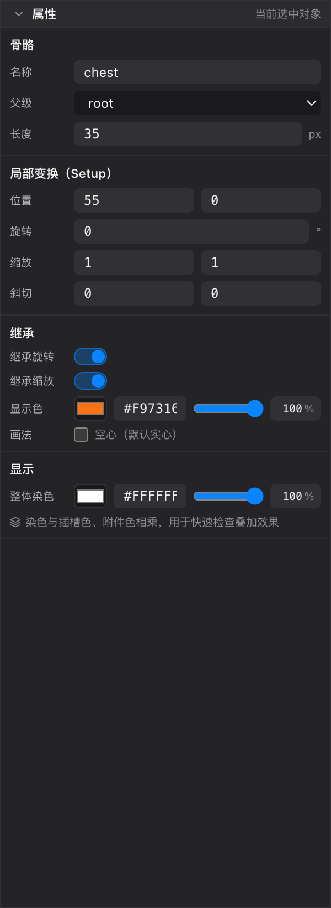

# 09 属性面板

[← 返回目录](index.md) ｜ 上一篇：[08 视口](08-viewport.md) ｜ 下一篇：[10 时间轴](10-timeline.md)

> 一句话：右栏「属性」显示**当前选中对象**的全部参数；选中什么就显示什么，什么也没选就提示去层级树里选。

| 选中对象 | 面板显示 |
| :--- | :--- |
| 骨骼 | 骨骼参数、局部变换、继承、显示 |
| 插槽 | 插槽参数、附件参数（当前 display） |
| 附件（网格 / 遮罩） | 附件参数 + 网格统计 + 权重骨骼列表 / 遮罩参数 |
| 约束 | 启用状态、目标、受约束骨骼链、各类型专属参数 |
| 什么也没选 | 「未选中对象」提示 |

> **Animate 态整栏收起**（绑定数据在动画态不能改）。想在动画里改数值，请按 `Tab` 回 Pose。

---

## 一、骨骼

| 字段 | 说明 |
| :--- | :--- |
| **名称** | 改名（回车生效）。改名会同步更新所有引用它的插槽、约束、权重与关键帧轨道 |
| **父级** | 下拉切换父骨骼；层级根骨骼不能改父级 |
| **长度** | 单位 px（100px = 1 世界单位）。长度只影响**显示与绘制骨骼形状**，不影响变形 |
| **位置** | 相对父骨骼的局部坐标 |
| **旋转** | 相对父骨骼的角度（度） |
| **缩放** | 局部缩放，负值即镜像 |
| **斜切** | 局部斜切角（度） |
| **继承旋转 / 继承缩放** | 是否跟随父骨骼旋转 / 缩放。关掉后父骨骼转动，这根骨骼保持自己的朝向 |
| **显示色** | 这根骨骼在视口里的颜色（也用于权重饼图、层级树图标） |
| **画法** | 勾选「空心」后骨骼以空心方式绘制（默认实心） |
| **整体染色 / 透明度** | 只影响编辑器里的显示，不写进工程、不影响导出，用于临时区分左右侧或检查叠加效果 |

> 大部分字段支持拖动数值、滚轮微调；连续拖动会合并成一步撤销。

---

## 二、插槽

| 字段 | 说明 |
| :--- | :--- |
| **名称** | 插槽名（工程内唯一） |
| **骨骼** | 宿主骨骼，换骨骼等于换它跟着谁动 |
| **混合** | `Normal` / `Additive` / `Multiply` / `Screen`；`Erase`、`Below`、`None` 在视口里是降级显示（导出到运行时仍保留数据） |
| **层序** | 即绘制顺序 `zOrder`，数值越大越晚绘制（盖在上面）；一般用 slot 层级面板拖更直观 |
| **颜色** | 插槽染色，会与附件颜色相乘；做「整体变暗 / 变红」时改这里 |
| **显示** | 当前显示哪一个附件（display）。下拉里列出该皮肤下这个插槽的全部附件，`（不显示）` 表示空插槽 |
| **可见** | 关闭后视口与导出都不绘制（等价于层级树行首的眼睛） |

> Animate 态下，选中插槽时「显示」「可见」会变成 `显示（关键帧）`、`可见（关键帧）` —— 但属性栏在 Animate 态是收起的，所以实际操作是在层级树右键打关键帧，或在时间轴里选中轨道按 `K`。

---

## 三、附件

附件分组标题会写明类型，例如「附件 · mesh」「附件 · region」「附件 · clipping」。

| 字段 | 说明 |
| :--- | :--- |
| **名称** | 附件名（同一插槽内唯一） |
| **图片** | 选择使用哪张图片；`（纯色）` 表示不贴图，用插槽颜色画一块纯色 |
| **位置 / 旋转 / 缩放** | 附件相对**骨骼**的局部变换 |
| **尺寸** | 附件的显示尺寸（世界单位）；右侧按钮可「恢复到图片大小」—— 按图片像素 ÷ 100 折算 |
| **原图（含裁剪留白）** | 显示图片原始像素尺寸，选中轮廓 / 手柄按它走，渲染仍只有上面「尺寸」那块 |
| **颜色** | 附件染色，与插槽颜色相乘 |
| **骨内FFD** | 仅特殊场景使用（偏移已按骨骼 bindpose 换算），正常保持关闭 |
| **顶点 / 三角面 / 加权** | 网格统计：顶点数、三角面数、有多少顶点带权重 |
| **权重骨骼列表** | 见下 |
| **遮罩** | 见下（clipping 附件） |
| **网格 / FFD** | 见下 |
| **子骨架字段** | 见下（armature 附件） |

### 子骨架（armature 附件专用）

选中一个骨架 display 时，分组标题是「附件 · armature」，比普通附件多 5 个字段：

| 字段 | 说明 | 默认 |
| :--- | :--- | :--- |
| **引用骨架** | 下拉列出工程内除自己以外的所有骨架；`（未引用）` = 断开 | 创建时的骨架 |
| **默认动画** | 子骨架的 setup 动画；`（setup 姿态）` = 停在绑定姿态 | `（setup 姿态）` |
| **播放次数** | `0` 或负数 = 循环；正数 = 播几次后定格末帧 | `0` |
| **起始偏移** | 从子动画第几秒开始播（单位秒） | `0` |
| **倍速** | 播放速度倍率 | `1` |

- 这些是 **setup 值**；时间轴上的「子骨架」通道会按帧覆盖它们；
- 骨架 display **没有「尺寸」字段**（本身不产生几何），但仍有位置 / 旋转 / 缩放 / 颜色；
- 换「引用骨架」会同时清空「默认动画」。

详见 [14 子骨架](14-subarmature.md)。

### 权重骨骼列表（网格专用）

| 元素 | 说明 |
| :--- | :--- |
| **添加绑定骨骼 / 完成绑定骨骼** | 进入「待绑定」状态：在视口里点骨骼即可加入列表，可连续点多根；右键、`Esc`、再点一次按钮结束 |
| **自动计算权重** | 按列表里的骨骼重算所有顶点权重：顶点离哪根骨骼近，在那根骨骼上的权重就高；列表外的骨骼不参与 |
| 颜色块 | 与视口里骨骼颜色、权重饼图颜色一致，便于对照 |
| 每行 × / ↑ ↓ | 从列表移除、调整顺序（顺序不影响结果，只影响阅读） |

> 「自动计算权重」只写绑定姿态，必须在 Pose 态执行。

### 遮罩（clipping 附件专用）

| 字段 | 说明 |
| :--- | :--- |
| 控制点数 | 遮罩只影响**绘制顺序中它之后、结束插槽之前**的附件 |
| **结束插槽** | 下拉只列出绘制顺序比遮罩大的插槽，默认「末尾」 |
| **反向遮罩** | 勾选后只保留多边形**外部**；Spine 要求此时按凸形处理，会自动开启凸形 |
| **凸多边形** | 多边形是凸的时打开可以加速；凹多边形请关掉（关掉也能正常裁剪） |
| **编辑遮罩点** | 切到遮罩工具并给出操作提示（点边线插点、拖点移动、`Delete` 删除、点空白取消选中） |

另外，属性面板「显示」区有 **「转为遮罩」** 按钮：把当前 display 转成多边形遮罩（保留附件名）。

- Region 取内容矩形的四角；
- 非加权的 Mesh 取顶点凸包；
- **加权网格不支持**（会提示「转换失败：加权网格暂不支持，请先解除权重或手工绘制遮罩」）；
- 只能 Pose 态执行；转换后自动切到遮罩工具。

> 遮罩反过来**不能**转成网格：「网格 / FFD」整组对遮罩隐藏 —— 遮罩的点是多边形控制点，不是可蒙皮的渲染网格。

### 网格 / FFD（选中项还不是网格时出现）

| 字段 | 说明 |
| :--- | :--- |
| **密度** | 1–24，默认 4，即 N×N 细分 |
| **转为网格（N×N）** | 把 Region 转成规则栅格网格 |
| **自动生成网格** | 沿不透明像素轮廓生成贴合网格（透明区不占三角形）；也可用来重设手动改乱的网格 |

两个按钮都**只在 Pose 态可用**，且只有 Region 能「转为网格」。

### 权重刷（权重刷工具的参数）

| 字段 | 说明 |
| :--- | :--- |
| **Mode** | `Add and Subtract` / `Grow and Shrink` / `Smooth` |
| **Bone** | 当前目标骨骼（改这里只影响「刷哪根」，不改选中对象） |
| **Normalize** | 刷过的顶点权重归一到 1；关掉后权重和可能不等于 1 |
| **Size** | 笔刷半径（px），视口里的圆圈即所见，默认 40 |
| **Hardness** | 0–100，每次施加多少权重；100 = 一次刷满，默认 1.5 |

---

## 四、约束

| 字段 | 说明 |
| :--- | :--- |
| **启用** | 关掉后约束不参与求解（数据保留） |
| **目标** | 目标骨骼（IK 指向它 / 变换约束参照它 / 路径约束的路径骨） |
| **受约束骨骼链** | 按顺序排布，`↑`/`↓` 调整、× 移除、下拉添加；IK 按「链根 → 链尾」顺序驱动 |
| **IK 参数** | 权重、弯曲方向（正向 +1 / 反向 −1）、用骨长 |
| **变换混合** | 旋转、X/Y 位移、X/Y 缩放、斜切各自的混合比例（0–1） |
| **路径参数** | 位置、间距、旋转混合、位移混合 |

- 目标或骨链为空时，面板会直接给出警告（「没有目标骨骼，IK 不会生效」等）。
- 「目标」和「添加骨骼」都能**从层级树拖骨骼进来**。

---

## 五、操作小技巧

- 数值框支持拖动改值、滚轮微调，`Esc` 取消输入。
- 改名时如果与现有名字冲突，会提示并按规则处理，不会静默覆盖。
- 属性面板的按钮统一样式是「实心蓝 + 白字」，与工具条开关同色，看到蓝色按钮就是在执行一个动作而不是切换开关。
