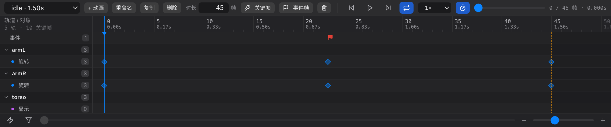

# 10 时间轴

[← 返回目录](index.md) ｜ 上一篇：[09 属性面板](09-inspector.md) ｜ 下一篇：[11 曲线面板](11-curve.md)

> 一句话：时间轴只在 **Animate** 态出现，左边的行是「哪个对象的哪条通道」，右边是这些通道的关键帧。

---

## 一、顶部播放条

从左到右：

| 元素 | 作用 |
| :--- | :--- |
| **动画下拉** | 首项固定「（未选择动画）」，其余显示为 `动画名 · 时长s`；切换动画会清空场景选中 |
| **+ 动画** | 新建动画（`animation`、`animation_2`…），默认时长 1 秒，建好自动切过去 |
| **重命名 / 复制 / 删除** | 重命名（回车确认、`Esc` 取消）、复制（连全部关键帧）、删除（可撤销）；无动画时禁用 |
| **时长（帧）** | 可编辑范围。回车 / 失焦生效，**中键左右拖动**可微调；不能短于最后一个关键帧 |
| **关键帧** | 把当前姿态写成关键帧（等价按 `K`） |
| **事件帧** | 在当前时间插入一个事件帧（名字默认 `event`） |
| **删除关键帧** | 等价按 `Delete` |
| **⏮ / ▶ / ⏭** | 上一帧（`←`）、播放暂停（`空格`）、下一帧（`→`） |
| **循环** | 循环播放开关 |
| **倍速** | 0.25× / 0.5× / 1× / 2× |
| **吸附到帧** | 打开后关键帧与播放头按帧对齐，关闭后按 0.001 秒精度 |
| **进度滑块** | 拖动即擦洗时间轴（会自动暂停） |
| **时间读数** | `当前帧 / 总帧 帧 · 秒` |

> 帧率不在时间轴上改，它在「新建项目」时选择（24 / 30 / 60），状态栏会显示当前帧率。

---

## 二、标尺与播放头

- 主刻度同时显示**帧号**（上行）与**秒数**（下行），超出动画结束时长的刻度会变淡。
- 动画结束位置有一条橙色虚线，右侧是灰色遮罩区；结束线右侧仍可拖入关键帧（拖过去会自动延长时长）。
- 播放头是一根蓝色竖线，标尺里带三角箭头。

---

## 三、左侧轨道

轨道按固定顺序排列：**事件 → 骨骼 → 插槽 → 插槽层级 → FFD → 约束**。

| 轨道 | 子通道 | 说明 |
| :--- | :--- | :--- |
| **事件** | 单行 | 只在有事件帧时出现，关键帧画成小红旗 |
| **骨骼** | 位置 / 旋转 / 缩放 / 斜切 | 分组行是骨骼名，行尾显示该组关键帧总数；没有关键帧的骨骼不出现 |
| **插槽** | 显示 / 颜色 / 可见性 / **子骨架** | 「显示」行常显，是做换装动画的入口，帧上带附件名；「子骨架」行只在插槽挂了骨架 display 且打过帧后才出现 |
| **插槽层级** | 单行 | 绘制顺序快照，阶跃缓动，只在该时刻写过层级时出现 |
| **FFD** | 插槽名 / 附件名 | 只有在动画里拖过该网格顶点后才出现 |
| **约束** | 按类型 | IK 只有「权重」；变换约束有 6 条混合 + 偏移；路径约束有位置 / 间距 / 旋转混合 / 位移混合 |

- 分组行左侧箭头可折叠 / 展开该对象的所有通道。
- 子通道行首有一个彩色小圆点区分通道（位置绿 / 旋转蓝 / 缩放黄 / 斜切紫 / 显示紫 / 可见绿）。
- 行尾灰色徽章是该行关键帧数。
- **单击行** = 选中对应对象，并把这条通道设为「打帧目标」（之后按 `K` 只给它打帧）。
- **右键行** = 取消通道选择。

---

## 四、关键帧操作

| 操作 | 说明 |
| :--- | :--- |
| **单击关键帧** | 选中它 + 把播放头定位到该帧 + 设为打帧目标；`Shift` / `⌘` / `Ctrl` 点击加选、减选 |
| **框选** | 在关键帧区左键拖动超过 4px 才开始框选，画出蓝色选框；按住左右手柄可等比拉伸 / 压缩时间 |
| **拖动** | 拖动整组改时间（1:1 跟随，可按帧吸附）；越过末尾会自动延长动画时长 |
| **删除** | `Delete` / `Backspace`：优先删选中的关键帧；只选了通道没选帧时删**整条通道** |
| **复制粘贴** | `⌘C` / `⌘V` 粘贴到播放头位置并保持相对间距；`⌘D` 粘贴到最后一帧之后 |
| **打帧** | `K` 或「关键帧」按钮：优先只打点中的那条子通道，否则按选中对象打全部通道；多选骨骼可一次整批打帧 |
| **单击空白** | 定位播放头并清空关键帧选择 |
| **事件帧** | 点「事件帧」插入，参数在视口下方的值条里改 |

> 同一轨道、同一时间点的多个通道关键帧会合并成**一个菱形**，拖动时整组一起动。

---

## 五、打关键帧的三种姿势

1. **快捷键**：选中对象 → 按 `K`（打全部通道）。
2. **只打一条通道**：在时间轴左侧点中某条子通道 → 按 `K`。
3. **右键菜单**：在层级树里右键对象 → 选「旋转关键帧」「全部通道关键帧」等（Animate 态才有）。

打帧后编辑器会自动滚到该轨道并闪一下，避免关键帧藏在列表下方看不见。

---

## 六、事件帧

事件帧用来标记「这一时刻发生了什么」（脚步声、打击点、发射子弹），运行时读出来自己派发。

- 点「事件帧」按钮插入，默认名 `event`、`event2`…
- 插入后立刻就选中，在**视口下方的值条**里改：事件名、字符串、整数、浮点。
- 事件帧在轨道上画成**小红旗**，拖动改时间，`Delete` 删除。

---

## 六·五、子骨架轨道

插槽挂了[子骨架](14-subarmature.md)时，这个插槽分组下会多一条 **「子骨架」** 子轨，用来控制「现在让子骨架播哪个动画」。

| 元素 | 说明 |
| :--- | :--- |
| 行尾 ⚡ | 在当前时间打一帧（取当前生效值，没有则取 setup 值） |
| 关键帧 | 一条帧同时带 `动画名 + 播放次数 + 起始偏移 + 倍速`，缓动固定「阶跃」 |
| 打帧方式 | ⚡ / 选中该子轨按 `K` / 视口左下属性打帧条里的「子骨架」行 |
| 值条 | 选中子骨架关键帧后，视口下方的值条出现 `动画 / 次数 / 偏移 / 倍速` 四个控件 |

> 层级树的 Animate 态右键菜单里**没有**子骨架项（只有显示 / 颜色 / 可见性 / 全部通道），子骨架请走时间轴或属性打帧条。

---

## 七、属性打帧条（视口左下角）

Animate 态下，选中骨骼或插槽时，视口左下角会出现一条「属性打帧条」：把该对象的每条通道列出来，每条后面有一个小圆点/按钮，点一下只给这条通道在当前时刻打帧。适合「只想动旋转，别的通道别乱打」的场景。

---

## 八、关键帧值条（视口下方中间）

选中关键帧后，视口正下方会出现一条浮动值条：

| 通道类型 | 可编辑内容 |
| :--- | :--- |
| 显示 | 下拉选择附件（首项「不显示」） |
| 位置 / 旋转 / 缩放 / 斜切 | 数值（位置按像素换算，缩放与斜切是比例） |
| 可见性 | 开关 |
| 颜色 | 拾色器 + `#RRGGBBAA` |
| 事件 | 事件名、字符串、整数、浮点 |
| 子骨架 | 动画（下拉）、次数、偏移、倍速 |

- 多选时只显示「关键帧：已选中 N 个」的只读块。
- FFD 与插槽层级帧没有可直接编辑的值，不会出现值条。
- 改值即写回文档（可撤销），**不需要重新打帧**。

---

## 九、常见问题

| 现象 | 原因 |
| :--- | :--- |
| 按 `K` 没反应 | 当前是 Pose 态；或时间轴没选动画；或没有选中对象 |
| 轨道列表是空的 | 该动画还没有任何关键帧，先选对象按 `K` |
| 关键帧拖不过动画末尾 | 会**自动延长时长**，但若关闭吸附则可能落在帧间小数位 |
| 播放时数字跳动 | 状态栏帧号来自播放头时钟，属正常现象 |
