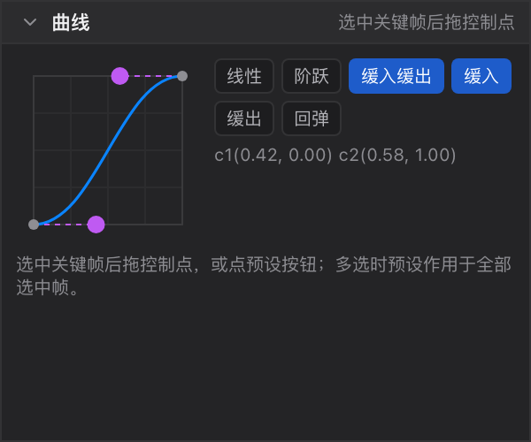

# 11 曲线面板

[← 返回目录](index.md) ｜ 上一篇：[10 时间轴](10-timeline.md) ｜ 下一篇：[12 状态栏与提示](12-statusbar.md)

> 一句话：曲线面板只对**选中的关键帧**生效 —— 选一帧，调它的缓动；选多帧，一次套用同一个预设。



> 位置：Animate 态左栏第三块（Pose 态这里是[资源与皮肤](07-assets.md)）。高度可拖，独立记忆。

---

## 一、它改的是什么

曲线描述「从这一帧到下一帧之间，值怎么过渡」：

- 横轴 = 时间进度（0 → 1）
- 纵轴 = 值进度（0 → 1）

每个关键帧自带一个缓动方式与可选的贝塞尔控制点。**没有选中关键帧时，整块区域是灰的**，并提示「先在 dope sheet 里选中关键帧」。

---

## 二、缓动预设

| 按钮 | 效果 |
| :--- | :--- |
| **线性** | 匀速过渡（默认） |
| **阶跃** | 保持前一帧的值直到下一关键帧（适合换装、可见性这类离散变化） |
| **缓入缓出** | Bezier `[0.42, 0, 0.58, 1]`，两头慢中间快，最常用 |
| **缓入** | Bezier `[0.42, 0, 1, 1]`，起步慢、后面快 |
| **缓出** | Bezier `[0, 0, 0.58, 1]`，起步快、收尾慢 |
| **回弹** | Bezier `[0.68, -0.55, 0.27, 1.55]`，带一点过冲 |

点预设按钮会把它套用到**当前全部选中的关键帧**；已选中的预设会高亮为实心蓝。

---

## 三、拖贝塞尔控制点

- 只有当缓动是「贝塞尔」时，曲线上才会出现两个紫色控制点。
- 拖动控制点即写入新的 `curve` 值，横纵坐标限制在 −0.5 ~ 1.5（允许少量过冲）。
- 面板底部实时显示读数，例如 `c1(0.42, 0.00) c2(0.58, 1.00)`。
- 非贝塞尔时显示直线（线性）或折线（阶跃），读数会提示「线性：匀速插值」/「阶跃：保持前一帧直到下一关键帧」。

---

## 四、与时间轴的关系

联动是**单向**的：

```
时间轴里选中关键帧  →  曲线面板变为可编辑  →  改缓动 / 控制点  →  写回这批关键帧
```

- 时间轴本身**不画缓动曲线**，只在关键帧菱形上看颜色与位置。
- 多选时曲线面板显示的是「默认线性」而不是多值，因此**多选时请用预设按钮**，不要拖控制点。
- 切换动画、取消选择都会让曲线面板回到不可编辑状态。

---

## 五、实用建议

- **位移 / 旋转**：默认线性即可；想让动作有重量感，用「缓入缓出」或手动拖贝塞尔。
- **循环动作**：首尾都用「缓入缓出」，循环点才不突兀。
- **换装 / 显示切换**：一定用「阶跃」，否则会出现两张图叠在一起过渡的现象。
- **描边类特效**：可试「回弹」，制造轻微过冲。

---

## 六、相关页面

- 关键帧怎么打、怎么选：[10 时间轴](10-timeline.md)
- 改关键帧的具体数值：时间轴页的「关键帧值条」一节
