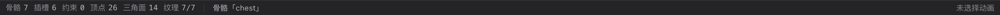

# 12 状态栏与提示

[← 返回目录](index.md) ｜ 上一篇：[11 曲线面板](11-curve.md) ｜ 下一篇：[13 对话框合集](13-dialogs.md)

> 一句话：状态栏是**唯一的全局反馈通道** —— 每次操作的结果、错误原因、统计数字都在这里。

---

## 一、左侧统计

从左到右依次是：`骨骼 N`、`插槽 N`、`约束 N`、`顶点 N`、`三角面 N`、`纹理 x/y`。

| 项目 | 口径 |
| :--- | :--- |
| **骨骼** | 当前骨架编译产物里的骨骼数量 |
| **插槽** | 当前骨架的插槽数量 |
| **约束** | IK / 变换 / 路径 / 物理约束总数 |
| **顶点** | 视口里**所有网格合并后的顶点总数**（不只是选中的那个网格） |
| **三角面** | 所有分组的索引数之和 ÷ 3 |
| **纹理 x/y** | 「已成功加载出纹理的图片数 / 工程图片总数」 |

> 统计每 250ms 轮询刷新，不在每帧触发重渲染，所以播放动画时数字不会抖动。

**纹理一项只在工程里有图片时出现**：

- 全部就绪：正常颜色，悬停提示「图片纹理全部就绪」；
- 有缺图：整项变**警示橙**，悬停提示「有 N 张图片没加载出纹理，视口里会显示为白块」。

这是排查「角色变白块」最快的地方。

---

## 二、中间：当前选中

| 显示 | 含义 |
| :--- | :--- |
| `骨骼「chest」` | 选中了一根骨骼 |
| `N 根骨骼（主选中「chest」）` | 多选骨骼，括号里是主选中 |
| `插槽「head」` | 选中了插槽 |
| `附件「head」` | 选中了具体附件（display） |
| `约束「legIK」` | 选中了约束 |
| `Pose 状态` / `Animate 状态` | 什么都没选 |

---

## 三、右侧：反馈

从右往左看：

| 元素 | 说明 |
| :--- | :--- |
| **动画名 + 帧信息** | Animate 态且选中动画时显示 `idle　12 / 30fps · 0.400s`；Pose 态或未选动画时显示「未选择动画」 |
| **提示（accent 色）** | 操作结果、错误原因、快捷键回显，约 2.6 秒后自动消失 |
| **忙碌指示（转圈 + 文案）** | 导入 / 导出 / 打包等耗时操作进行中 |

提示文本是**排查问题的第一来源**，例如：

- 「工具：权重刷工具（G）」
- 「已新建骨骼「bone」… · 长度 1.23」
- 「请先在层级树里选中要刷权重的骨骼」
- 「切到 Pose 状态才能改绑定数据（骨骼 / 插槽 / display / 约束）」
- 「已适配视野」
- 「有 2 张图片没加载出纹理，视口里会显示为白块」

---

## 四、常见提示对照表

| 提示 | 怎么处理 |
| :--- | :--- |
| 切到 Pose 状态才能改绑定数据 | 按 `Tab` 回 Pose 再改骨骼 / 插槽 / 网格 / 权重 |
| 播放控制仅在 Animate 状态可用（Tab 切换） | 同上 |
| 打关键帧只在 Animate 状态可用（Tab 切换） | 先 `Tab` 到 Animate，并确保时间轴上选了动画 |
| 当前工程还没有动画，可点时间轴上的「+ 动画」新建 | 在时间轴左上角点「+ 动画」 |
| 请先保存工程：参考图要存到工程目录的 stage/ 下 | 先 `⌘S` 保存工程，再设置舞台参考图 |
| 场景里还没有骨骼：先画一根骨骼，再把图片拖进来 | 用画骨骼工具 `B` 建一根 |
| 顶点信息已过期：请在视口里重新点选顶点 | 网格被改动过，重新点一下顶点再删 |
| 删除顶点改的是绑定网格：请切到 Pose 状态 | 顶点属于绑定数据，Animate 态只能写 FFD |
| 框选到 N 个顶点（共选中 M 个；拖动任意一个整组移动） | 顶点框选成功，可整组拖动 |
| 框选：矩形里没有顶点（右键可取消当前选择） | 框选范围内没有当前附件的顶点 |
| 已取消选择（左键在空白处拖动可框选顶点） | 网格 / FFD 工具下右键取消选择 |
| 请选择这份资源要导入到哪里： | 导入 Spine / DragonBones 时等待你选目标 |

---

## 五、相关页面

- 每个面板/工具的操作反馈：见对应章节
- 导出与导入的失败原因：[40 导入详解](40-import-formats.md)、[41 导出详解](41-export-formats.md)
- 更多问题排查：[44 常见问题](44-faq.md)
