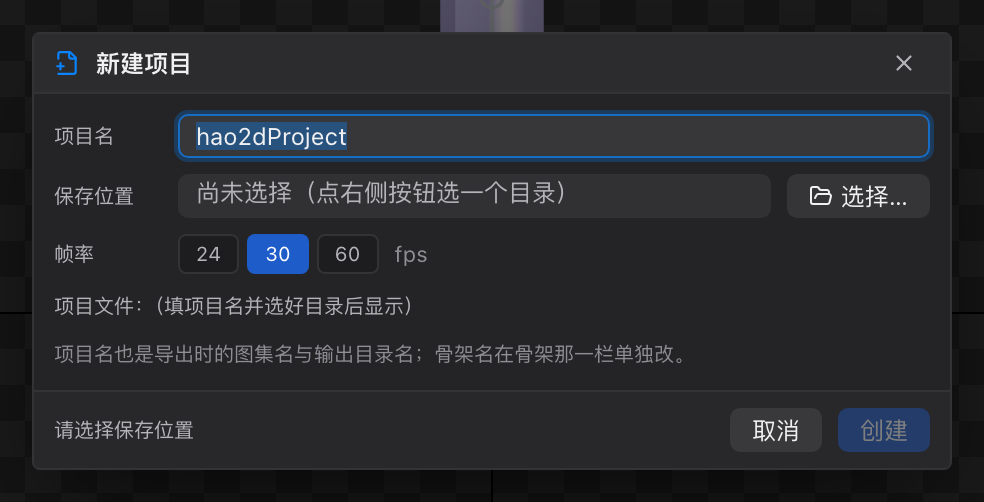
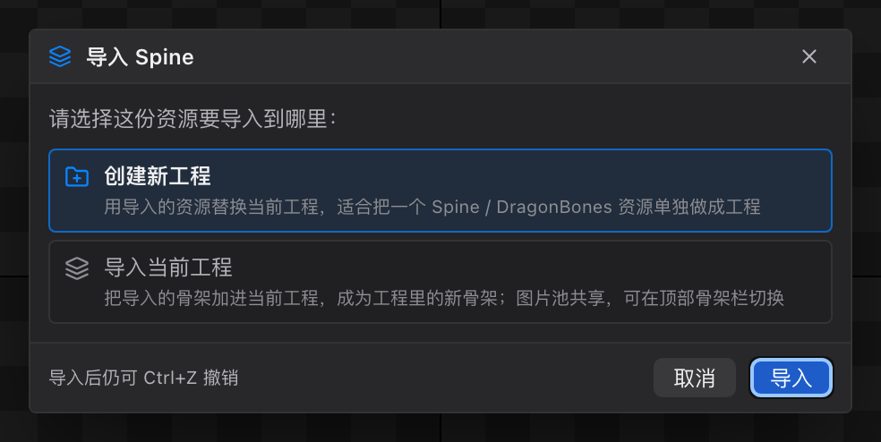
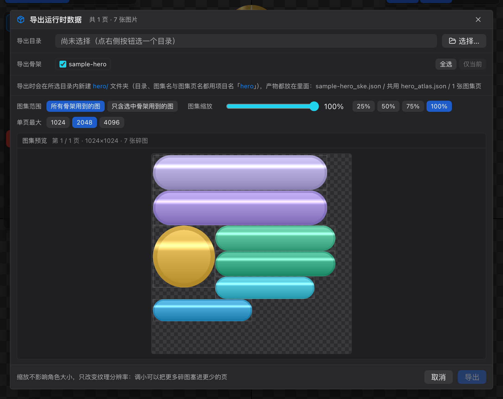
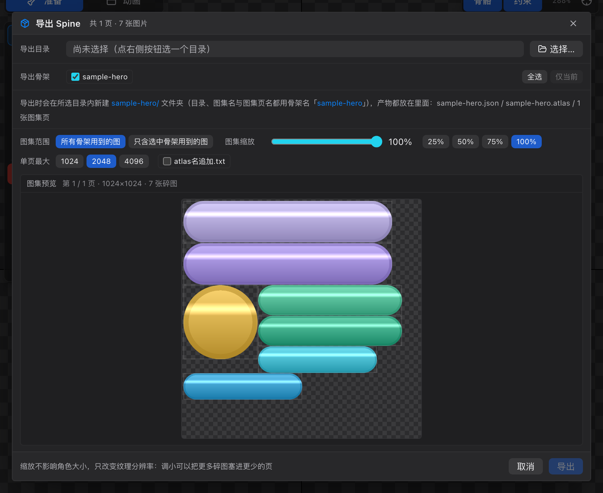
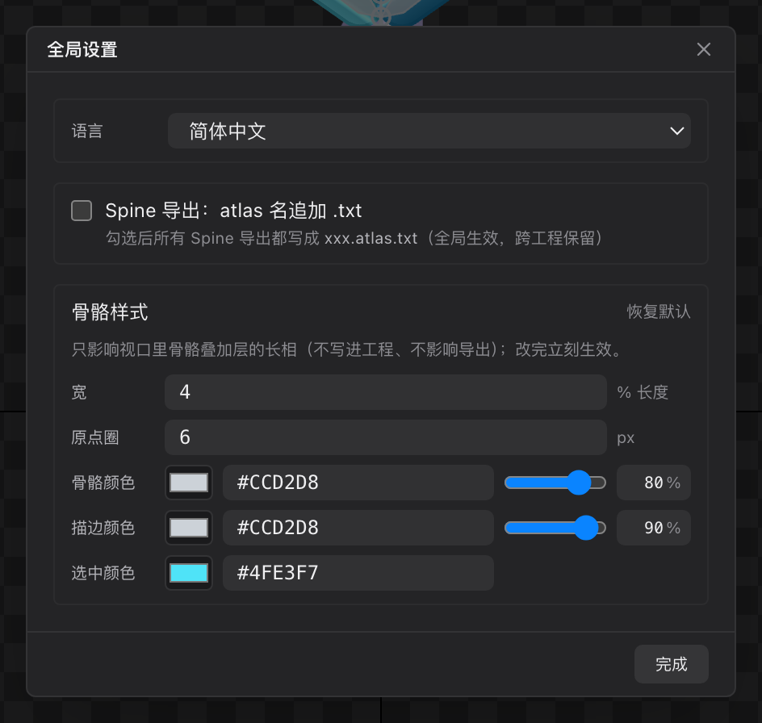
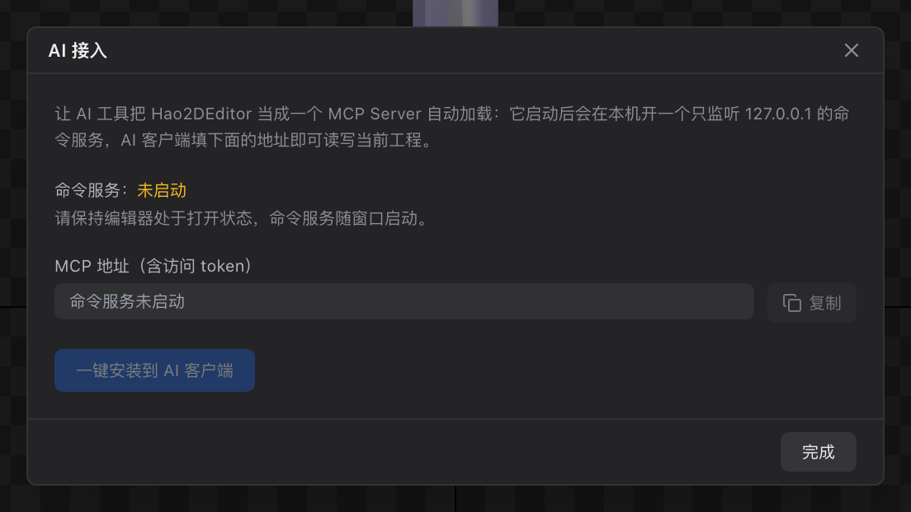
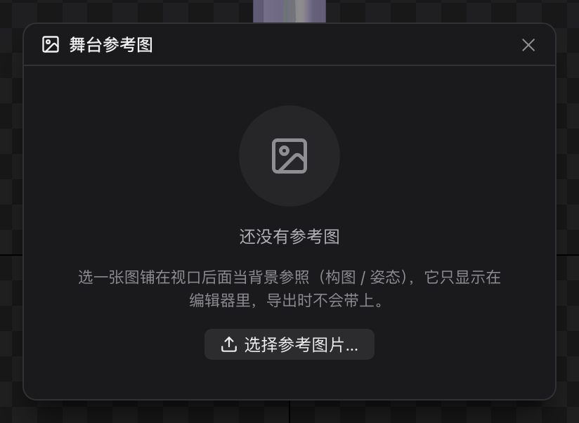

# 13 对话框合集

[← 返回目录](index.md) ｜ 上一篇：[12 状态栏与提示](12-statusbar.md) ｜ 下一篇：[20 选择工具 V](20-tool-select.md)

> 一句话：这一页把所有弹窗集中说明 —— 它们的入口、字段，以及点确定之后到底发生了什么。

| 弹窗 | 入口 | 快捷键 |
| :--- | :--- | :--- |
| 新建项目 | 菜单栏「新建项目」 | `⌘N` / `Ctrl+N` |
| 导入目标选择 | 导入 Spine / DragonBones 且**解析成功之后**自动弹出 | — |
| 导出（运行时 / Unity / Spine） | 菜单栏「导出 ⌄」 | `⌘E`、`⇧⌘E`、`⌥⌘E` |
| 全局设置 | 应用菜单「设置」 | `⌘,` / `Ctrl+,` |
| AI 接入 | 应用菜单「AI 接入」 | — |
| 导入 PSD | 菜单「文件 → 导入 PSD」，或导入时选到 `.psd` | — |
| 舞台参考图 | 视口工具面板最下方的「舞台」按钮 | — |
| 确认框 | 危险操作（重绘网格边线等） | — |

> 新建项目、导出、设置、AI 接入、导入 PSD 都支持按 `Esc` 关闭，也可以拖动标题栏挪位置、双击标题栏回到屏幕中央；**舞台参考图**点弹窗外部（或右上角关闭按钮）即关闭。

---

## 一、新建项目

| 字段 | 说明 |
| :--- | :--- |
| 项目名 | 默认 `hao2dProject`；不能含空格与 `/ \ : * ? " < > \|`；也是导出的图集名与目录名 |
| 保存位置 | 点「选择…」挑目录；工程写成 `<目录>/<项目名>.hao2d.proj` |
| 帧率 | 24 / 30 / 60，默认 30，写入所有骨架 |
| 项目文件 | 只读预览最终路径 |

确认后会立刻把工程文件写到磁盘，并回到 Pose 态。

---

## 二、导入目标选择

导入 **Spine / DragonBones** 时，解析成功之后会先问一句：这份资源要**建新工程**还是**并进当前工程**。

| 选项 | 行为 |
| :--- | :--- |
| **创建新工程**（默认） | 用导入的资源**整份替换**当前文档；工程还没名字时用被导入的文件名当项目名 |
| **导入当前工程** | 把导入的骨架**追加**成工程里的新骨架，图片池合并共享，自动切到新骨架 |

细节：

| 情况 | 表现 |
| :--- | :--- |
| 当前工程有未保存改动 | 选「创建新工程」时下方出现红字：「当前工程有未保存的改动：创建新工程会整份替换当前文档，这些改动不会保留。」 |
| 骨架重名 | 并入时自动改名（`hero` → `hero_2`），并同步改写同批骨架内部的嵌套引用 |
| 图片重名（同名不同文件） | 自动改名（`atlas.png` → `atlas_2.png`），并改指新骨架的引用 |
| 取消 / `Esc` / 关闭 | 导入中止，状态栏提示「已取消导入」 |
| 导入图片 / PSD | **不弹**这个对话框（只有 Spine / DragonBones 会弹） |
| 解析失败 | 不会弹：文件不对时先报错，不必徒增一次选择 |

> 并入是**可撤销**的（弹窗底部也写着「导入后仍可 Ctrl+Z 撤销」），撤销会连同新骨架与合并的图片一起回退。
> 通过 **AI 命令** `importSpine` / `importDragonBones` 导入时**不会弹窗**，一律按「整份替换」处理，需要合并请用 `nestArmature` 或手动操作。

---

## 三、导出

三种导出共用一套弹窗布局，差异在「产物说明」与个别选项。

| 区块 | 说明 |
| :--- | :--- |
| **导出目录** | 必选。编辑器会在里面新建一个以项目名 / 骨架名命名的子文件夹 |
| **导出骨架** | 每个骨架一个复选框（显示「N 骨骼 / N 动画」）；右侧「全选」「仅当前」 |
| **产物说明** | 一行文字，明确写出生成的目录名与文件名 |
| **图集范围** | 「所有骨架用到的图」（默认）或「只含这次导出的骨架用到的图」 |
| **图集缩放** | 拖动条 + 25% / 50% / 75% / 100% 预设；只改纹理分辨率，不改角色大小 |
| **单页最大** | 1024 / 2048 / 4096；页数不够会自动加页 |
| **图集预览** | 每页的打包结果（棋盘底 = 透明），可翻页；显示页数与碎图数 |
| **预览** | 桌面版可在浏览器里用 Spine 官方运行时播放，支持手机扫码看 |
| **取消 / 导出** | — |

**三种模式的产物**

| 模式 | 产物 |
| :--- | :--- |
| 运行时 | `<骨架>_ske.json` + 共用 `<项目>_atlas.json` + 图集 png |
| Unity | 每个骨架一个 `.hao2d`，共用图集 png 与材质（Hao2D/Sprite） |
| Spine | Spine 4.3 的 `<骨架>.json` + `<骨架>.atlas` + 图集 png |

> Spine 模式多一个 **「atlas名追加.txt」** 复选框，勾上会写成 `xxx.atlas.txt`（Spine 编辑器默认形态，spine-unity 也认）。这项也是全局设置里同一个开关。

细节参数与产物结构见 [41 导出详解](41-export-formats.md)。

---

## 四、全局设置

**与工程无关**，跨工程保留（存本机）。

| 区块 | 字段 | 说明 |
| :--- | :--- | :--- |
| 语言 | 简体中文 / English | 立即生效，记住选择 |
| Spine 导出 | atlas 名追加 .txt | 勾选后所有 Spine 导出都写成 `xxx.atlas.txt` |
| 骨骼样式 | 宽（%）、端点圈（px）、骨骼颜色、描边颜色、选中颜色、透明度 | 只影响视口里骨骼叠加层的长相，不写进工程、不影响导出；改完立刻生效，可「恢复默认」 |

---

## 五、AI 接入

| 元素 | 说明 |
| :--- | :--- |
| 说明文字 | 让 AI 工具把 Hao2DEditor 当成一个 MCP Server 自动加载；命令服务只监听 `127.0.0.1` |
| 命令服务状态 | 显示「运行中 / 未启动」；服务随窗口启动，需保持编辑器打开 |
| **MCP 地址（含访问 token）** | 复制给 AI 客户端；「复制」按钮一键复制 |
| **一键安装到 AI 客户端** | 自动写入已识别的 AI 客户端配置 |
| 完成 | 关闭 |

> 浏览器调试模式下没有本地服务，会显示「命令服务未启动」，桌面版才有完整功能。

细节见 [42 AI 接入](42-ai.md)。

---

## 六、导入 PSD

入口：菜单「文件 → 导入 PSD」，或用「导入图片」选到 `.psd` 文件。

| 元素 | 说明 |
| :--- | :--- |
| **图层树** | 勾选要导入的图层；编组（组）可以整组勾选；每行显示图层尺寸或「无像素」，PSD 里隐藏的层带一个眼睛斜杠图标 |
| 计数 | 「已选 N / N 层」 |
| **按 PSD 位置直接添加到场景** | 勾上后按 PSD 里的位置/大小铺到视口，逐个建插槽；不勾则只把图层作为图片导入图片池 |
| 取消 / 导入 | — |

---

## 七、舞台参考图

| 字段 | 说明 |
| :--- | :--- |
| 位置 X / Y | 世界坐标（y 向上），按 PPU 换算成像素显示 |
| 大小 宽 / 高 | 显示像素；新导入时按原图像素 ÷ 100 初始化 |
| 透明度 | 0–1，默认 0.5 |
| 更换图片 / 删除图片 | 换图或移除参考图 |
| 文件 | 显示当前参考图文件名，并提示「仅编辑器显示 · 不导出 · 存于工程 stage/ 目录」 |

> 第一次设置参考图前必须**先保存工程**（参考图要写进工程目录的 `stage/`），否则会提示「请先保存工程」。

---

## 八、确认框

危险操作会先弹确认，例如网格工具的「自己绘制边界」：

- 标题「重绘网格边线」
- 明细：「对象：slot / attachment」「本次将丢弃：N 个网格点、N 根骨骼的绑定权重、N 个 FFD 关键帧（N 个动画）」
- 提示「这一步可以用 Ctrl+Z 整步撤销」
- 按钮：取消 / 重绘

选中的对象没有东西可丢时（空网格、没绑定权重），不会弹这个框。

---

## 九、其他浮层

| 浮层 | 出现时机 |
| :--- | :--- |
| **右键菜单** | 层级树、slot 层级、资源面板、视口里的图片 |
| **颜色选择器** | 点颜色字段时弹出，支持十六进制输入与吸管 |
| **最近打开的工程 / 导出下拉** | 菜单栏两个下拉，点外部即关闭 |
