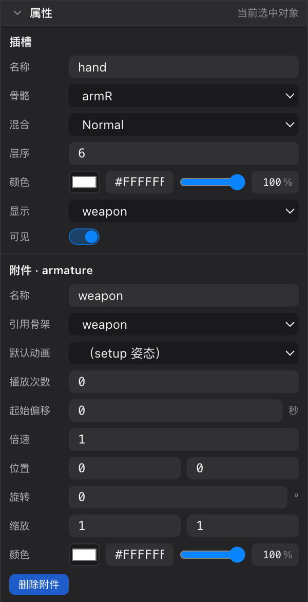
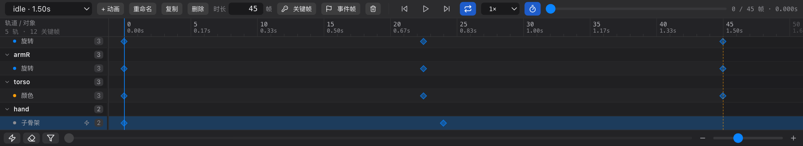

# 14 子骨架（骨架嵌套）

[← 返回目录](index.md) ｜ 上一篇：[13 对话框合集](13-dialogs.md) ｜ 下一篇：[20 选择工具 V](20-tool-select.md)

> 一句话：把工程里的**另一套骨架**挂到某个插槽上，它就变成这个插槽的一个 display；再用一条「子骨架」轨道控制它播哪个动画。

> 它在界面上的四个位置：**顶部骨架条**（从这里拖出）→ **层级树的插槽行**（变成 `显示中 · 骨架 xxx`）→ **右栏属性**（「附件 · armature」）→ **底部时间轴**（插槽下的「子骨架」轨道）。

---

## 一、它是什么

| 说法 | 含义 |
| :--- | :--- |
| **子骨架 / 嵌套骨架** | 一个附件类型（`附件 · armature`），本身不产生任何几何，只是把**同工程里的另一个骨架**挂到插槽上 |
| **按名字引用** | 存的是被引用骨架的**骨架名**，不是复制数据 —— 改子骨架 = 改那个骨架本身 |
| **一个插槽可挂多个** | 和普通贴图一样属于 display，同一插槽可以有多套骨架，切换显示其中一套 |
| **只保留一份** | 同一个骨架在同一个插槽里只会有一份 display，重复添加会直接复用并切过去 |

常见用途：

- 角色手里拿的武器做成独立骨架，挥砍动画在武器骨架里做，角色只负责「什么时候播」；
- 坐骑 / 宠物 / 附属机械臂；
- 一套骨架复用到多个角色身上（共用同一套动画）。

> 子骨架和父骨架**共享图片池**（全工程只有一份），所以不会重复占图。

---

## 二、怎么创建

**没有「新建子骨架」按钮**。唯一的手工入口是：**从顶部骨架条，把另一个骨架拖出去**。

| 落点 | 结果 | 状态栏提示 |
| :--- | :--- | :--- |
| 层级树的**插槽行** | 给该插槽加一个骨架 display | 已把骨架「A」挂到插槽「B」 |
| 层级树的**骨骼行** | 先在该骨骼下新建同名的插槽，再挂上去 | 已在骨骼「B」下新建插槽「A」，并挂上嵌套骨架「A」 |
| **视口** | 在当前鼠标下的骨骼（没有则 `root`）下新建插槽并挂上，位置取落点 | — |

- 仅 **Pose 态**可用（Animate 态提示「切到 Pose 状态才能把骨架放进场景」）；
- 当前骨架自己**不能拖到自己身上**（提示「不能把骨架拖到它自己的层级里」）；
- 拖到别的地方（空白、列表外）会提示「骨架只能拖到骨骼或插槽上（拖到骨骼行 = 自动新建插槽）」。

创建后会自动**选中这个 display**，插槽的「显示」也切到它。

> 骨架条上非当前骨架的标签，悬停提示就写着「拖到骨骼行 / 插槽行 / 视口 = 嵌套」。

---

## 三、层级树里长什么样

- 图标是**人形**（区别于骨骼的骨头图标），行内小字显示 `显示中 · 骨架 xxx` 或 `骨架 xxx`；
- 类型名就是「骨架」；
- 双击聚焦、单击选中，与普通 display 一致；
- Animate 态右键该 display 行，可以打「显示关键帧 / 隐藏关键帧」（和别的 display 一样）。

---

## 四、属性面板：setup 默认值

选中这个骨架 display 后，右栏「附件 · armature」里多了 5 个字段：

| 字段 | 说明 | 默认 |
| :--- | :--- | :--- |
| **引用骨架** | 下拉列出工程内**除自己以外**的所有骨架；改成「（未引用）」= 断开 | 创建时的骨架 |
| **默认动画** | 子骨架的 setup 动画；`（setup 姿态）` = 停在绑定姿态 | `（setup 姿态）` |
| **播放次数** | `0` 或负数 = **循环**；正数 = 播几次后定格在末帧 | `0`（循环） |
| **起始偏移** | 从子动画的第几秒开始播 | `0` |
| **倍速** | 播放速度倍率 | `1` |

下面还有通用的 **位置 / 旋转 / 缩放 / 颜色**（骨架 display 没有「尺寸」，因为它本身没有几何）。染色 = 父插槽颜色 × 附件颜色。

> 换「引用骨架」会**自动清空默认动画**（旧骨架里的动画名在新骨架里通常不存在），需要重新选。

**皮肤不在这里设置**：子骨架跟随父骨架当前皮肤，找不到同名皮肤时退回它自己的默认皮肤。

---

## 五、时间轴：子骨架动画轨道

`Tab` 进 Animate，选中挂了子骨架的插槽 —— 时间轴里这个插槽分组下会多一条 **「子骨架」** 子轨：

| 元素 | 说明 |
| :--- | :--- |
| 通道名 | 子骨架（title 写明「控制嵌套骨架播哪个动画；点右侧闪电图标在当前位置打一帧」） |
| 行尾 ⚡ 按钮 | 在当前时间打一帧，取当前生效值 / setup 值 |
| 关键帧 | 一条帧同时带 **动画名 + 播放次数 + 起始偏移 + 倍速**，不是四条并行轨道 |
| 缓动 | 固定为「阶跃」—— 动画名是离散量，不插值 |

**三种打帧方式**

1. 时间轴子轨右侧的 **⚡**；
2. 选中该子轨道后按 **`K`**（只给这条通道打帧）；
3. 视口左下方的**属性打帧条**里「子骨架」那一行，选好动画后点闪电。

选中子骨架关键帧后，视口下方的**关键帧值条**会显示 4 个控件：`动画`（下拉）、`次数`、`偏移`、`倍速`。

> 第一条关键帧之前，用属性面板里的 setup 值。

### 播放行为

- **确定性时钟**：编辑器每帧按父动画的当前时间算出子动画该播到哪，再 `seek` 过去 —— 暂停、拖播放头、反复横跳都不会漂移。
- **循环（次数 ≤ 0）**：子动画用自己的绝对时钟，父动画循环回卷时子骨架继续往前走，两边互不影响。
- **非循环（次数 > 0）**：跟随父动画时间，父动画每轮从头播，子骨架也跟着重来。
- 时间轴子轨只在**有帧之后**才出现（第一次打帧用视口下方的属性打帧条，或先在属性面板设好默认动画再打）。

---

## 六、嵌套的边界

| 规则 | 提示文案 |
| :--- | :--- |
| 不能引用自己 | 不能把骨架拖到它自己的层级里 |
| 不能形成环（A→B→A） | 会形成循环引用：A → … → B → A |
| 最多 8 层嵌套 | 嵌套层数超过上限（8 层） |
| 引用的骨架被删 / 改名 | 工程加载时会断开并告警（如「骨架「A」的插槽「B」引用了不存在的骨架「C」，已断开」） |

工程文件里每个环只断开第一条边，尽量保住已有数据。

---

## 七、导出

| 模式 | 处理 |
| :--- | :--- |
| **运行时** | 一并导出，运行时按 ske 里的 nested 清单加载；提示「包含嵌套子骨架：A（已一并导出）」 |
| **Unity** | 需要把被嵌套骨架的 `.hao2d` **一起导出到同一目录**（导入器按骨架名自动关联，缺文件时该 display 不渲染） |
| **Spine** | **不支持骨架嵌套**，这些 display 会被跳过，并在提示里写明「已跳过这些 display」 |
| 引用缺失 | 导出时会是一个空 display，提示「骨架「A」引用了工程里不存在的骨架「B」」 |

---

## 八、AI / 脚本

| 命令 | 作用 |
| :--- | :--- |
| `nestArmature` | 把另一个骨架嵌到指定插槽：`slot`、`armature`、`name`、`skin`；会拒绝自引用 / 环 / 超深 |
| `keySlotSubArmatureFrame` | 打子骨架帧：`slot`、`time`、`clip`（空串 = 回 setup 姿态）、`playTimes`、`offset`、`speed` |

详见 [42 AI 接入](42-ai.md)。

---

## 九、常见问题

| 现象 | 原因 |
| :--- | :--- |
| 骨架条上的标签拖不动 | 只有**非当前骨架**才能拖出去；当前骨架被拒绝 |
| 拖进层级树没反应 | 必须落在骨骼行或插槽行上；空白处不接受 |
| 子骨架不动 | 属性面板没设「默认动画」，也没有任何子骨架关键帧 → 它停在 setup 姿态 |
| 改了子骨架，父角色也变了 | 引用不复制数据，改的就是同一个骨架 |
| 时间轴看不到「子骨架」轨道 | 该插槽还没有打过子骨架帧 |
| Spine 导出后丢了手部武器 | Spine 不支持嵌套，需要把武器并进同一个骨架 |
