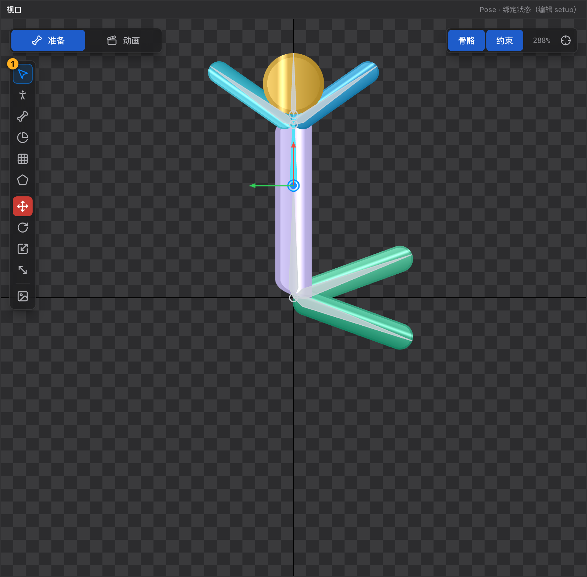

# 20 选择工具 V

[← 返回目录](index.md) ｜ 上一篇：[13 对话框合集](13-dialogs.md) ｜ 下一篇：[21 Pose 工具 P](21-tool-pose.md)

> 一句话：选择工具负责「选中并变换」—— 它本身不改变数据，只是把鼠标交给你选中的对象。

| | |
| :--- | :--- |
| 快捷键 | `V` |
| 可用状态 | Pose 与 Animate 都可用 |
| 提示原文 | 「选中并变换骨骼 / 插槽 / 附件」 |

---

## 一、基本操作

| 操作 | 结果 |
| :--- | :--- |
| 点骨骼 | 选中它，并按**当前变换工具**（W / E / R / T）开始拖动 |
| 点骨骼的**原点圆圈** | 无论当前是哪种变换工具，都是**平移** |
| 点图片 | 选中附件；Pose 态可直接拖动，Animate 态只选中（提示「位置属于绑定数据，切到 Pose 态才能拖动」） |
| 点空白 | 清空选择，状态栏「已取消选择」 |
| `Shift` / `⌘` / `Ctrl` + 点骨骼 | 加选 / 减选（与层级树同一套规则） |
| 双击空白 | 适配视野 |
| 在图片上右键 | 弹出插槽层级菜单（移到顶层 / 上移一层 / 下移一层 / 移到底层；Pose 态还有删除插槽） |

**骨骼不参与框选**：视口里左键拖框是**网格顶点**的框选（只在网格 / FFD 工具下生效，见 [24 网格工具](24-tool-mesh.md)）。选择骨骼多选一律用 `Shift` / `⌘` / `Ctrl` 点击。

---

## 二、点骨骼时发生了什么

视口把一根骨骼分成三个可点区域，行为不同：

| 点的位置 | 行为 |
| :--- | :--- |
| **原点圆圈** | 平移（与当前变换工具无关） |
| **骨骼本体 / 末端方块** | 按当前变换工具处理：移动 / 旋转 / 缩放 / 斜切 |
| 骨骼身上的斜切包围盒边 | 仅斜切模式下出现，拖动即斜切 |

> 也就是说：**「点哪儿」决定是平移还是按工具走**，「当前工具」决定旋转 / 缩放 / 斜切的语义。想让骨骼动起来更可预期，先按 `W` / `E` / `R` / `T` 选好变换方式。

---

## 三、多选骨骼

- 多选后拖动任意一根，**每根骨骼各自加上同一个增量**（各自在父空间里累加），所以父子同时选中时子骨骼会「自己再动一次」。
- 状态栏会显示「已选中 N 根骨骼（主选中「x」）」。
- 主选中（最后一根）决定属性面板显示谁。

---

## 四、锁定与限制

- 层级树里锁定的骨骼 / 插槽，在视口里点不中：提示「骨骼「X」已锁定，先解锁再编辑」。
- 斜切模式不支持附件，拖附件会提示改用移动 / 旋转 / 缩放，或斜切它所在的骨骼。

---

## 五、和变换工具配合

选择工具常与 [27 变换工具](27-tool-transform.md) 一起用：

| 想做的事 | 先按 | 再拖 |
| :--- | :--- | :--- |
| 移动骨骼 | `W` | 骨骼本体或轴 |
| 旋转骨骼 | `E` | 圆环或骨骼本体 |
| 缩放 / 改长度 | `R` | X 轴（长度）/ Y 轴（粗细）/ 中心（等比） |
| 斜切 | `T` | 包围盒的边 |

---

## 六、常见误用

| 现象 | 原因 |
| :--- | :--- |
| 拖骨骼时网格没变形 | 选择工具拖骨骼只改骨骼，蒙皮被锁在世界坐标；想让网格跟着走要用 [Pose 工具](21-tool-pose.md) |
| Animate 态拖不动图片 | 附件位置属于绑定数据，需回 Pose |
| 按 `⌘` 加选没生效 | 焦点在输入框里时快捷键会被跳过，先点一下视口空白 |
