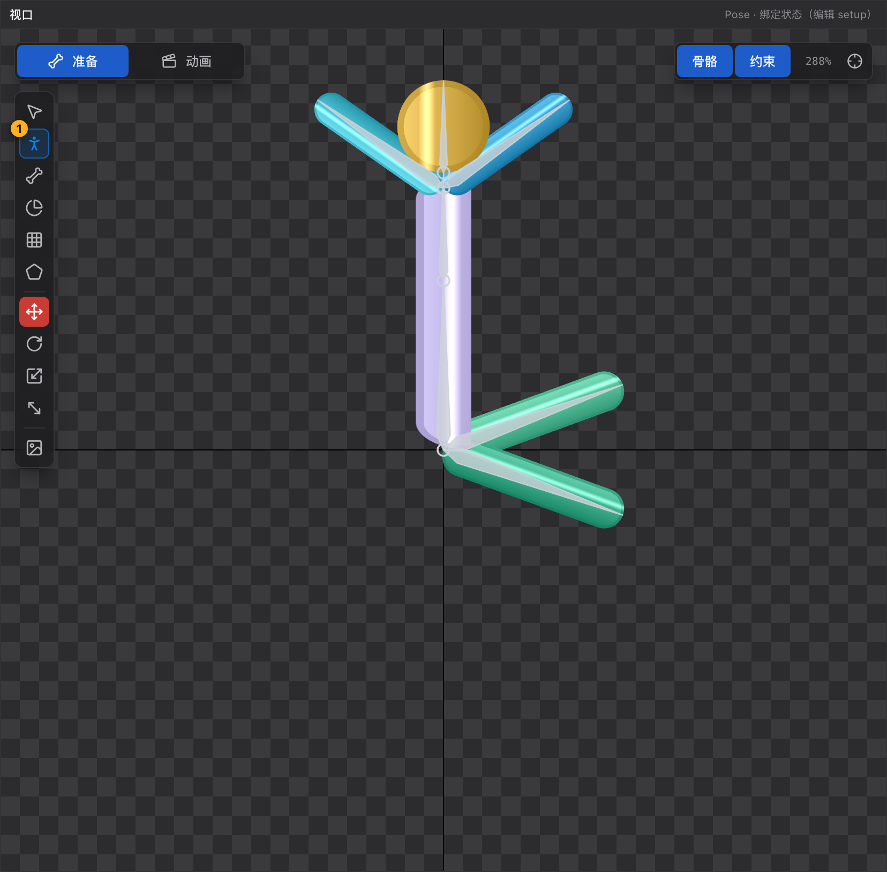

# 21 Pose 工具 P

[← 返回目录](index.md) ｜ 上一篇：[20 选择工具 V](20-tool-select.md) ｜ 下一篇：[22 画骨骼工具 B](22-tool-bone.md)

> 一句话：Pose 工具是**绑定姿态专用**的拖拽工具 —— 拖骨骼时网格会跟着走，这是它和选择工具最大的区别。

| | |
| :--- | :--- |
| 快捷键 | `P` |
| 可用状态 | **仅 Pose**（Animate 态按钮隐藏） |
| 提示原文 | 「调绑定：拖顶点只移动顶点（UV 不动）；拖骨骼改绑定姿态，蒙皮随之变形」 |

---

## 一、拖骨骼：让蒙皮跟着变形

| 工具 | 拖骨骼后 | 网格顶点 |
| :--- | :--- | :--- |
| 选择工具 V | 只改骨架 | 被锁在世界坐标，**看起来不变形** |
| **Pose 工具 P** | 改绑定姿态 | 按权重把顶点「烘」进绑定网格：权重 0 的顶点不动，权重 1 的刚性跟随 |

这就是「摆绑定姿态」的正确姿势：调整手臂角度、把角色摆成 T-Pose/A-Pose 时，用 Pose 工具拖，网格才会跟着骨骼一起走，而不是撕开。

Pose 工具下同样可以用 `W` / `E` / `R` / `T` 的坐标系拖动，效果一致。

---

## 二、拖顶点：只动顶点，不重算 UV

| 工具 | 拖顶点改什么 | 贴图表现 |
| :--- | :--- | :--- |
| **Pose 工具 P** | 只改几何顶点，**UV 一个分量都不动** | 贴图被拉伸 / 裁剪 —— 适合修贴图位置 |
| [网格工具 M](24-tool-mesh.md)（Pose 态） | 改几何，并对**内部顶点**反算 UV | 贴图原地不动 —— 适合调网格形状 |

> 记法：**Pose 拖顶点 = 连贴图一起拉；网格工具拖顶点 = 只动网格、贴图不跑。**
> 边缘顶点在网格工具下不会反算 UV（没有足够的邻居约束），所以贴图仍可能轻微移动。

---

## 三、优先级

- Pose 工具下，顶点**只让位于真正的骨骼手柄**（原点圈 / gizmo / 斜切边）；骨骼本体不抢顶点，否则压在网格上的骨骼会让顶点永远拖不动。
- 没抓到顶点时，会继续尝试拾取骨骼 / 操作器，和选择工具一致。

---

## 四、典型流程

1. 选中网格附件（层级树里点它的 display 行）。
2. 按 `P`，把角色摆成目标姿态（比如把手臂从 T-Pose 放到自然下垂）。
3. 观察贴图：如果某个关节被拉得很怪，去 [23 权重刷](23-tool-weight.md) 调权重，而不是继续拖顶点。
4. 姿态定好后按 `Tab` 进 Animate 开始做动画。

---

## 五、常见误用

| 现象 | 原因 |
| :--- | :--- |
| Animate 态找不到这个工具 | 正常，Pose 工具只在绑定态可用 |
| 拖顶点后贴图糊了 | Pose 工具不重算 UV，是预期行为；想保持贴图请改用网格工具 |
| 拖骨骼时角色「撕开」 | 权重不合理，去刷权重或检查「权重骨骼列表」 |
