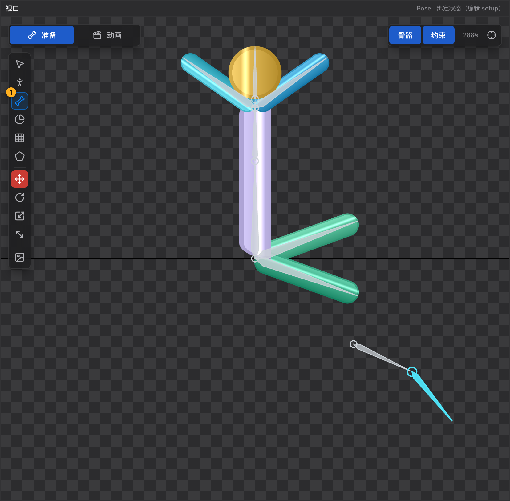

# 22 画骨骼工具 B

[← 返回目录](index.md) ｜ 上一篇：[21 Pose 工具 P](21-tool-pose.md) ｜ 下一篇：[23 权重刷工具 G](23-tool-weight.md)

> 一句话：按住拖一下就是一根骨骼；**从哪起笔决定它是谁的子骨骼**。

| | |
| :--- | :--- |
| 快捷键 | `B` |
| 可用状态 | **仅 Pose**（Animate 态提示「骨骼属于绑定数据：切到 Pose 状态再画」） |
| 提示原文 | 「在视口拖拽画骨骼：起点落在骨骼上会吸附并以它为父，接着拖就能连成骨骼链」 |

---

## 一、画一根骨骼

1. 按 `B`。
2. 在视口里**按下 → 拖 → 松开**。
3. 松开即生成骨骼，并**自动选中新骨骼**，状态栏显示「已新建骨骼「bone」… · 长度 1.23」。

长度单位是世界单位（1 单位 = 100px），下限 0.02；拖得太短（< 0.001）会提示「拖动距离太短，未生成骨骼」。

---

## 二、父级是怎么定的

起笔位置决定新骨骼挂在谁下面：

| 起笔位置 | 结果 |
| :--- | :--- |
| 距任意骨骼的**根端或末端 ≤ 20 屏幕像素** | 精确吸附到该点，并以该骨骼为父（提示「已吸附到「X」的骨骼端点」） |
| 压在骨骼**身上**（不在端点附近） | 投影到骨骼轴线，以该骨骼为父（提示「从「X」接着画…」） |
| 空白处 | 挂到层级根骨骼 `root` 下 |

> 编辑器**刻意不看当前选中的骨骼**来决定父级，只认你下笔的位置 —— 避免「以为挂在 A 上，结果挂到别处」。

---

## 三、连续画成链

松开后新骨骼自动被选中，此时**从它的末端继续起笔**（20px 内会自动吸附），下一根就自然接在它下面，形成骨骼链。

收笔位置同样会吸附骨骼端点，方便对齐。

---

## 四、画骨骼时顺手做的两件事

| 行为 | 说明 |
| :--- | :--- |
| 在**插槽**上松手 | 该插槽会挂到新骨骼下（位置换算不跳），提示「· 插槽「S」已挂到它下面」 |
| 按 `W` / `E` / `R` / `T` | **不会**把画骨骼工具顶掉 —— 画完可以直接微调，不用重新选工具 |

---

## 五、命名

默认 `bone`、`bone_2`、`bone_3`…；想改名到 [属性面板](09-inspector.md) 改「名称」。

---

## 六、和层级结构按钮的区别

| 方式 | 结果 |
| :--- | :--- |
| 画骨骼工具 `B` | 方向、长度都由拖拽决定，父级由起笔点决定 |
| 层级结构工具栏「骨骼」按钮 | 直接挂到**当前选中的骨骼**下，默认长度 0.4，方向继承父级 |

两种方式可以混用：结构用按钮快速搭，角度用 `B` 直接画。

---

## 七、常见误用

| 现象 | 原因 |
| :--- | :--- |
| 画的骨骼跑到 `root` 下面了 | 起笔点离目标骨骼的端点超过 20px，也没压在骨骼身上 |
| 画完发现方向反了 | 从末端往根部画会得到反向骨骼；删掉重画，或用属性面板调旋转 |
| Animate 态画不了 | 骨骼属于绑定数据，按 `Tab` 回 Pose |
