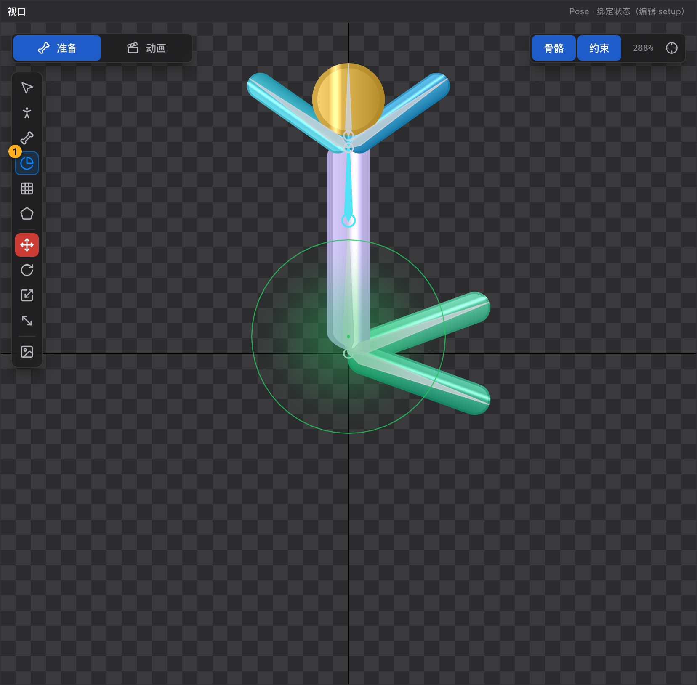

# 23 权重刷工具 G

[← 返回目录](index.md) ｜ 上一篇：[22 画骨骼工具 B](22-tool-bone.md) ｜ 下一篇：[24 网格工具 M](24-tool-mesh.md)

> 一句话：权重决定「这个顶点跟着哪根骨骼动多少」；权重刷就是用笔刷去改这套比例。

| | |
| :--- | :--- |
| 快捷键 | `G` |
| 可用状态 | **仅 Pose** |
| 提示原文 | 「先在层级树或视口里点一根骨骼作为目标，按住拖动刷权重」 |

---

## 一、先定「刷哪根骨骼」

三种方式任选：

1. 在**层级树**里点一根骨骼；
2. 在**视口**里单击骨骼（不压着顶点、不拖动），松手后它成为目标；
3. 在**属性面板 → 权重刷 → Bone** 下拉里选（只改刷哪根，不改当前选中对象）。

没定目标时拖动会提示「请先在层级树里选中要刷权重的骨骼」（`Smooth` 模式例外，不需要目标）。

---

## 二、刷之前的两项前提

| 前提 | 不满足时的提示 |
| :--- | :--- |
| 必须选中一个**网格附件** | 「先在层级树里选中要刷权重的网格附件（Region 请先转为网格）」 |
| 必须在 Pose 态 | 「权重刷只在 Pose 状态可用（动画状态的角色姿态不是绑定姿态）」 |

权重刷**只作用于当前选中的那一个网格附件**，不会误刷到别的部件。

---

## 三、笔刷参数（属性面板「权重刷」）

| 参数 | 说明 |
| :--- | :--- |
| **Size** | 笔刷半径（px），视口里那个圆圈就是它的真实大小，默认 40 |
| **Hardness** | 0–100，每次施加多少权重；100 = 一次刷满，默认 1.5（很轻） |
| **Normalize** | 刷过的顶点权重归一到 1；关掉后权重和可能不等于 1（做特殊效果时才关） |
| **Mode** | `Add and Subtract`（增加 / Alt 减少）、`Grow and Shrink`（只动已受影响的顶点）、`Smooth`（朝邻居平均） |
| **Bone** | 目标骨骼 |

---

## 四、修饰键（优先于 Mode）

| 按住 | 效果 |
| :--- | :--- |
| 不按 | 增加权重 |
| **Alt** | 减少权重 |
| **Shift** | 覆盖（直接设成当前强度，不再累加） |
| **Ctrl** | 平滑（朝周围顶点平均） |
| **Ctrl + Shift** | 生长（只增加**已经受该骨骼影响**的顶点） |
| **Ctrl + Shift + Alt** | 收缩（只减少已受影响的顶点） |

光标会随模式变化：加号 = 增加、减号 = 减少、上箭头 = 生长、波浪 = 平滑、实心圆 = 覆盖；半径圈也会跟着变色。

---

## 五、看权重

| 方式 | 说明 |
| :--- | :--- |
| **单击顶点**（不拖） | 选中该顶点并在属性面板显示它的权重明细，不产生撤销记录 |
| **权重饼图** | 权重刷工具激活时，每个顶点画成一个饼，扇形颜色与「权重骨骼列表」里的色块、视口里骨骼颜色一致 —— 哪根骨骼占多少一眼可见 |

---

## 六、自动算权重（省事的起点）

在属性面板的「权重骨骼列表」里：

1. 点「**添加绑定骨骼**」，在视口里连续点选相关骨骼（比如手臂刷 `arm` + `forearm`），右键或 `Esc` 结束；
2. 点「**自动计算权重**」：按列表里的骨骼重算所有顶点 —— 顶点离哪根骨骼近，权重就高，列表外的骨骼不参与。

适合先得到一个合理的基础权重，再用笔刷局部修正。

---

## 七、实用流程

1. 选中网格附件 → `G`；
2. 选目标骨骼（层级树点一下最稳）；
3. 把 `Hardness` 调低一点（如 10），沿着关节来回刷；
4. 用 `Alt` 减掉不需要的影响，用 `Ctrl` 平滑过渡带；
5. 按 `E` 转一下骨骼验证：过渡带应该平滑、没有撕裂。

---

## 八、常见误用

| 现象 | 原因 |
| :--- | :--- |
| 刷了没反应 | 没选中网格附件；或 Region 还没转成网格 |
| 关节处「折断」 | 权重过硬（全 0/1 突变），用 `Ctrl` 平滑过渡带 |
| 整块部件跟着乱动 | 该顶点被刷上了不该有的骨骼权重，用 `Alt` 减掉 |
| 刷完导出异常 | 检查 `Normalize`，权重和应为 1 |
