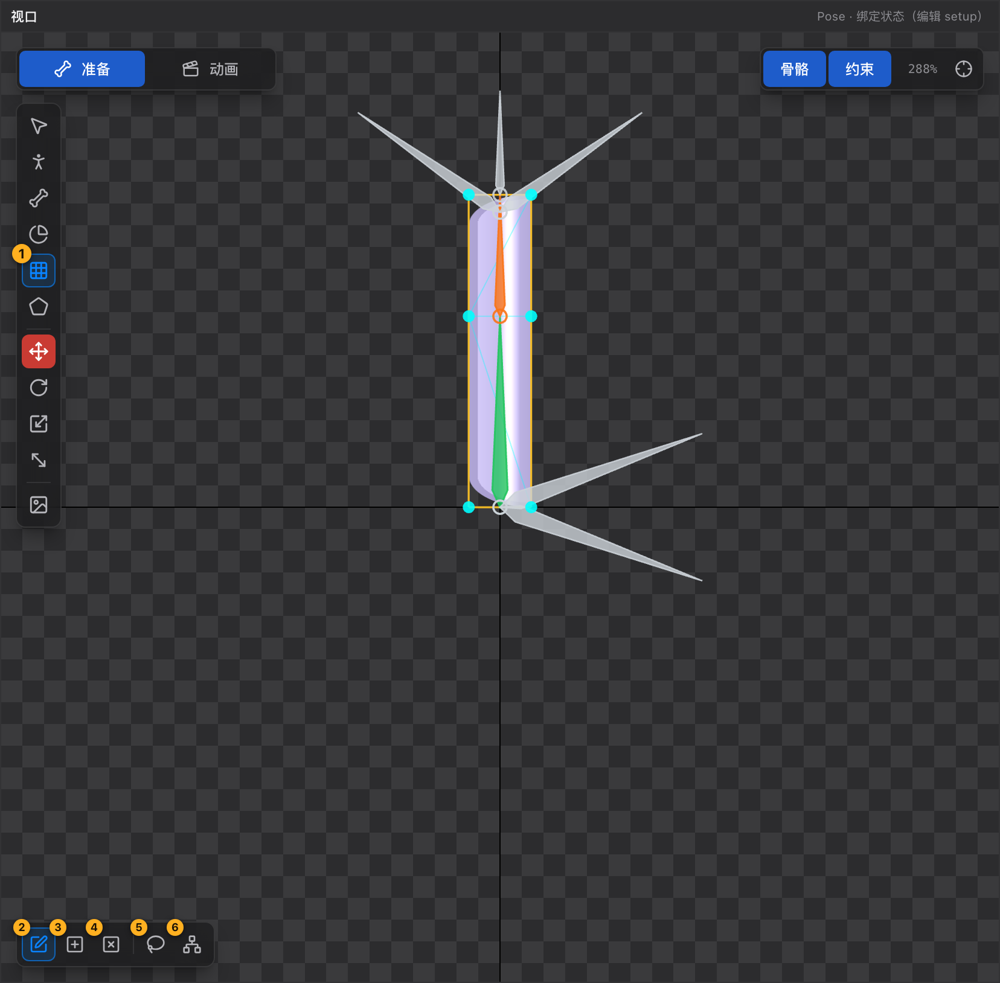
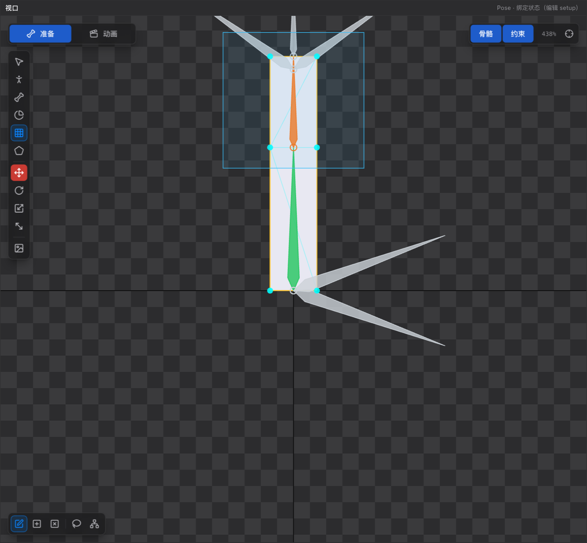

# 24 网格工具 M

[← 返回目录](index.md) ｜ 上一篇：[23 权重刷工具 G](23-tool-weight.md) ｜ 下一篇：[25 FFD 顶点工具 D](25-tool-ffd.md)

> 一句话：网格工具把一张贴图切成三角形并给顶点绑权重 —— 弯折、挤压、飘动都靠它。

| | |
| :--- | :--- |
| 快捷键 | `M`（Pose 态；同一按钮在 Animate 态叫 [FFD 顶点工具](25-tool-ffd.md)，按 `D`） |
| 可用状态 | Pose 态（Animate 态按钮改名并只写变形帧） |
| 提示原文 | 「编辑网格顶点 / 三角面；网格内 Alt+点击插入顶点」 |

> 选中网格附件后，视口会**只高亮正在编辑的那个网格**，其它部件以描边显示 —— 这是刻意的隔离显示，方便看清顶点。

---

## 一、先有网格

Region（普通贴图）本身没有顶点，需要先转成网格。入口在**属性面板最下方**的「网格 / FFD」一栏：

| 控件 | 说明 |
| :--- | :--- |
| **密度** | 1–24，默认 4，即 N×N 细分；越大越贴合形状，也越吃性能 |
| **转为网格（N×N）** | 把 Region 转成规则栅格网格（形状方正的部件用这个） |
| **自动生成网格** | 沿**不透明像素轮廓**生成贴合网格，透明区不占三角形（复杂外形的部件用这个） |

两个按钮都只在 Pose 态可用；「转为网格」只对 Region 有效，「自动生成网格」要求附件有图片或是从图片转来的网格。

> 手动改乱了网格，随时可以再点一次「自动生成网格」重设（会丢掉手改的顶点）。

---

## 二、左下角子工具条

只有「网格工具 + Pose 态」时出现。**只有「编辑顶点」是常态**，其余都是临时模式：点「自己绘制边界 / 自定义布线」的右键收尾后会回到「编辑顶点」，或再点一次同一个图标也能回去。

| 子工具 | 图标 | 作用 |
| :--- | :--- | :--- |
| **编辑顶点** | 笔 | 拖动顶点改网格几何；内部顶点会反算 UV，让贴图**原地不动**；在空白处左键拖框 = **框选顶点** |
| **添加顶点** | + | 点网格的边或三角形内部插入一个顶点（UV / 权重按位置插值，落在边上会把边一分为二） |
| **删除顶点** | × | 点一个顶点把它删掉，引用它的三角形就地重新三角化补上（至少保留 3 个顶点） |
| **自己绘制边界** | 套索 | 沿着轮廓依次点击，画完点回起点或右键闭合，整块重画网格 |
| **自定义布线** | 网络 | 从一个顶点拖到另一个顶点，在两点之间连一条线并沿它重新三角化 |

光标上带小徽标（`+` / `×` / `✎` / `⌁`），一眼看出当前模式。

**右键在网格工具里的含义**：

| 场景 | 右键效果 |
| :--- | :--- |
| 「编辑顶点」下 | **取消选择**（顶点选中、以及选中的附件一起清掉），提示「已取消选择（左键在空白处拖动可框选顶点）」 |
| 「自己绘制边界」绘制中 | 闭合多边形、结束重绘 |
| 「自定义布线」 | 取消当前连线 |

> 左键在空白处拖动**不再**等于「取消选择」，而是框选顶点 —— 取消选择挪到右键了。其他工具（选择 / Pose 工具）的右键仍是插槽层级菜单。

---

## 二·五、框选顶点（多选）

网格工具（以及 Animate 态的 FFD 工具）支持**矩形框选**：

| 操作 | 结果 |
| :--- | :--- |
| 在视口里**左键拖动**（空白处或网格内部都行） | 拉出矩形选框，松手选中框内的顶点 |
| 拖动距离 < 3 屏幕像素（等于单击） | **不改选择** —— 所以点一下不会再丢掉已选顶点 |
| 按住 **Shift** 拖框 | 把框内顶点**加进**现有选择（不替换） |
| **右键** | 取消选择 |

要点：

- **只框当前附件的顶点**：选中了某个网格附件时，框选只收这个附件的点（网格工具本来就把其它部件隔离显示）。
- 框内的顶点会**被选中高亮**，状态栏提示「框选到 N 个顶点（共选中 M 个；拖动任意一个整组移动）」；框里没点时提示「框选：矩形里没有顶点（右键可取消当前选择）」。
- **选中多个后拖动任意一个，整组一起平移**（网格工具改绑定几何，FFD 工具写变形帧）。
- 删除要注意：`Delete` / `Backspace` **只删一个顶点**（选择列表里的第一个），不会整组删。要批量删请逐个点选删除。

> 骨骼仍然**不支持框选**，多选骨骼请用 `Shift` / `⌘` / `Ctrl` 点选（见 [20 选择工具](20-tool-select.md)）。

---

## 三、Alt + 点击插入顶点

任何网格 / FFD 工具下，按住 `Alt` 在网格内部点击即可插入顶点（**按住期间不动**才插点；一旦拖动就变成平移视口）。

- 网格 / 顶点工具下**双击**网格内部也可以插点；
- 权重刷与遮罩工具下 `Alt` 另有含义（减少权重 / 删除遮罩点），不会插点。

---

## 四、自己绘制边界（要注意）

这是唯一**进去之前会弹确认框**的子工具，因为它是「整块重画」：

- 会丢弃：原有网格点、绑定权重、对应的 FFD 关键帧；
- 确认框会列出具体会丢多少（「本次将丢弃：N 个网格点、N 根骨骼的绑定权重、N 个 FFD 关键帧」）；
- 提示「这一步可以用 Ctrl+Z 整步撤销」；
- 选中的对象没东西可丢时不会弹框。

绘制期间视口会切换成「只显示图片 region 框 + 正在画的轮廓」，网格与顶点临时隐藏（落点也会被夹进 region 框）。点回起点（第一个大圆点）或右键闭合；点错了按 `Ctrl+Z` **只撤上一个点**，不动文档。

---

## 五、验证网格

看状态栏：

- **顶点 / 三角面**：数字合理即可（一个方块转成 4×4 网格是 25 顶点 / 32 三角面左右）；
- 按 `E` 旋转相关骨骼，看网格是否平滑弯曲、有没有撕裂；
- 有撕裂 → 去 [23 权重刷](23-tool-weight.md) 调权重。

---

## 六、常见误用

| 现象 | 原因 |
| :--- | :--- |
| 拖顶点后贴图跑了 | 你用的是 [Pose 工具](21-tool-pose.md)（不反算 UV）；改用网格工具 |
| 提示「网格至少得保留 3 个顶点」 | 删太多了 |
| 提示「该位置不在网格内部」 | 加点只能落在网格覆盖的区域内 |
| 「自定义布线」连不上 | 两点之间已经有连线，或这条线没有横穿网格内部 |
| Animate 态点这些子工具没反应 | 拓扑操作只能在 Pose 态；Animate 态拖顶点写的是 FFD 帧 |
