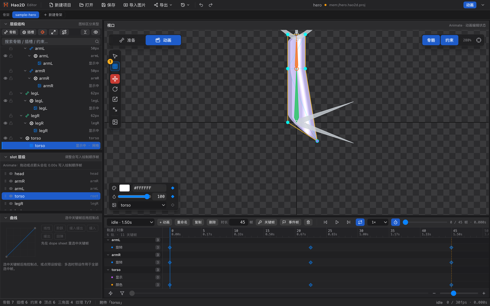

# 25 FFD 顶点工具 D

[← 返回目录](index.md) ｜ 上一篇：[24 网格工具 M](24-tool-mesh.md) ｜ 下一篇：[26 遮罩工具 N](26-tool-mask.md)

> 一句话：同一个按钮，在 Pose 态叫「网格工具」，在 **Animate 态叫 FFD 顶点工具** —— 拖顶点写的是**变形关键帧**。

| | |
| :--- | :--- |
| 快捷键 | `D`（Animate 态；Pose 态同一按钮是 `M` 网格工具） |
| 可用状态 | Pose 与 Animate 都可用（语义不同） |
| 提示原文 | 「拖顶点写当前时间点的 FFD 帧；网格内 Alt+点击插入顶点」 |

---

## 一、同一个按钮，两种身份

| 状态 | 名字 | 拖顶点改什么 | 撤销标签 |
| :--- | :--- | :--- | :--- |
| Pose | 网格工具 M | 绑定网格的几何（+ 内部顶点反算 UV） | 编辑网格顶点 |
| **Animate** | **FFD 顶点工具 D** | 当前时间点的**变形偏移**，几何与 UV 都不动 | 编辑 FFD |

也就是说：**FFD = 不改网格本身，只记录「这一帧这个顶点被拉走了多少」**。

---

## 二、怎么用

1. `Tab` 进 Animate，时间轴上确认已选中一个动画；
2. 在层级树里选中要变形的**网格附件**（或它所在的插槽）；
3. 按 `D`；
4. 把播放头移到目标时间，拖动顶点 —— 编辑器会在当前时刻写入一个 deform 关键帧；
5. 换个时间再拖一次，就形成一段变形动画。

> 同一个时间点已有 FFD 帧时，拖动是**在原有偏移上累加**，不会从零开始。

---

## 三、能做什么 / 不能做什么

| 能做 | 不能做 |
| :--- | :--- |
| 拖顶点写 FFD 帧 | 添加 / 删除顶点（拓扑操作只能在 Pose） |
| **左键拖框 = 框选顶点，选中多个后拖动整组变形** | 画边界、自定义布线 |
| 在网格内 `Alt`+点击插入顶点（等同双击） | 改权重（权重属于绑定数据） |
| 拖遮罩控制点写变形帧 | 改网格拓扑 |

Animate 态下看不到网格子工具条，就是因为这些拓扑操作不合法。

### 框选与右键

- 左键在空白处 / 网格内部拖动会拉出矩形选框（**Shift 拖框 = 加进选择**），松手选中框内顶点；拖动距离不到 3px 就当成单击，不会清掉已有选择。
- 选中多个顶点后拖任意一个，**整组一起写进同一个 FFD 帧**。
- **右键 = 取消选择**（提示「已取消选择（左键在空白处拖动可框选顶点）」）。

---

## 四、遮罩点也用这个工具

遮罩的控制点属于绑定数据，但它的**动画**以 FFD 形式表达：

- Pose 态用 [遮罩工具 N](26-tool-mask.md) 画与改；
- Animate 态用 `D` 拖控制点，写 FFD 关键帧。

---

## 五、隔离显示

顶点工具下编辑器**只渲染正在编辑的那一个网格**，其它部件以描边显示。这是为了看清顶点，不是显示错误。

---

## 六、典型用法

| 效果 | 做法 |
| :--- | :--- |
| 头发飘动 | 给头发建网格，在几个时间点把末端顶点往不同方向拖 |
| 布料抖动 | 同上，配合「缓入缓出」曲线 |
| 呼吸起伏 | 胸部网格顶点的轻微上下偏移，循环播放 |
| 挤压 / 拉伸（卡通） | 整体把两侧顶点向外 / 向内拖 |

---

## 七、常见误用

| 现象 | 原因 |
| :--- | :--- |
| 拖完角色一直在抖 | 同一时间点反复拖会累加偏移，`⌘Z` 撤销后可重来 |
| 找不到 FFD 轨道 | 时间轴里 FFD 行只在该附件有变形帧后才出现 |
| 想加顶点却提示切到 Pose | 拓扑操作属于绑定数据，回 Pose 做 |
