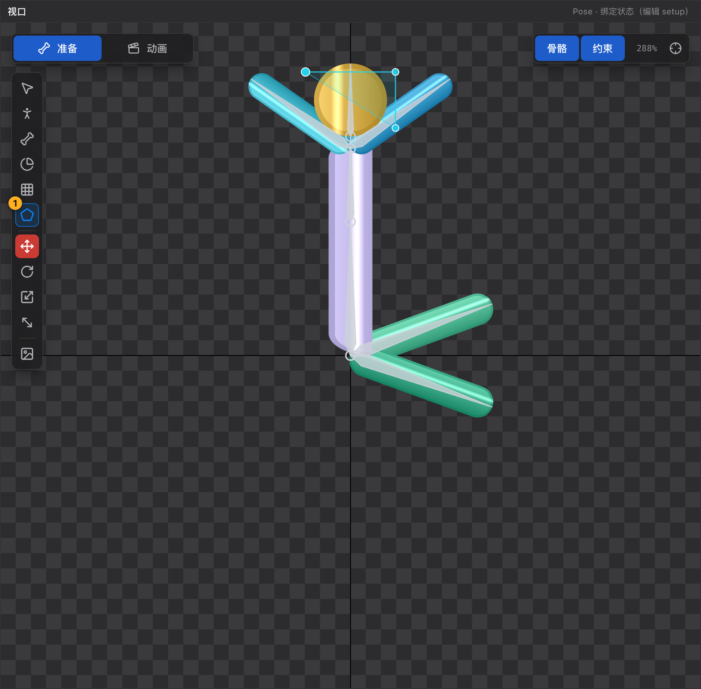

# 26 遮罩工具 N

[← 返回目录](index.md) ｜ 上一篇：[25 FFD 顶点工具 D](25-tool-ffd.md) ｜ 下一篇：[27 变换工具 W/E/R/T](27-tool-transform.md)

> 一句话：遮罩就是「用多边形裁掉一部分绘制内容」，用来做眨眼、露出口腔、衣服下的身体、局部隐藏。

| | |
| :--- | :--- |
| 快捷键 | `N` |
| 可用状态 | **仅 Pose**（Animate 态用 `D` 拖控制点写变形帧） |
| 提示原文 | 「多边形遮罩：空白插槽单击加点、点回起点 / 右键闭合；已有遮罩时点边线插点、拖点移动、Delete 删除」 |

---

## 一、画一个新遮罩

1. 先在层级树里**选中一个插槽**（遮罩要挂在某个插槽上）；
2. 按 `N`；
3. 在视口里**逐点单击**，围出多边形；
4. 收尾三种方式任选：
   - 点回**起点**（8px 内）；
   - **右键**；
   - 按 `Enter`。
5. 至少要 3 个点才能闭合。

绘制过程中的快捷键：

| 按键 | 作用 |
| :--- | :--- |
| `Ctrl` / `⌘` + `Z` | **只撤上一个遮罩点**（不动文档历史） |
| `Esc` | 取消整个绘制（「已取消遮罩绘制」） |

> 已经在给另一个插槽画遮罩时，会提示先闭合或按 `Esc` 取消，不会同时画两个。

---

## 二、编辑已有遮罩

选中一个遮罩附件后再用 `N`：

| 操作 | 结果 |
| :--- | :--- |
| 拖控制点（8px 内） | 选中并移动该点 |
| 点在**边线**上（6px 内） | 在边上插入一个控制点并立刻跟着拖 |
| **Alt + 点击**控制点 | 删除该点（至少保留 3 个） |
| 选中控制点后按 `Delete` / `Backspace` | 同样删除 |
| 点空白 | 取消选中（不会重画） |

---

## 三、裁剪范围：结束插槽

遮罩不会裁掉所有东西，它只裁**绘制顺序中它之后、`结束插槽`之前**的附件。设置位置在属性面板的「遮罩」一栏：

| 字段 | 说明 |
| :--- | :--- |
| 控制点数 | 「控制点 N 个 · 遮罩只影响绘制顺序中它之后、结束插槽之前的附件」 |
| **结束插槽** | 下拉只列出绘制顺序比遮罩大的插槽；默认「末尾」表示裁到最后 |
| **反向遮罩** | 只保留多边形**外部**；Spine 要求此时按凸形处理，编辑器会自动打开凸形 |
| **凸多边形** | 形状是凸的时勾上可以少算一些；凹多边形保持关闭也能正确裁剪 |
| **编辑遮罩点** | 一键切到遮罩工具并给出操作提示（点边线插点、拖点移动、`Delete` 删除、点空白取消选中） |

---

## 三·五、把已有附件转成遮罩

不想手画时，可以用属性面板「显示」区的 **「转为遮罩」**：

| 原附件 | 转换结果 |
| :--- | :--- |
| Region | 取内容矩形的四角，生成矩形遮罩 |
| 非加权的 Mesh | 取顶点**凸包**作为多边形 |
| 加权网格 | **不支持** —— 提示「转换失败：加权网格暂不支持，请先解除权重或手工绘制遮罩」 |

- 只能 Pose 态执行，转换后附件名保留、自动切到遮罩工具；
- 也可以从层级树右键菜单 / 时间轴之外的入口找，但结果相同；
- 反过来不行：遮罩**不能**转成网格 —— 选中遮罩时属性面板的「网格 / FFD」整组是隐藏的，因为遮罩点只是多边形控制点，不是可蒙皮的渲染网格。

常见做法：把遮罩放在「头部」插槽上，结束插槽设为「眼睛」之后，这样只有眼睛被裁剪。

---

## 四、动画里的遮罩

遮罩控制点属于绑定数据，不能在 Animate 态新增/删除，但**可以动**：

- `Tab` 进 Animate；
- 用 [FFD 顶点工具 D](25-tool-ffd.md) 拖控制点；
- 写入的是 FFD 关键帧（时间轴里的 FFD 行，槽位是「插槽名 / 遮罩名」）。

改控制点数量会自动清掉该遮罩的旧 FFD 轨道（避免偏移错位），所以**先定形状再 K 动画**。

> Animate 态下遮罩工具会被替换成 FFD 工具（按钮上写的是「FFD 顶点工具」），这是唯一能在动画里改遮罩的方式。

---

## 五、常见提示

| 提示 | 含义 |
| :--- | :--- |
| 先在层级树里选中一个插槽，再画遮罩 | 遮罩必须挂在插槽上 |
| 遮罩至少需要 3 个点 | 点太少无法闭合 |
| 没有新增遮罩点，原多边形未修改 | 编辑时没点到点/边线 |
| 遮罩至少保留 3 个控制点 | 删点删到极限了 |
| 遮罩点换算失败（插槽没有绑定骨骼，或骨骼缩放为 0） | 宿主骨骼异常，先检查骨骼 |

---

## 六、典型用途

| 用途 | 做法 |
| :--- | :--- |
| 眨眼 | 头部插槽上建一个多边形遮罩只保留眼睛，再用显示帧切换睁眼/闭眼贴图 |
| 嘴型 | 遮罩裁出嘴部区域，配合换图 |
| 衣服下的身体 | 遮罩裁掉衣服覆盖的区域，减少穿模 |
| 局部隐去 | 反向遮罩 + 动画移动控制点，做「渐渐出现」 |
| 武器拖影 / 裁剪特效 | 快速「转为遮罩」做个矩形，再在动画里改形状 |

---

## 七、导出与脚本

| 场景 | 表现 |
| :--- | :--- |
| 运行时导出 | 遮罩作为 clipping attachment 写进 ske，运行时按「遮罩之后的插槽」生效 |
| Spine 导出 | 写成 Spine 的 `clipping` 附件；**反向遮罩会同时写 `inverse` 并要求多边形是凸的** |
| Unity（`.hao2d`） | 支持裁剪，但依赖运行时实现；导出弹窗里的差异提示会列出不吃裁剪的情况 |
| 结束插槽 | 导出时按插槽索引写 `end`；找不到对应插槽时该遮罩不生效 |

AI 命令：`createMask`、`setMaskPoints`、`insertMaskPoint`、`setMaskOptions`、`listMasks`（详见 [42 AI 接入](42-ai.md)）。
