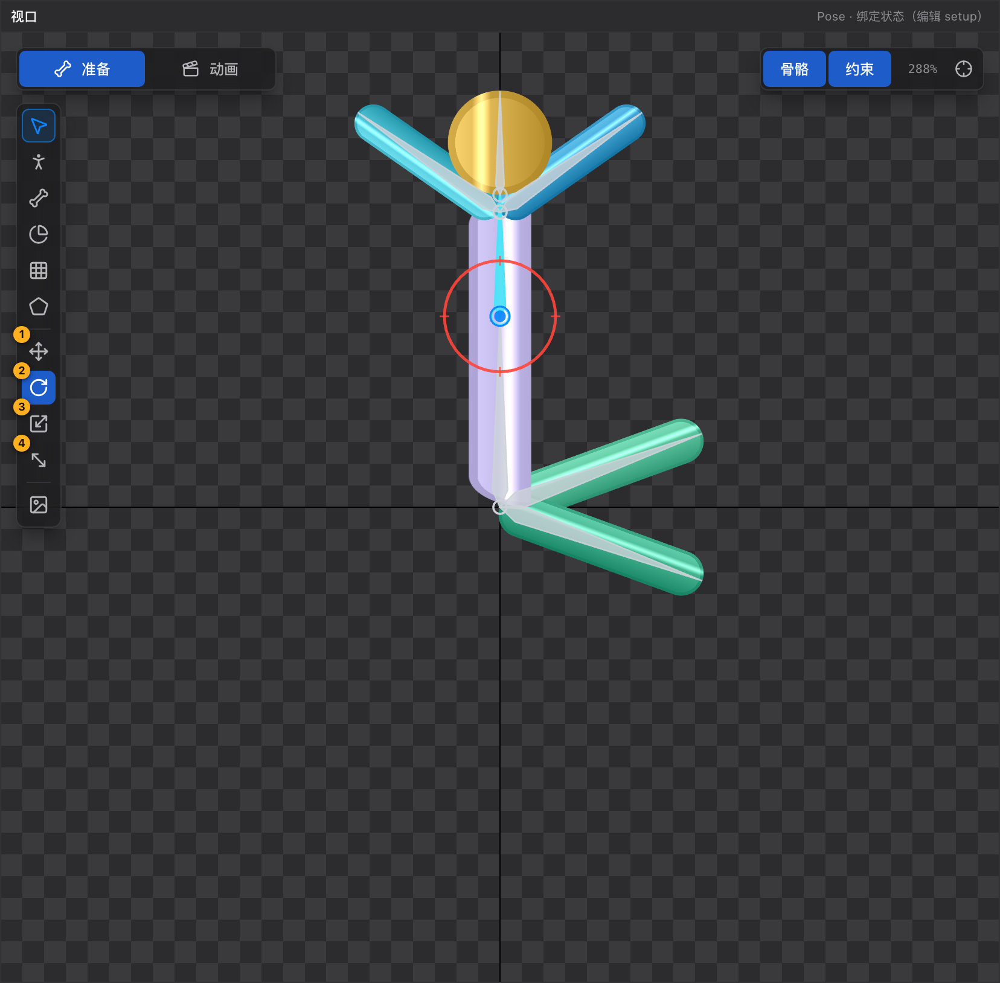

# 27 变换工具 W / E / R / T

[← 返回目录](index.md) ｜ 上一篇：[26 遮罩工具 N](26-tool-mask.md) ｜ 下一篇：[28 舞台参考图](28-tool-stage.md)

> 一句话：这一组不改变「鼠标在视口里干什么」，只决定**选中骨骼怎么动** —— 移动、旋转、缩放、斜切。

| 键 | 工具 | 提示原文 |
| :---: | :--- | :--- |
| `W` | 移动 | 「拖 X/Y 轴只走单轴，拖中间方块自由移动」 |
| `E` | 旋转 | 「拖圆环或骨骼本体都行」 |
| `R` | 缩放 | 「X 轴改长度、Y 轴改粗细，拖中间方块等比缩放」 |
| `T` | 斜切 | 「选中骨骼会被包围盒框住，拖动包围盒的边即可斜切」 |

> 工具条上的激活色与轴色对齐：**移动红、旋转蓝、缩放绿、斜切紫**。

---

## 一、轴颜色

| 元素 | 颜色 |
| :--- | :--- |
| X 轴 | 红 |
| Y 轴 | 绿 |
| 中心方块 | 蓝 |
| 旋转圆环 | 红 |
| 斜切包围盒 | 紫 |
| 附件操作器中心 | 橙（与骨骼的蓝色区分） |

---

## 二、四种行为细节

| 工具 | 拖动方式 | 细节 |
| :--- | :--- | :--- |
| **移动 W** | 拖 X / Y 轴（单轴），拖中心方块（自由） | 位移存在**父骨骼局部空间**，相对按下点计算，骨骼不会先跳到指针下；多选时同一增量加到每根骨骼 |
| **旋转 E** | 拖圆环或骨骼本体 | 按「指针绕骨骼原点转过的角度」逐帧累计，修正 ±180° 回绕，抓在环上任意位置都不会跳 |
| **缩放 R** | 拖 X 轴（改长度）/ Y 轴（改粗细）/ 中心（等比） | 抓点与轴心距离之比；因子下限 0.02；可拖过轴心变负 = 镜像 |
| **斜切 T** | 拖包围盒的边 | 上下边横向拖改 `shearY`，左右边纵向拖改 `shearX`；结果夹在 ±85°（再大矩阵会退化） |

斜切模式**不画小坐标轴**，只画包围盒；且**不支持附件**（提示改用移动 / 旋转 / 缩放，或斜切它所在的骨骼）。

---

## 三、没有吸附

变换工具拖动**没有任何吸附**：没有角度吸附、没有网格吸附、没有位移吸附，按住 `Shift` 也不会约束轴向。

需要精确数值时，松开鼠标后到 [属性面板](09-inspector.md) 里直接输入数字。

> 工程里唯一的「吸附」是画骨骼时的端点吸附（20px），以及遮罩点 / 边线 / 边界起点这类像素级拾取容差。

---

## 四、Pose 态与 Animate 态

| 状态 | 拖动的结果 | 状态栏后缀 |
| :--- | :--- | :--- |
| Pose | 改 setup（绑定姿态） | （修改 setup） |
| Animate | 在播放头位置写关键帧 | （写入关键帧） |

> 但要注意：Animate 态只有**选择工具**能拖骨骼；切到 Animate 时如果当前工具是绑定类工具，会被自动收回选择工具。

另外，**Pose 工具**拖骨骼时蒙皮会跟着变形；选择工具拖骨骼只改骨架（见 [21 Pose 工具](21-tool-pose.md)）。

---

## 五、和工具的关系

- 在**选择工具 / Pose 工具 / 画骨骼工具**下按 `W`/`E`/`R`/`T`，工具本身不变，只是换一种变换方式；
- 在**绘制类工具**（权重刷、FFD、遮罩）下按 `W`/`E`/`R`/`T`，会**退出绘制工具**、切回带变换的鼠标，状态栏提示「已退出绘制工具，鼠标现在用于移动骨骼」。

---

## 六、常见误用

| 现象 | 原因 |
| :--- | :--- |
| 选中的是图片却只能移动 | 斜切不支持附件；其它三种可以拖附件，但拖完就是改附件位置 |
| 想让旋转按 15° 步进 | 没有吸附，请到属性面板输入精确角度 |
| 缩放把骨骼翻面了 | 拖过了轴心，因子变负即镜像，再拖回来即可 |
| 多选拖动后子骨骼动了两倍 | 父子同时选中时，子骨骼会继承父的增量再自己动一次，属预期 |
