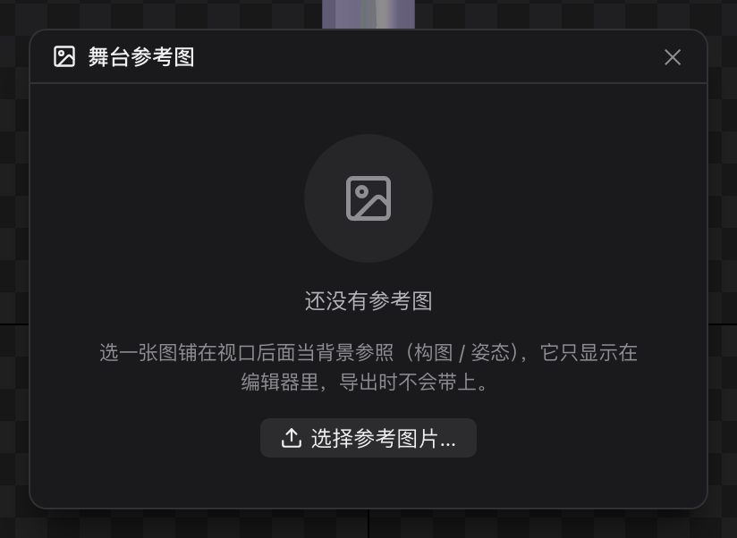

# 28 舞台参考图

[← 返回目录](index.md) ｜ 上一篇：[27 变换工具 W/E/R/T](27-tool-transform.md) ｜ 下一篇：[30 教程 1：新建工程与导入素材](30-tutorial-import.md)

> 一句话：往视口后面铺一张参考图（原画、构图稿、姿态参考），**只给你自己看，不会导出**。



| | |
| :--- | :--- |
| 入口 | 视口工具面板最下方的「舞台」图标 |
| 用途 | 构图 / 比例 / 姿态参照 |
| 是否导出 | **不导出**，也不参与运行时编译 |

---

## 一、设置步骤

1. **先保存工程**（参考图要写进工程目录的 `stage/`，没保存会提示「请先保存工程」）；
2. 点工具面板最下方的舞台按钮；
3. 「选择参考图片…」挑一张图；
4. 调整位置 / 大小 / 透明度。

---

## 二、参数

| 字段 | 单位与说明 |
| :--- | :--- |
| **位置 X / Y** | 世界坐标（y 向上），按 PPU 换算成像素显示；指的是图片**中心**的位置，默认 (0, 0) |
| **大小 宽 / 高** | 显示像素（世界单位 × 100）；新导入时按原图像素 ÷ 100 初始化 |
| **透明度** | 0–1，步长 0.05，默认 0.5 |
| **更换图片 / 删除图片** | 换图或移除 |
| 文件 | 显示文件名，并提示「仅编辑器显示 · 不导出 · 存于工程 stage/ 目录」 |

同名文件会自动加 `_2` / `_3` 后缀，不会互相覆盖。

---

## 三、它存在哪

```
我的角色/
├── 我的角色.hao2d.proj
├── images/          ← 参与导出的贴图
└── stage/           ← 舞台参考图（只在编辑器里显示）
    └── reference.png
```

工程文件里只记录 `editorMeta.stage.file` 这个文件名；**运行时编译器完全不读 `editorMeta`**，所以参考图不会出现在任何导出产物里。

---

## 四、常见用法

| 场景 | 用法 |
| :--- | :--- |
| 照着手绘稿搭骨骼 | 把原画铺在舞台上，透明度 50%，骨骼按图比例摆放 |
| 对齐多套动作 | 打开上一版截图当参考，检查姿势是否一致 |
| 构图检查 | 放入目标画面尺寸的框，检查角色在画面中的位置 |

> 参考图会一直显示在角色后面，**不影响选中与拾取**（它是纯背景）。

---

## 五、常见问题

| 现象 | 处理 |
| :--- | :--- |
| 点「选择参考图片」提示先保存工程 | 先 `⌘S` / `Ctrl+S` 保存工程 |
| 参考图挡住角色看不清 | 降低透明度 |
| 导出后找不到参考图 | 正常，参考图不导出 |
| 换了台电脑参考图没了 | `stage/` 目录没跟着工程一起拷走 |
