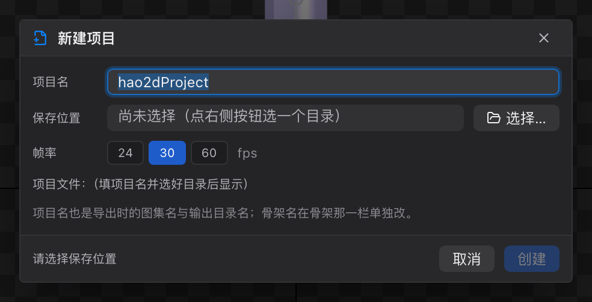
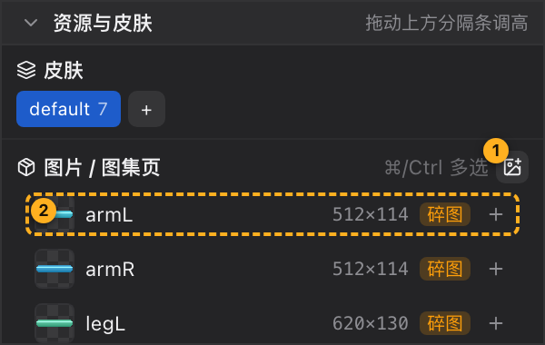
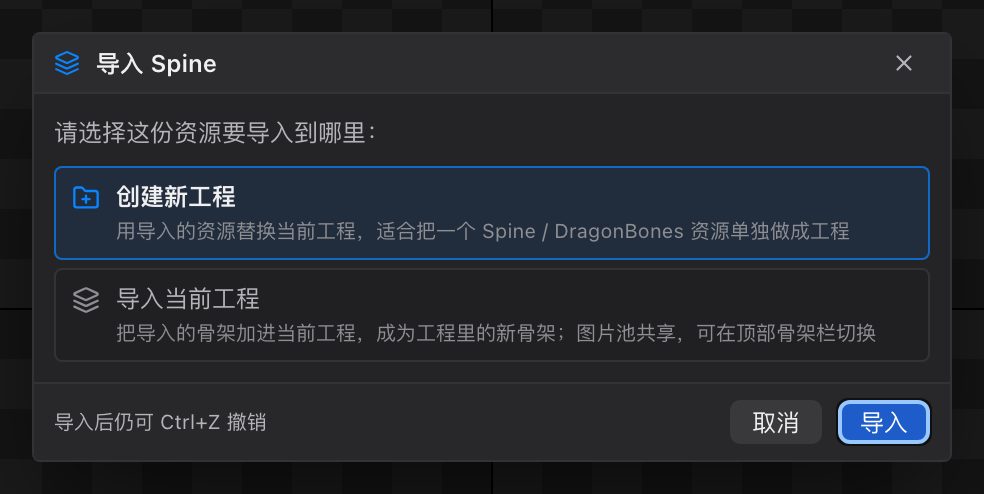

# 30 教程 1：新建工程与导入素材

[← 返回目录](index.md) ｜ 上一篇：[28 舞台参考图](28-tool-stage.md) ｜ 下一篇：[31 教程 2：搭骨架与绑定](31-tutorial-rig.md)

> 目标：建好一个工程，把角色拆好的部件图导进来，确认资源面板与状态栏都对得上。

---

## 步骤 1：新建工程

1. 按 `⌘N` / `Ctrl+N`（或点菜单栏「新建项目」）。
2. **项目名**填 `hero`（不能含空格与 `/ \ : * ? " < > |`）。
3. **保存位置**选一个空目录，例如 `~/Documents/Hao2D/`。
4. **帧率**保持 `30`。
5. 点「创建」。

创建完成后：

- 工程文件已经写到磁盘：`<目录>/hero.hao2d.proj`；
- 视图回到 Pose 态，层级树里只有一根 `root` 骨骼；
- 骨架条上出现一个标签 `hero`。

> 项目名会决定导出时的**图集名**与**输出目录名**，所以一开始就取个正经名字，比后面改名省事。

---

## 步骤 2：准备素材

推荐的拆图方式：

| 方式 | 适用 | 说明 |
| :--- | :--- | :--- |
| **碎图**（每部件一张 png） | 最通用 | 文件名即部件名，例如 `head.png`、`arm_l.png` |
| **PSD 分层** | 美术给的是分层稿 | 导入时可直接按图层位置铺到场景 |
| **Spine / DragonBones 工程** | 已有现成资源 | 导入时可选择「创建新工程」或「并入当前工程」 |

图片尺寸建议：单个部件不要超过 2048×2048；同一角色的部件放在**同一个文件夹**里，方便一次拖入。

---

## 步骤 3：导入图片

按 `⌘I` / `Ctrl+I`（或菜单栏「导入图片」）：

- 可以**多选**多张 png；
- 也可以直接选一个**文件夹**（会递归收集里面的图片）；
- 更简单：把文件 / 文件夹直接**拖进「资源与皮肤」面板**。

导入后检查：

| 检查项 | 正确表现 |
| :--- | :--- |
| 图片列表 | 每张图一行，显示缩略图、名字、`宽×高`、`碎图` 角标 |
| 状态栏「纹理」 | `7/7` 这样的数字，两边相等 |
| 状态栏提示 | 「已导入 N 张图片」 |

> 「纹理 x/y」不相等 → 说明有图读不出来（路径被移动、文件损坏），视口里会显示成白块。

---

## 步骤 4（可选）：导入 PSD

如果美术给的是 PSD：

1. 菜单「文件 → 导入 PSD」（或「导入图片」时选到 `.psd`）；
2. 弹窗里勾选要导入的图层（编组可整组勾选）；
3. 保持勾选「**按 PSD 位置直接添加到场景**」—— 这样每层会按 PSD 里的位置自动建插槽，直接得到「立起来」的角色；
4. 点「导入」。

注意：PSD 导入要求**工程已保存**（图层图片要写进工程目录的 `images/`）。

---

## 步骤 5（可选）：导入 Spine / DragonBones

- **Spine**：菜单「文件 → 导入 Spine」，选 `xxx.json`；同目录必须存在 `xxx.atlas` 与图集 png。
- **DragonBones**：菜单「文件 → 导入 DragonBones」，选骨骼 json；同目录要有 `texture_*.json` 与图集 png。

解析成功后编辑器会先问一句「导入到哪里」：

| 选项 | 结果 |
| :--- | :--- |
| **创建新工程**（默认） | 整份替换当前内容（骨骼、插槽、皮肤、动画全换），提示「已导入 Spine：N 骨骼 / N 插槽 / N 动画」 |
| **导入当前工程** | 追加成工程里的新骨架并切过去，提示「已把 Spine 骨架「x」并入当前工程：N 骨骼 / N 插槽 / N 动画」 |

本教程选 **创建新工程**；如果想把多个角色放进同一个工程，选「导入当前工程」，骨架条上就会多出一个标签。

---

## 验收标准

- [ ] 骨架条上只有一个骨架，名字是 `hero`
- [ ] 资源与皮肤面板列出所有部件图，尺寸正确
- [ ] 状态栏「纹理 x/y」两边相等
- [ ] 标题栏路径指向 `hero.hao2d.proj`

---

## 常见问题

| 现象 | 处理 |
| :--- | :--- |
| 提示「请先保存或创建工程」 | PSD 导入前必须先有工程文件 |
| 导入后角色没出现 | 图片只进了图片池，还没有建插槽 —— 下一步见 [31 教程 2](31-tutorial-rig.md) |
| 提示「同目录下没有找到 .atlas 图集文件」 | Spine 的 json 与 atlas 必须放在同一目录 |
| 导入后上一版内容没了 | 你选了「创建新工程」，它是整份替换；想保留请选「导入当前工程」或先另存 |
| 弹出「请选择这份资源要导入到哪里」 | 正常流程，按需要选「创建新工程」或「导入当前工程」；`Esc` 会取消导入 |

---

下一步：[31 教程 2：搭骨架与绑定](31-tutorial-rig.md)
