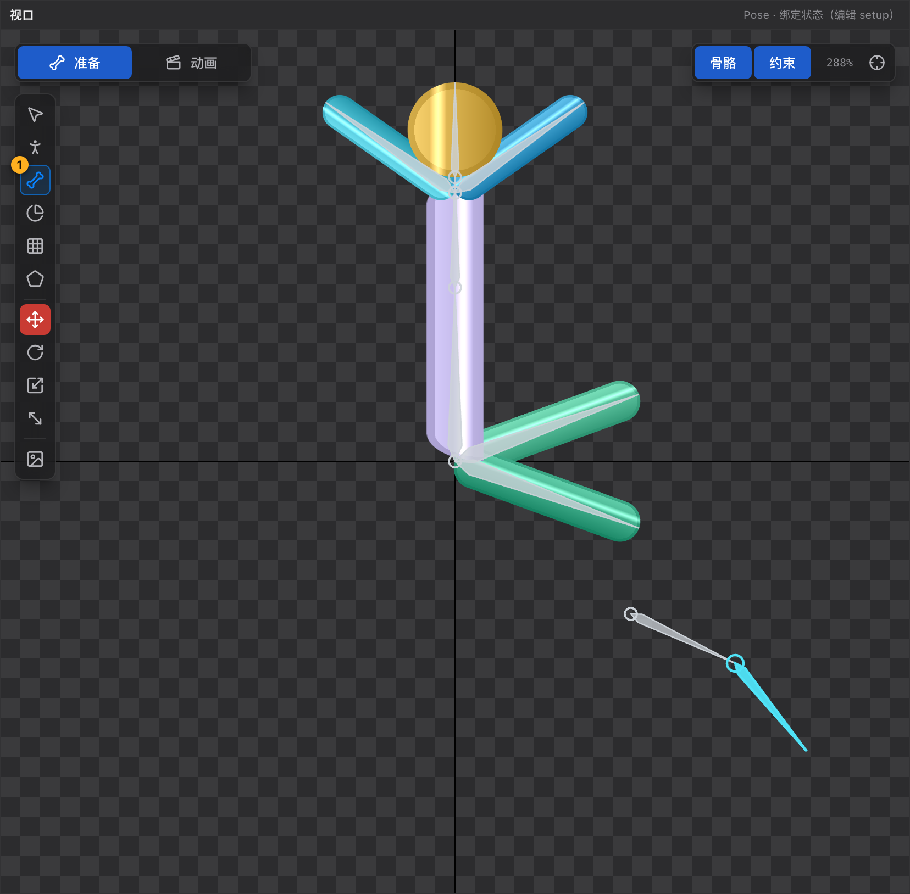
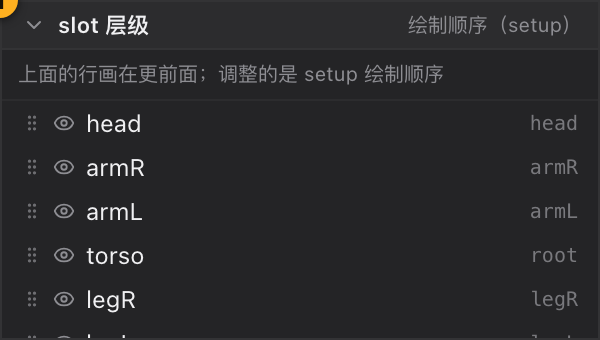

# 31 教程 2：搭骨架与绑定

[← 返回目录](index.md) ｜ 上一篇：[30 教程 1：新建工程与导入素材](30-tutorial-import.md) ｜ 下一篇：[32 教程 3：建网格与刷权重](32-tutorial-skin.md)

> 目标：画出骨骼树，把每个部件挂到对应骨骼上，并调好谁盖住谁。



---

## 步骤 1：画主干骨骼

1. 按 `B` 切到画骨骼工具。
2. 从角色**髋部**向上拖出第一根（建议叫它 `root` 之下的一根脊柱骨，例如 `spine`）。
3. 松开后新骨骼自动选中，**从它的末端继续起笔**画下一根（`chest` → `neck` → `head`）。

起笔位置有吸附：

| 起笔位置 | 结果 |
| :--- | :--- |
| 骨骼端点 20px 内 | 精确吸附并以该骨骼为父 |
| 骨骼身上 | 投影到轴线，以该骨骼为父 |
| 空白处 | 挂到 `root` 下 |

> 画错了直接 `⌘Z` 撤销；方向反了删掉重画，或用属性面板改旋转。

---

## 步骤 2：画四肢

同样从最近的骨骼端点起笔：

- 手臂：`chest` 末端 → `upper_arm_l` → `forearm_l` → `hand_l`；
- 腿：髋部 → `thigh_l` → `shin_l` → `foot_l`；
- 左右各一套（`_l` / `_r`）。

画完检查层级树：骨骼应该是树形缩进，**没有意外挂到 `root` 下的孤儿骨**。

---

## 步骤 3：把图片挂上去

两种方式：

**方式 A：拖图到骨骼行**（推荐，结构最清晰）

1. 在「资源与皮肤」里选中一张图；
2. 拖到层级结构里**目标骨骼行**上；
3. 松开后在该骨骼下新建一个插槽，这张图成为它的 display。

**方式 B：拖图到视口**

- 在落点处直接建插槽，宿主是当前选中的骨骼；
- 位置就是落点，之后可以用选择工具微调。

**方式 C：行尾 `+` 按钮**

- 在资源面板图片行尾点 `+`，会在**当前选中骨骼**下建插槽。

> 顺序建议：先挂躯干、再挂四肢、最后挂头部与配件 —— 后面调绘制顺序时更好找。

---

## 步骤 4：调绘制顺序

打开「slot 层级」面板，按**从上到下 = 从后到前**排列：



典型顺序（从下到上）：

```
后腿 → 后手 → 身体 → 前腿 → 前手 → 头 → 头发 → 武器
```

- 直接拖动行；
- 或悬停行尾点 `↑` / `↓`；
- 或右键「移到顶层 / 上移一层 / 下移一层 / 移到底层」。

> 这一步属于**绑定数据**，必须在 Pose 态做。

---

## 步骤 5：命名与整理

- 在层级树里点骨骼 / 插槽 → 右侧属性面板改「名称」；
- 重命名会同步更新插槽宿主、约束、权重与动画轨道引用；
- 层级树搜索框可以快速定位（搜索期间自动全展开）。

---

## 步骤 6：摆一个干净的绑定姿态

1. 选中网格/贴图附件；
2. 按 `P` 切到 Pose 工具；
3. 拖动骨骼把角色摆成自然姿态（注意：**Pose 工具拖骨骼时网格会跟着变形**，选择工具则不会）。

摆好后按 `F` 适配视野，检查整体比例。

---

## 验收标准

- [ ] 层级树是一棵完整的树，每根骨骼的长度合理
- [ ] 每个部件都有插槽，且插槽宿主正确（转动骨骼时部件跟着走）
- [ ] slot 层级顺序正确，前手盖住身体、身体盖住后手
- [ ] 视口里没有部件「浮」在错误的位置

---

## 常见问题

| 现象 | 原因 |
| :--- | :--- |
| 转动一根骨骼，部件纹丝不动 | 插槽没挂在这根骨骼上，去层级树检查宿主 |
| 部件前后关系反了 | 调 slot 层级 |
| 拖图到视口提示「场景里还没有骨骼」 | 先画一根骨骼 |
| `P` 拖骨骼时角色被拉变形 | 这是 Pose 工具的正常行为；只想挪骨骼不改网格请用选择工具 |

---

下一步：[32 教程 3：建网格与刷权重](32-tutorial-skin.md)
