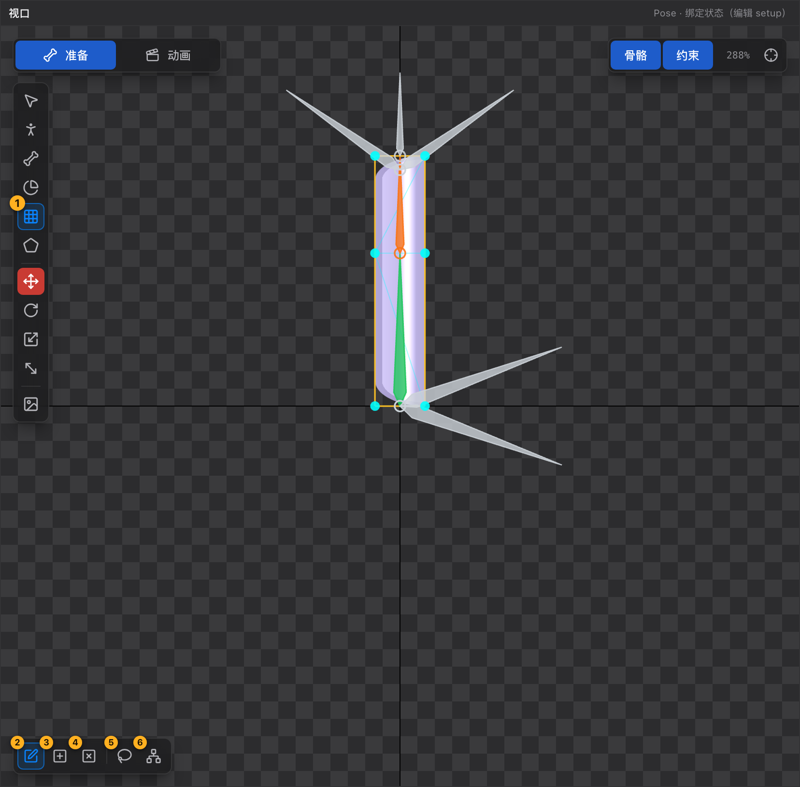
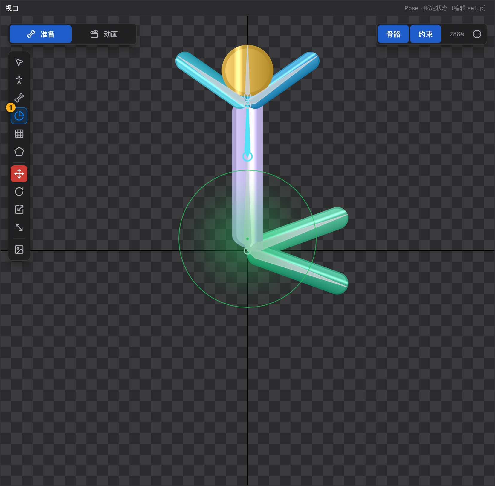

# 32 教程 3：建网格与刷权重

[← 返回目录](index.md) ｜ 上一篇：[31 教程 2：搭骨架与绑定](31-tutorial-rig.md) ｜ 下一篇：[33 教程 4：K 动画](33-tutorial-animate.md)

> 目标：把需要弯折的部件变成网格，给它绑上骨骼权重，并验证「转骨骼时过渡自然、不撕裂」。

---

## 为什么需要网格

Region（普通贴图）只能整体跟着一根骨骼刚性移动。要做**手臂弯折、裙摆飘动、身体挤压**，就要：

1. 把贴图切成三角形（网格）；
2. 给每个顶点分配骨骼权重；
3. 骨骼转动时，顶点按权重混合变形。

不需要弯折的部件（头、道具）保持 Region 就好，省性能。

---

## 步骤 1：把 Region 转成网格

1. 在层级树里选中要处理的**附件**（插槽下的 `显示中 · 网格` 之前那一行，或直接点插槽再在属性里选 display）；
2. 滚到右栏属性面板最下方「网格 / FFD」；
3. 选择建网格方式：

| 按钮 | 适用 |
| :--- | :--- |
| **转为网格（N×N）** | 形状接近矩形（手臂、腿、身体） |
| **自动生成网格** | 外形复杂（头发、裙摆、带镂空的道具） |

**密度**：默认 4（4×4 细分）。手臂这种细长部件用 4–6 就够；飘带类可用 8 以上。

> 两个按钮都只在 Pose 态可用。

---

## 步骤 2：给网格绑骨骼

在属性面板「权重骨骼列表」里：

1. 点「**添加绑定骨骼**」；
2. 在视口里**依次点选**相关的骨骼（例如手臂网格：`upper_arm_l`、`forearm_l`），可以连续点多根；
3. 右键、按 `Esc`、或再点一次按钮结束绑定；
4. 点「**自动计算权重**」。

自动权重按「顶点离哪根骨骼近，权重就高」分配，是个不错的起点。

---

## 步骤 3：用权重刷修正

1. 按 `G` 切到权重刷；
2. 目标骨骼：在层级树点一下（例如 `forearm_l`）；
3. 属性面板里把 `Hardness` 调低（10 左右），`Size` 调到能覆盖关节（40 左右）；
4. 在**肘部过渡带**来回刷，让权重从 0 平滑过渡到 1；
5. 按住 `Alt` 减掉不需要的影响，按住 `Ctrl` 平滑过渡带。

**看权重**：权重刷工具下顶点会画成饼图，扇形颜色与「权重骨骼列表」里的色块、视口骨骼颜色一致。

> 单击一个顶点（不拖）可以在属性面板看到它的权重明细，这个操作不产生撤销记录。

---

## 步骤 4：验证

1. 按 `E` 切到旋转工具；
2. 选中 `forearm_l`，转动看肘部；
3. 合格的过渡带应该**平滑弯曲、没有折叠或撕裂**；
4. 按 `⌘Z` 撤销这次旋转（验证不是修改）。

| 现象 | 原因 | 处理 |
| :--- | :--- | :--- |
| 关节处「折断」 | 权重突变 | 用 `Ctrl` 平滑，或用权重刷在过渡带多刷几次 |
| 网格边缘「飞出去」 | 顶点绑到了不相干的骨骼 | 用 `Alt` 减掉那根骨骼的权重 |
| 整块部件随另一根骨骼动 | 权重分配错误 | 检查「权重骨骼列表」里是否多加了骨骼 |

---

## 步骤 5：需要手动改形状时

按 `M`（网格工具）：

- 拖顶点改形状（内部顶点会自动反算 UV，贴图不跑）；
- `Alt`+点击在网格内部插入顶点；
- 左下角子工具条里可以「添加顶点 / 删除顶点 / 自己绘制边界 / 自定义布线」。

> 「自己绘制边界」会**丢掉这个网格的顶点、权重和 FFD 关键帧**，编辑器会先弹确认框。

---

## 验收标准

- [ ] 状态栏「顶点 / 三角面」数字合理（不是 0，也不爆炸）
- [ ] 旋转主要关节时过渡平滑，无明显撕裂
- [ ] 权重饼图上，关节附近是两种颜色混合，末端是单一颜色
- [ ] 撤销后回到原姿态

---

## 常见问题

| 现象 | 处理 |
| :--- | :--- |
| 点「转为网格」没反应 | 确认在 Pose 态、选中的是 Region 附件 |
| 权重刷提示「请先在层级树里选中要刷权重的骨骼」 | 先点一根骨骼确定目标 |
| 刷权重没效果 | 确认选中的是网格附件（不是 Region） |
| FFD 之后网格越改越乱 | 回 Pose 用「自动生成网格」重设 |

---

下一步：[33 教程 4：K 动画](33-tutorial-animate.md)
