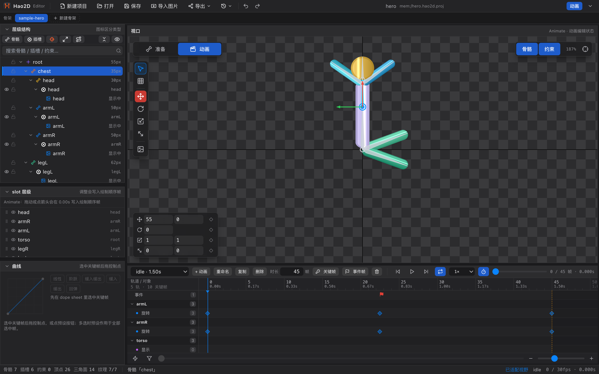
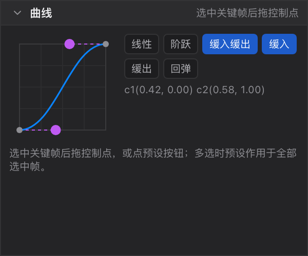
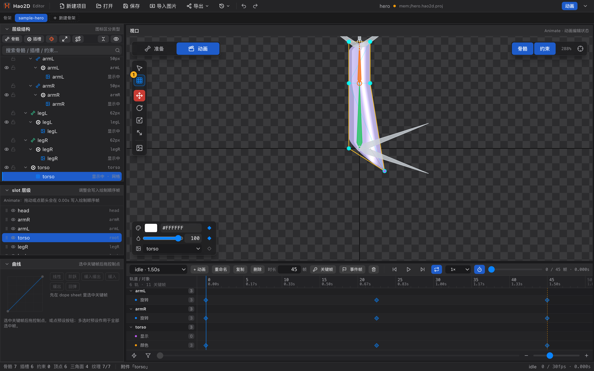

# 33 教程 4：K 动画

[← 返回目录](index.md) ｜ 上一篇：[32 教程 3：建网格与刷权重](32-tutorial-skin.md) ｜ 下一篇：[34 教程 5：导出与验收](34-tutorial-export.md)

> 目标：做一个 1.5 秒的挥手动作，包含旋转关键帧、缓动曲线和一个事件帧。

---

## 步骤 1：进入动画态并新建动画

1. 按 `Tab` 切到 **Animate**（视口左上角二段开关也会跟着变）。
2. 底部出现时间轴，左栏第三块变成「曲线」。
3. 在时间轴左上角点「**+ 动画**」，得到一个默认 1 秒的动画（可以之后重命名）。
4. 把「时长」改成 `45` 帧（30fps 下即 1.5 秒）。

---

## 步骤 2：打第一个关键帧

1. 把播放头拖到 `0s`；
2. 在层级树里选中要动的骨骼（例如 `upper_arm_l`）；
3. 按 `K`（或时间轴上的「关键帧」按钮）。

时间轴左侧出现这个骨骼的分组行，下面挂着「位置 / 旋转 / 缩放 / 斜切」四条通道，**打过的通道**才会有菱形。

> 只想打一条通道：在时间轴左侧点中那条子通道，再按 `K`。

---

## 步骤 3：在第二个时间点改变姿态

1. 把播放头拖到 `0.75s`（或直接拖动进度条）；
2. 用 `E` 旋转工具转动骨骼；
3. 编辑器会**自动写入关键帧**（状态栏提示「（写入关键帧）」），不需要再按 `K`。

> 如果只想在某个时刻记录当前姿态而不改它，仍可以按 `K`。

---

## 步骤 4：调缓动

1. 在时间轴上单击中间那个关键帧（菱形变亮、播放头跳过去）；
2. 左栏「曲线」面板变为可编辑；
3. 点「**缓入缓出**」预设。

想让动作更「活」，可以手动拖曲线上的两个紫色控制点，或在多选关键帧后统一套用预设。

---

## 步骤 5：让它循环

1. 在 `1.5s` 处再把姿态转回初始角度（或直接复制第一帧：选中 `0s` 的帧，`⌘C` → 播放头拖到 `1.5s` → `⌘V`）；
2. 打开时间轴上的「循环」按钮；
3. 按 `空格` 预览。

---

## 步骤 6：加一个事件帧

1. 播放头拖到 `0.75s`；
2. 点时间轴上的「**事件帧**」按钮；
3. 视口下方出现值条，填写：
   - 事件名：`wavePeak`
   - 字符串：`wave`
   - 整数：`1`
   - 浮点：`1`

事件帧在轨道上画成小红旗，运行时由你的游戏逻辑读取并派发。

---

## 步骤 7（可选）：FFD 变形

要让头发 / 裙摆跟着动：

1. 选中该网格附件；
2. 按 `D` 切到 FFD 顶点工具；
3. 在目标时间拖动顶点 —— 写下的是**变形关键帧**，网格几何本身不变。

---

## 步骤 8（可选）：换装 / 显示帧

做「拔剑 / 换表情」这类切换：

1. 选中目标插槽；
2. 在层级树右键该插槽 → 「显示关键帧」（或在时间轴点「显示」通道后按 `K`）；
3. 到另一个时间点，在**属性面板**（需回 Pose）或时间轴显示行改显示哪个附件。

> 显示帧记得用「阶跃」缓动，否则会出现两张图混合过渡。

---

## 步骤 9（可选）：让武器 / 挂件自己动

如果武器、坐骑是**另一套骨架**，先切到 Pose 态把它的骨架条标签拖到角色手上的插槽（变成「子骨架」），再回到 Animate：

1. 选中挂子骨架的插槽；
2. 在时间轴该插槽分组下的「子骨架」子轨上打一帧，选好要播的动画与次数；
3. 之后再打一帧换动画，就能做「平时收着、挥砍时播放」。

详见 [14 子骨架](14-subarmature.md)。

---

## 验收标准

- [ ] 时间轴上能看到 0 / 0.75 / 1.5 三处关键帧
- [ ] 空格播放时动作平滑、循环点不突兀
- [ ] 事件轨上有一个小红旗，参数正确
- [ ] 状态栏右侧显示动画名与 `帧 / 30fps · 秒`

---

## 常见问题

| 现象 | 处理 |
| :--- | :--- |
| 按 `K` 提示「打关键帧只在 Animate 状态可用」 | 按 `Tab` 切到 Animate |
| 打帧没目标 | 先选中骨骼 / 插槽 / 网格附件 / 约束 |
| 动作没有过渡感 | 给关键帧套「缓入缓出」，参考 [11 曲线面板](11-curve.md) |
| 播放时动作卡顿 | 打开「吸附到帧」，并检查时长是否过短 |
| 关键帧拖不过末尾 | 拖过去会自动延长时长；也可以先手动改「时长」 |

---

下一步：[34 教程 5：导出与验收](34-tutorial-export.md)
