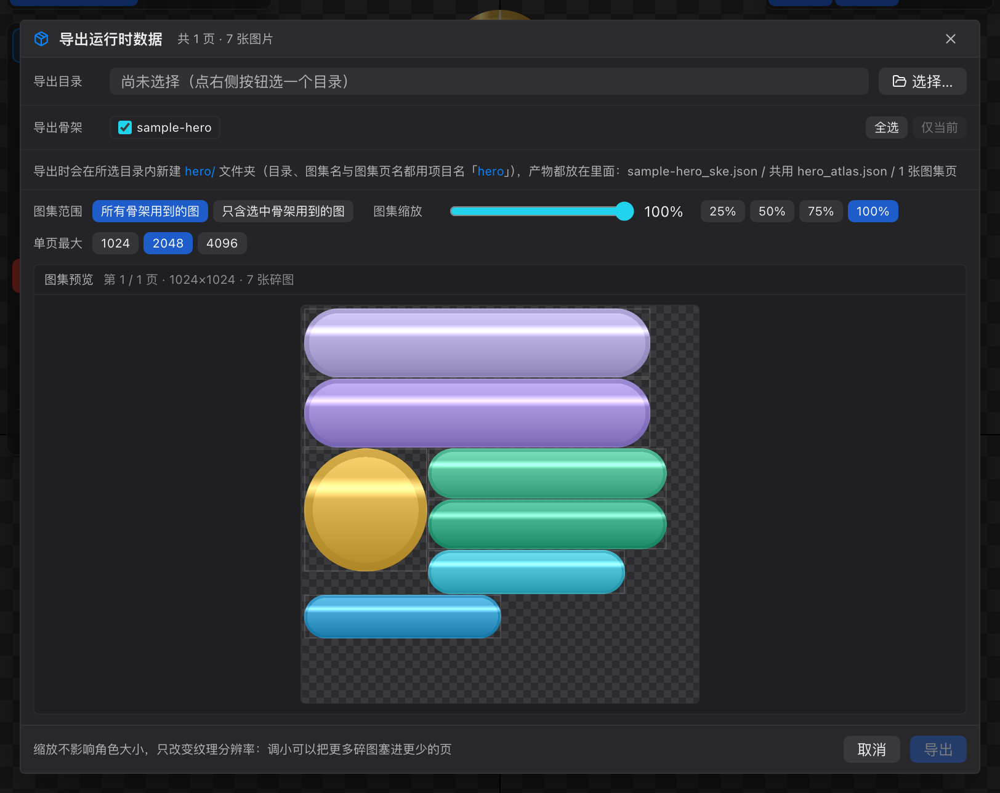
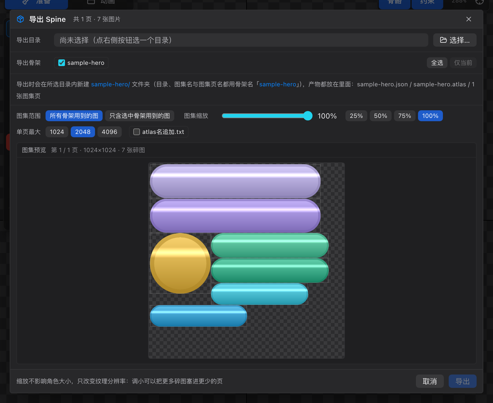

# 34 教程 5：导出与验收

[← 返回目录](index.md) ｜ 上一篇：[33 教程 4：K 动画](33-tutorial-animate.md) ｜ 下一篇：[40 导入详解](40-import-formats.md)

> 目标：把角色导出成可用的运行时数据，并确认产物齐全、贴图正确。



---

## 步骤 0：导出前自检

| 检查项 | 在哪看 |
| :--- | :--- |
| 没有缺图 | 状态栏「纹理 x/y」两边相等 |
| 没有编译警告 | 状态栏提示；警告会第一时间弹出 |
| 骨架 / 插槽 / 约束数量对得上 | 状态栏左侧 |
| 动画名字清晰 | 时间轴动画下拉 |
| 保存过工程 | 标题栏没有橙点 |

---

## 步骤 1：打开导出弹窗

按 `⌘E` / `Ctrl+E`（导出运行时），或菜单栏「导出 ⌄ → 导出运行时」。

---

## 步骤 2：选目录与骨架

1. 点「选择…」挑输出目录（编辑器会在里面**新建一个子文件夹**）；
2. 「导出骨架」默认全选；只导当前骨架可点「仅当前」；
3. 确认产物说明那一行写的目录名与文件名符合预期。

> 目录名与图集名用**项目名**；骨架文件用**骨架名**。所以项目名一开始就该取好。

---

## 步骤 3：图集参数

| 参数 | 怎么选 |
| :--- | :--- |
| **图集范围** | 单骨架工程用「所有骨架用到的图」即可 |
| **图集缩放** | 100% 先导一版；包体太大再降到 50% / 75% |
| **单页最大** | 默认 2048；移动端可用 1024；桌面端可 4096 |

图集预览区会显示每页的打包结果：

- 棋盘底 = 透明区域；
- 顶部显示「第 x / y 页 · W×H · N 张碎图」；
- 多页可以翻页。

> 缩放只改变纹理分辨率，不改变角色在游戏里的大小。

---

## 步骤 4：导出

点「导出」。完成后状态栏提示「已导出到 …」，并自动在文件管理器里定位到输出目录。

产物（运行时模式）：

```
<所选目录>/hero/
├── sample-hero_ske.json      ← 骨骼 + 动画
├── hero_atlas.json           ← 图集描述
└── hero_0.png                ← 图集页（多页时 _1、_2…）
```

---

## 步骤 5：验收产物

| 检查 | 方法 |
| :--- | :--- |
| 文件齐全 | 骨架 json + atlas json + 至少一张 png |
| 贴图正确 | 打开 png，部件应紧凑排布、没有互相覆盖 |
| 动画数量 | 骨架 json 里 `animations` 数量与时间轴一致 |
| 尺寸合理 | 单页 png 不超过所选「单页最大」 |

**想更直观地验收**：在导出弹窗里点「预览」，编辑器会起一个本地网页服务，用 Spine 官方运行时播放这个角色，还可以切骨架 / 皮肤 / 动画，手机扫码也能看。

---

## 其他两种导出

| 模式 | 何时用 | 关键差异 |
| :--- | :--- | :--- |
| **导出 Unity**（`⇧⌘E`） | 用 Unity 的 Hao2D 运行时 | 产物是 `.hao2d` + png + 材质 `.mat`，GUID 稳定，重复导出不会丢引用 |
| **导出 Spine**（`⌥⌘E`） | 想在 Spine 里继续编辑，或用 spine-unity | 只导**当前骨架**；文件名用骨架名；可勾「atlas名追加 .txt」 |



---

## 验收标准

- [ ] 输出目录里有骨架文件 + 图集描述 + 图集 png
- [ ] 图集预览里没有「未被打包」的警告
- [ ] 用预览功能播放时，动作与编辑器里一致
- [ ] 导出后工程没有意外变成「未保存」状态之外的改动

---

## 常见问题

| 现象 | 处理 |
| :--- | :--- |
| 提示「至少要勾选一个骨架」 | 勾上至少一个骨架 |
| 某些图「未被打包」 | 单页最大太小，调大或降低图集缩放的取舍 |
| 导出后游戏里贴图错位 | 检查图集是否被外部工具二次压缩 / 拆图 |
| Unity 里材质变 Missing | 不要把 `.mat` 与 png 分开放，材质按 `<纹理基名>_Hao2D.mat` 同目录查找 |
| Spine 里打开黑屏 | 检查 `.atlas.txt` 选项与你使用的导入器是否匹配 |

---

## 完成

到这里你已经走完一整条链路：**导入 → 绑定 → 蒙皮 → 动画 → 导出**。

接下来可以看：

- [40 导入详解](40-import-formats.md) / [41 导出详解](41-export-formats.md) 查参数细节
- [42 AI 接入](42-ai.md) 用脚本批量生成角色与动画
- [44 常见问题](44-faq.md) 排查异常
