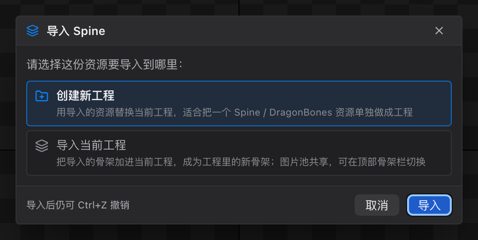

# 40 导入详解

[← 返回目录](index.md) ｜ 上一篇：[34 教程 5：导出与验收](34-tutorial-export.md) ｜ 下一篇：[41 导出详解](41-export-formats.md)

> 一句话：四种素材都能进 —— **碎图、PSD 分层、Spine、DragonBones**；其中 Spine / DragonBones 导入时会让你选「建新工程」还是「并进当前工程」。

---

## 一、入口总览

| 素材 | 入口 | 需要的文件 |
| :--- | :--- | :--- |
| 碎图 | 「导入图片」`⌘I` / 拖进资源面板 | png / jpg / jpeg / webp（拖拽还支持 gif / bmp） |
| 文件夹 | 拖进资源面板 | 递归收集里面的图片 |
| PSD | 菜单「文件 → 导入 PSD」，或导入图片时选 `.psd` | `.psd` |
| Spine | 菜单「文件 → 导入 Spine」 | `xxx.json` + 同目录 `xxx.atlas` + 图集 png |
| DragonBones | 菜单「文件 → 导入 DragonBones」 | 骨骼 `.json`（含 `armature`）+ 同目录 `texture_*.json` + 图集 png |

> 导入完成后会自动切回 **Pose** 态、清空时间轴选中的动画、并 `fit()` 视口。若工程从未命名，会用被导入文件的名字（去掉 `_ske` / `_tex`）作为项目名。

---

## 一·二、先选：建新工程，还是并进当前工程

导入 **Spine / DragonBones**（菜单或拖入都算）时，**解析成功之后**会弹出「导入 Spine / 导入 DragonBones」确认框：

| 选项 | 行为 | 适合 |
| :--- | :--- | :--- |
| **创建新工程** | 整份替换当前文档（骨骼、插槽、皮肤、动画全换），旧图片释放 | 手头是**一份独立的资源**，要单独做成工程 |
| **导入当前工程** | 追加成工程里的**新骨架**，自动切过去；图片池合并共享 | 想把多个角色 / 部件放进**同一个工程**，或在现有工程里加一套骨架 |

并入时编辑器会自动处理冲突：

- **骨架重名**：自动改成 `hero_2`、`hero_3`…，同批骨架内部的嵌套引用一起改指新名；
- **图片重名**（同名但文件不同）：自动改名 `atlas.png` → `atlas_2.png`，并改写新骨架的引用；
- **项目名与保存路径沿用当前工程**，工程标记为已修改；
- 全程一条撤销记录：`⌘Z` 可以整步回退（连新骨架带合并的图片）。

> 当前工程有未保存改动时，选「创建新工程」下面会出现红字警告 —— 那份改动会被替换掉。
> 取消（`Esc` / 取消按钮）等于放弃这次导入，状态栏提示「已取消导入」。
> **AI 命令** `importSpine` / `importDragonBones` 不弹这个框，一律按整份替换处理。

---

## 二、碎图

- 按路径去重；同名文件自动改名 `name_2` 并告警。
- 所有碎图标记为「碎图」（导出时要打包）。
- 提示「已导入 N 张图片」或「没有新增图片（可能已存在）」。
- 尺寸读不出来时给告警「图片「x」尺寸读取失败，可能不是有效的图片文件」，但不中断导入。

### 图集转碎图

如果拿到的是一张图集 + 描述文件：

- 资源面板里图集行右侧的**剪刀按钮** → 「拆成碎图」；
- 每块子图各写出一张 png（被旋转存放的会转正），引用它的附件自动改用碎图，图集从工程移除（磁盘原 png 保留，可撤销）。

---

## 三、PSD

**前置条件：工程必须已保存或创建**（图层 png 要写进 `<工程目录>/images/`）。

流程：

1. 打开弹窗，图层树全部列出、**默认全选**；
2. 编组行的勾选框 = 全选 / 全不选它的子层；
3. 文本层、调整层等**无像素层置灰不可选**；PSD 里隐藏的层带眼睛斜杠标记；
4. 「按 PSD 位置直接添加到场景」**默认勾选**：
   - 勾选：每个图层建一个插槽 + 区域附件，**全部挂到根骨骼**，位置 = 图层中心相对画布中心的偏移（y 取负，除以 100）；
   - 不勾：只把图层作为图片放进图片池。
5. 点「导入」。

成功提示：「PSD「x」导入完成：已导入 N 层图片，按 PSD 位置添加了 M 个插槽（画布中心对齐根骨骼）」。

> PSD 导入是按图层中心对齐根骨骼的，所以角色会在原点附近「立起来」；之后还需要按 [31 教程 2](31-tutorial-rig.md) 重挂到正确的骨骼上。

---

## 四、Spine

| 项目 | 说明 |
| :--- | :--- |
| 支持版本 | 3.x 到 4.3（4.2 起支持新版约束与贝塞尔坐标） |
| 必需文件 | 骨骼 `xxx.json`、同目录 `xxx.atlas`、图集 png |
| 导入内容 | 骨骼、插槽、皮肤、附件（region / mesh / clipping）、动画、约束 |
| 动画 | 优先交给 **官方 Spine 运行库烘焙**；失败时回退内置解析并告警（3.3 及更早格式常见） |
| 限制 | 混合模式 `mask` 不支持，按 Normal 导入并告警 |
| 成功提示 | 「已导入 Spine：N 骨骼 / N 插槽 / N 动画」 |

---

## 五、DragonBones

| 项目 | 说明 |
| :--- | :--- |
| 必需文件 | 骨骼 `.json`（含 `armature` 段）+ 同目录 `texture_*.json`（`SubTexture[]` 或 `imagePath`）+ 图集 png |
| 文件筛选 | 目录内所有 json 都会被读一遍按内容筛选，文件名与 armature 名相同的优先 |
| 图集页 | 页尺寸读 `imagePath` 指向的 png，提示会写「合并 N 张图集页」 |
| 限制 | 不支持内嵌 `armature` 类型的显示对象 |

---

## 六、导入失败对照表

| 提示 | 原因 |
| :--- | :--- |
| 不是 Spine 骨骼文件（检测到 xxx） | JSON 里没有 `skeleton` 段 |
| 同目录下没有找到 .atlas 图集文件 | 只给了 json，atlas 缺失或不在同目录 |
| 这是图集文件，请选择含 "armature" 段的骨骼 JSON | 选到了 DragonBones 的 texture json |
| 同目录下没有找到图集（texture_*.json） | DragonBones 缺图集描述 |
| DragonBones 数据里没有 armature 段 | 结构不对，可能选错了 json |
| 「x.psd」里没有带像素的图层 | 全是文本 / 调整层 |
| 解析 PSD 失败：… | 文件损坏或格式不支持 |
| 请先保存或创建工程 | 导入 PSD / 单图前必须先有工程文件 |
| 图片「x」尺寸读取失败 | 不是有效图片（仅告警） |
| 拖入的文件夹里没有可导入的图片 | 文件夹里没有支持的扩展名 |
| 请同时拖入同目录的 .atlas 图集文件 | 只拖了 Spine json |

---

## 七、导入之后

1. 检查状态栏「纹理 x/y」是否相等；
2. 检查层级树结构是否符合预期（Spine / DragonBones 直接就是完整骨架）；
3. 按 `F` 适配视野；
4. 如果还要继续绑定或调网格，参考 [31 教程 2](31-tutorial-rig.md)、[32 教程 3](32-tutorial-skin.md)。
