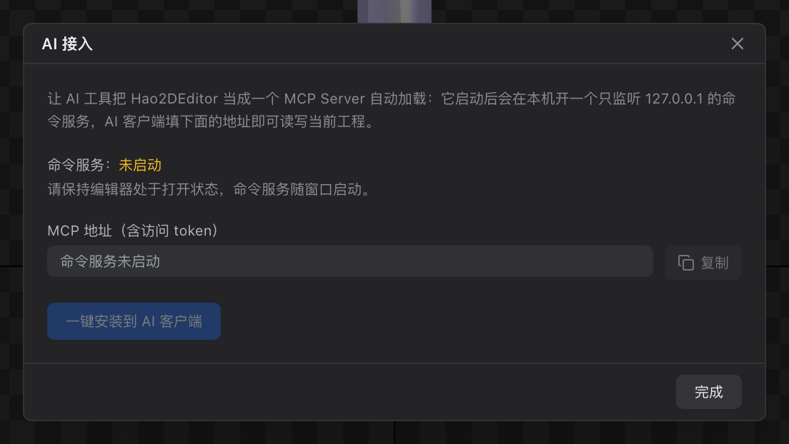

# 42 AI 接入

[← 返回目录](index.md) ｜ 上一篇：[41 导出详解](41-export-formats.md) ｜ 下一篇：[43 快捷键速查](43-shortcuts.md)

> 一句话：编辑器内置一个**只监听本机**的命令服务（HTTP + WebSocket + MCP），AI 工具可以直接读写当前工程。



> 截图取自浏览器调试模式，所以状态显示「未启动」。桌面版会显示运行状态与带 token 的 MCP 地址。

---

## 一、打开接入面板

菜单「AI 接入」（macOS 在应用菜单里，Windows 在「文件」菜单末尾）。

| 元素 | 说明 |
| :--- | :--- |
| 命令服务状态 | 运行中 / 未启动。服务随窗口启动，关掉编辑器即停止 |
| **MCP 地址（含 token）** | 一键复制，填进 AI 客户端即可 |
| **一键安装到 AI 客户端** | 自动写入已识别的客户端配置 |
| 完成 | 关闭面板 |

---

## 二、服务发现

| 项目 | 说明 |
| :--- | :--- |
| 监听地址 | `127.0.0.1`（只本机，不对外网开放） |
| 默认端口 | **37241**；被占用时顺延最多 10 个端口 |
| token | 首次生成后持久化，跨重启不变 |
| 发现文件 | `command-server.json`（含 `port` / `token` / `url` / `instructions`）；关编辑器即删除 |
| 发现文件位置 | macOS `~/Library/Application Support/hao2d-editor/`；Windows `%APPDATA%\hao2d-editor\`；Linux `~/.config/hao2d-editor/` |
| token 带法 | `?token=`、请求头 `x-hao2d-token`、或 `Authorization: Bearer` |

---

## 三、端点

| 方法 | 路径 | 作用 |
| :--- | :--- | :--- |
| GET | `/health` | 探活：`{ok, service, port, url}` |
| GET | `/commands` | 全部命令的自描述（含 `instructions` 与 `playbook`） |
| POST | `/command` | 执行一条：`{name, args}` |
| POST | `/batch` | 批量：`{commands, transaction, label}`；`transaction:true` 合并成一条撤销记录，失败整体回滚 |
| WS | `/ws` | 长连接；连上先收 `{hello:"hao2d-command", instructions}` |
| GET | `/.well-known/mcp.json` | MCP 本地发现（不含 token） |
| POST | `/mcp` | MCP JSON-RPC：`initialize` / `tools/list` / `tools/call`，同样要 token |

统一返回：`{ ok, changed, data, message, error, label }`，HTTP 状态码一律 200；参数校验失败**不写撤销栈、不标脏**。

---

## 四、MCP 地址

形如：

```
http://127.0.0.1:37241/mcp?token=8Yk...
```

---

## 五、一键安装支持哪些客户端

| 客户端 | 行为 |
| :--- | :--- |
| Claude Desktop | 自动写入 `mcpServers` 配置 |
| Cursor | 自动写入 `~/.cursor/mcp.json` |
| VSCode / Copilot | 自动写入用户 `settings.json` |
| Codex / WorkBuddy / CodeBuddy / DeepSeek Harness / Trae / ZCode | 只探测安装目录，面板会提示手动填地址 |

写入后需要**重启 AI 客户端**才会加载。

---

## 六、能做什么（命令分类）

服务端共注册 **130+ 条命令**，按模块分组：

| 分类 | 数量 | 代表命令 |
| :--- | :---: | :--- |
| 工程 / 导入 / 导出 | 26 | `newProject` `openProject` `saveProject` `importImages` `importSpine` `importDragonBones` `addSkeleton` `exportProject` `undo` `redo` |
| 骨骼 / 插槽 / 附件 / 动画对象 | 22 | `addBone` `setBoneTransform` `addSlot` `setSlotHost` `addDisplay` `nestArmature` `addAnimation` `setAnimationDuration` |
| 打帧 | 13 | `keyBoneFrame` `keySlotDisplayFrame` `keyDrawOrderFrame` `keyDeformFrame` `keySlotSubArmatureFrame` `setKeyframeEasing` `clearTrack` |
| 网格 / 权重 | 12 | `convertToMesh` `autoMeshFromImage` `insertMeshVertex` `bindWeightBone` `setVertexWeight` `autoWeightMesh` |
| 遮罩 | 9 | `createMask` `setMaskPoints` `insertMaskPoint` `setMaskOptions` `listMasks` |
| 层级 / 图片池 / 编辑器状态 | 27 | `moveBone` `moveSlot` `setDrawOrder` `setSelection` `setMode` `fitViewport` `importImage` `splitAtlas` |
| 相机 / 舞台 | 7 | `focusNode` `panViewport` `setViewportZoom` `setStage` `removeStage` |
| 查询 | 16 | `getProjectState` `listBones` `getAnimationKeys` `getDisplayWorldBounds` `captureViewport` `getHierarchy` |

**典型链路**：

```
getProjectState → createProject → importImages
→ 批量 addBone / addSlot / addDisplay
→ autoMeshFromImage / autoWeightMesh
→ addAnimation / keyBoneFrame
→ saveProject → exportProject {mode: 'runtime' | 'unity' | 'spine'}
```

---

## 七、边界与限制

- **只有桌面版**有命令服务；浏览器调试模式不可用。
- 关编辑器即服务停止、token 失效、发现文件删除。
- **有意不开放**：在线预览、画笔式刷权重（需要人手的连续笔触）。
- 场景未就绪（还没画第一帧）时，依赖像素的命令（`autoWeightMesh`、`convertToOutlineMesh`）会明确报错，稍后重试即可。
- 所有文件类命令**不弹对话框**，路径必须显式给出；导入类命令（`importSpine` / `importDragonBones`）一律**整份替换**当前文档，需要合并请改用 `nestArmature`（骨架嵌套）。
- 建议单批 ≤ 30 条命令；需要「要么全成要么全不成」时用 `transaction: true`。
- 撤销栈上限 80 条。

---

## 八、工程里的 AI 目录

保存 / 打开 / 新建工程时，编辑器会在工程目录写出：

```
<工程>/ai/
├── hao2d-ai-command-api.md     ← 命令 API 文档
├── hao2d-ai-playbook.md        ← 推荐工作流
└── hao2d-ai-server.json        ← 服务运行时才写，含 url / token（注意保密）
```

> `hao2d-ai-server.json` 里带访问 token，分享工程前建议删掉这个文件或整个 `ai/` 目录。

---

## 九、常见问题

| 现象 | 处理 |
| :--- | :--- |
| 面板显示「命令服务未启动」 | 用桌面版打开；浏览器调试模式没有服务 |
| 客户端连不上 | 确认端口未被占用；先 `GET /health` 探活 |
| 401 / 鉴权失败 | 地址里的 token 不完整或不匹配，重新从「AI 接入」面板复制完整 MCP 地址 |
| 命令返回 ok:false | 看 `error` 字段，参数校验失败不会污染文档 |
| 装了 MCP 但工具列表为空 | 重启 AI 客户端 |
