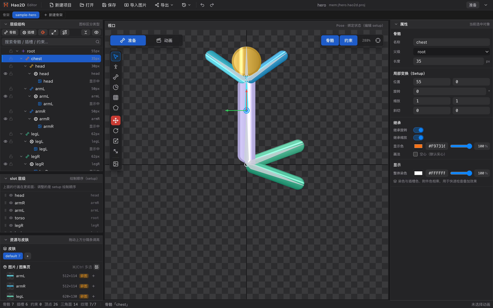

# Hao2D Editor 使用手册

> 面向 **Hao2D Editor 0.3.0** 的中文用户手册。从「这个按钮是干什么的」到「完整做一个角色并导出」，都能在这里查到。

Hao2D Editor 是一款免费、轻量的 2D 骨骼动画编辑器（Electron + TypeScript + PixiJS），支持网格蒙皮、FFD 变形、IK / 变换 / 路径约束、曲线编辑与实时预览，可导入 Spine、DragonBones、PSD 与碎图，导出 Spine 4.3、Unity 资源或 `.hao2d` 运行时数据。

---

## 怎么读这本手册

| 你是谁 | 建议路线 |
| :--- | :--- |
| **第一次打开软件** | [安装与首次启动](01-install.md) → [界面总览](02-interface.md) → [五步上手教程](30-tutorial-import.md) |
| **从 Spine / DragonBones 转过来** | [界面总览](02-interface.md) → [导入详解](40-import-formats.md) → [绑定与蒙皮](31-tutorial-rig.md) → [导出详解](41-export-formats.md) |
| **想查某个按钮 / 面板** | 直接看下面的「界面与面板」「工具」两章，每页都有配图与字段表 |
| **想接 AI / 脚本自动化** | [AI 接入](42-ai.md) |

---

## 目录

### 一、入门

| 页面 | 内容 |
| :--- | :--- |
| [01 安装与首次启动](01-install.md) | 下载、安装、首次打开、切换语言、认识主界面 |
| [02 界面总览](02-interface.md) | 九大区域速查、Pose / Animate 两种状态的差异、面板布局调整 |
| [03 工程与骨架管理](03-project.md) | 新建 / 打开 / 保存 / 另存、最近列表、多骨架、工程文件结构 |

### 二、界面与面板

| 页面 | 内容 |
| :--- | :--- |
| [04 菜单栏](04-menubar.md) | 快捷动作、导出下拉、最近打开、状态徽标、重置布局 |
| [05 层级结构](05-hierarchy.md) | 骨骼 / 插槽 / 约束树、工具栏、搜索、右键菜单、拖拽规则 |
| [06 slot 层级](06-slot-order.md) | 绘制顺序、拖拽排序、Animate 态写层级帧 |
| [07 资源与皮肤](07-assets.md) | 皮肤管理、图片与图集页、拖图建插槽、替换 / 删除 / 切图集 |
| [08 视口](08-viewport.md) | 平移缩放、适配视野、骨骼与约束开关、选中与拾取规则 |
| [09 属性面板](09-inspector.md) | 骨骼 / 插槽 / 附件 / 网格 / 遮罩 / 约束的全部字段 |
| [10 时间轴](10-timeline.md) | 动画下拉、播放条、轨道、关键帧与事件帧 |
| [11 曲线面板](11-curve.md) | 缓动预设、贝塞尔控制点、与 Dope Sheet 的联动 |
| [12 状态栏与提示](12-statusbar.md) | 统计口径、纹理就绪度、操作回显 |
| [13 对话框合集](13-dialogs.md) | 新建项目、导入目标选择、导出、设置、AI 接入、PSD 导入、舞台参考图 |
| [14 子骨架（骨架嵌套）](14-subarmature.md) | 把另一套骨架挂到插槽上，用「子骨架」轨道控制它播哪个动画 |

### 三、工具

| 页面 | 内容 |
| :--- | :--- |
| [20 选择工具 V](20-tool-select.md) | 点选与多选、拖骨骼、附件拾取 |
| [21 Pose 工具 P](21-tool-pose.md) | 拖顶点只动顶点、拖骨骼改绑定姿态 |
| [22 画骨骼工具 B](22-tool-bone.md) | 吸附父级、连续拖拽成链 |
| [23 权重刷工具 G](23-tool-weight.md) | 目标骨骼、Alt / Shift / Ctrl 组合、权重饼图 |
| [24 网格工具 M](24-tool-mesh.md) | 建网格、五个子工具（编辑 / 添加 / 删除顶点、绘制边界、自定义布线） |
| [25 FFD 顶点工具 D](25-tool-ffd.md) | 动画态拖顶点写变形帧 |
| [26 遮罩工具 N](26-tool-mask.md) | 多边形遮罩绘制与编辑 |
| [27 变换工具 W / E / R / T](27-tool-transform.md) | 移动 / 旋转 / 缩放 / 斜切坐标系 |
| [28 舞台参考图](28-tool-stage.md) | 背景参考图的位置、大小、透明度 |

### 四、实战教程

| 页面 | 内容 |
| :--- | :--- |
| [30 教程 1：新建工程与导入素材](30-tutorial-import.md) | 项目命名、帧率、导入碎图 / PSD / Spine |
| [31 教程 2：搭骨架与绑定](31-tutorial-rig.md) | 画骨骼、挂插槽、调绘制顺序 |
| [32 教程 3：建网格与刷权重](32-tutorial-skin.md) | 自动建网格、切线、刷权重、验证蒙皮 |
| [33 教程 4：K 动画](33-tutorial-animate.md) | 打关键帧、调曲线、加事件帧 |
| [34 教程 5：导出与验收](34-tutorial-export.md) | 图集设置、三种导出、产物校验 |

### 五、进阶与参考

| 页面 | 内容 |
| :--- | :--- |
| [40 导入详解](40-import-formats.md) | Spine、DragonBones、PSD 图层、碎图与图集 |
| [41 导出详解](41-export-formats.md) | 运行时、Unity、Spine 4.3 三种产物的参数对照 |
| [42 AI 接入](42-ai.md) | 本地 HTTP / WebSocket 命令服务、MCP 一键接入 |
| [43 快捷键速查](43-shortcuts.md) | 全局 / 工具 / 动画 / 文件，macOS 与 Windows 对照 |
| [44 常见问题](44-faq.md) | 白块缺图、撤销、导入失败、导出报错 |

---

## 术语表

| 术语 | 界面里的含义 |
| :--- | :--- |
| **骨架（armature）** | 一套完整的骨骼 + 插槽 + 皮肤 + 动画。一个工程可以有多个骨架，共享图片池 |
| **骨骼（bone）** | 树形结构的变换节点，决定挂在其上的插槽怎么动。层级根骨骼固定叫 `root` |
| **插槽（slot）** | 挂在骨骼上的「槽位」，决定**绘制顺序**、颜色、可见性 |
| **附件（attachment）** | 插槽里的具体内容：贴图区域（region）、网格（mesh）或遮罩（clipping） |
| **display** | 一个插槽可以有多张附件，当前显示的那一张叫 display；层级树里 `显示中` 指的就是它 |
| **皮肤（skin）** | 同一套骨骼的不同换装方案，切换皮肤即换掉各插槽的附件组合 |
| **网格（mesh）** | 把贴图切成三角形、给顶点绑权重，实现弯折与形变 |
| **子骨架（armature display）** | 挂在插槽上的另一种「附件」：它引用工程里的另一套骨架，可独立播放自己的动画 |
| **FFD** | 自由变形：在动画里拖动网格顶点，记录成变形关键帧 |
| **Pose 状态** | 绑定态。改骨骼长度、插槽层级、网格拓扑、权重都在这里 |
| **Animate 状态** | 动画态。时间轴、关键帧、曲线、FFD 变形在这里 |
| **图集（atlas）** | 把多张碎图打包成一张大图；导出时自动生成 |
| **碎图** | 单独的一张 png。资源面板里带「碎图」角标 |
| **PPU** | Pixels Per Unit，编辑器内部固定 1 世界单位 = 100 图像像素。层级树里的 `55px` 就是 0.55 世界单位 |

---

## 阅读约定

- **Pose / Animate**：这本手册统一用界面上的叫法，菜单徽标上分别写作「准备」和「动画」。
- **快捷键**：macOS 写作 `⌘`，Windows / Linux 写作 `Ctrl`，两者在编辑器里等价；单独出现的单字母（如 `V`、`K`）表示直接按该键，不需要组合键。
- **截图**：全部截图取自编辑器实际运行画面（中文界面），界面元素以截图为准；版本升级后按钮位置可能微调，以最新版本为准。

---

## 关于

- 版本：0.3.0
- 下载：[百度网盘](https://pan.baidu.com/s/13h2HvBEMe7V4XfcnhCOEug?pwd=8pqe)（提取码 `8pqe`）
- 本手册目录即仓库 `wiki/` 文件夹，可直接推送到 GitHub / Gitee 作为 Wiki 或文档站使用。
